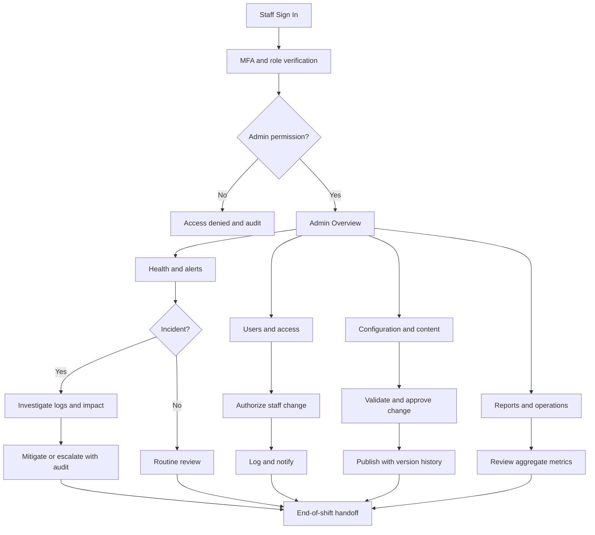
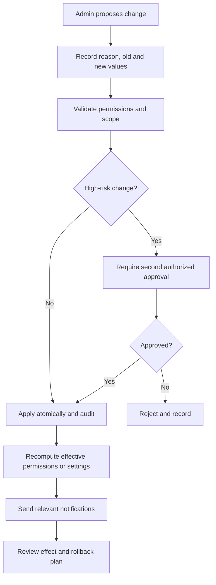
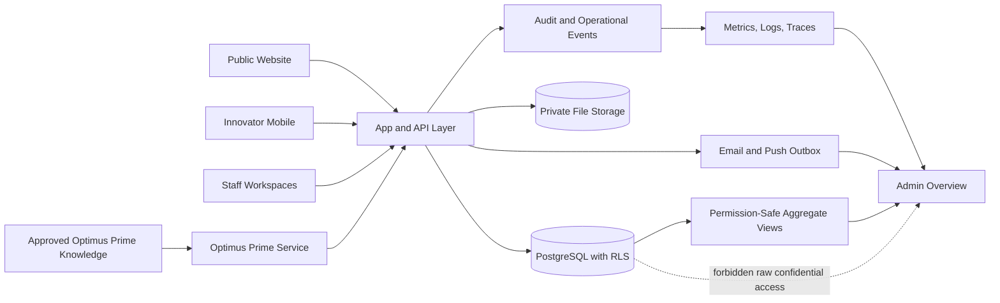
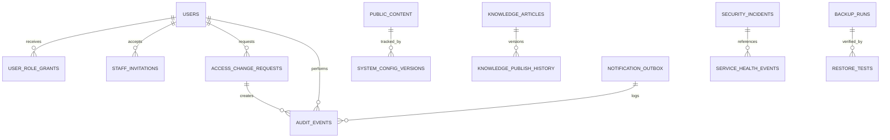

# CEDA Innovation Portal
## System Administrator — Complete User Journey, Screens, Permissions, Monitoring and Data Flows

**Document type:** Implementation-ready functional, UI/UX and technical specification  
**Version:** 1.0 | **Date:** 19 November 2026  
**Persona:** Kabelo, a fictional CEDA System Administrator  
**Companion specifications:** Innovator, Standard Assessor, Assessment Manager / Lead Assessor, and Support Officer.  
**Status:** Proposed hackathon system design. Security, retention, operational thresholds and organizational policy require CEDA confirmation.

> **Central distinction:** The administrator operates and protects the platform. The assessment team owns scores, collective recommendations and final assessment outcomes. The Support Officer owns human support conversations. The System Administrator must not have a hidden power to approve, reject, alter votes, edit applicant evidence or browse private conversations merely because they administer the platform.

## 1. Purpose and role boundary

The CEDA public site presents institutional information, innovation guidance, published impact indicators and account access. The authenticated Innovator Portal handles applications. Staff enter role-based workspaces. **Kabelo**, the System Administrator, manages identity and access, public content publishing, configuration, operational observability, platform security, notifications, integrations, backups and audited service interventions. All access is least-privilege and server-enforced.

### 1.1 In scope

- Staff provisioning, invitations, deactivation, recovery, role grants and removal; no shared accounts.
- User account support actions that are lawful and documented, without reading credentials or impersonating users.
- System-wide operational dashboard, frontend and API telemetry, availability, errors, performance, queue health and storage usage.
- Email, in-app and push delivery monitoring with safe retries and failure investigation.
- Optimus Prime knowledge-base publishing and AI health/quality monitoring without unauthorized disclosure of sensitive prompts or user conversations.
- Support system configuration (hours, capacity, categories, thresholds) and aggregate queue performance; not normal ticket handling.
- Assessment system configuration with change-control for rubrics, scoring policy and statuses; **cannot edit active rounds or decisions**.
- Public website content, approved impact statistics, help pages and announcements (only with editorial publishing authority).
- Integration connectivity and secret rotation workflow, audit logs, incident response, backup verification and recovery coordination.
- Role-secured reports, configuration history, accessibility, responsive layouts, failure states and verification checks.

### 1.2 Explicitly outside this role

- Scoring an innovation or participating in a collective vote by virtue of the administrator role.
- Directly approving, declining or releasing an innovation outcome.
- Editing an innovator's submitted application, replacing documents or reading private IP files without a separate, justified grant.
- Reading assessor-only comments, votes or collaboration chats as routine administrative access.
- Reading a user's Optimus Prime or human support transcript without assigned and documented operational need.
- Directly replying as Maseo or changing ticket contents, unless separately granted a support role.
- Building loan underwriting, grant payment or funding-disbursement workflows in this MVP.

### 1.3 Role ownership matrix

| Activity | Innovator | Assessor | Assessment Manager | Support Officer | System Administrator |
|---|---|---|---|---|---|
| Create and track own applications | Own only | No | No | No | No |
| Score and comment on assigned innovation | No | Yes | Only if separately assigned | No | No |
| Run panel votes / release authorized outcome | No | Vote | Govern / release | No | No |
| Talk to visitors on active support tickets | As visitor | No | Via authorized escalation | Yes | Only with separate support role |
| View assessment turnaround dashboard | Own status | Personal workload | Yes | No | Aggregate metrics only |
| Manage staff account roles | No | No | No | No | Yes, with controls |
| Monitor uptime, API errors, jobs, integrations | No | No | No | No | Yes |
| Maintain Optimus Prime knowledge and prompt versions | No | No | No | No | Yes / authorized content editors |
| Change final approval or rejection | No | No | No unilateral override | No | **Never** |

## 2. Admin product architecture and navigation

**Public-to-private boundary:** From the public website, staff use **Staff Sign In**. After MFA and role checks, Kabelo is routed to `/staff/admin`. The admin workspace is not a public-site menu item for ordinary users. Unauthorized roles receive an access-denied view, not hidden access through a URL.

**Desktop navigation:** Overview; Users & Access; Public Website; Platform Health; Integrations; Notifications; Optimus Prime AI; Support Operations; Assessment Configuration; Storage & Backups; Security & Audit; Reports; System Settings; Help; Profile.

**Responsive mobile behavior:** Collapsible drawer; persistent alert icon; list-to-detail navigation; read-only simplified charts; destructive configuration changes may require full desktop confirmation. The public and innovator mobile experiences continue independently.

**Global UI elements:** CEDA logo and current workspace, environment label (production/staging), search, alerts, last-sync time, access-scope chip, profile menu, notification center, breadcrumb navigation, and unsaved-change warning. No decorative metrics masquerading as live information.

## 3. End-to-end persona: Kabelo administers the platform

1. **Login and verification.** Kabelo visits Staff Sign In, enters credentials, completes MFA, and sees a clear security notice. The system logs the session start and recognized administrator scope.
2. **System overview.** He opens Admin Overview. Live indicators show service health, recent errors, failed jobs, queue sizes, registered users, activity volume, storage and notification delivery. The page labels which metrics are operational versus business aggregates.
3. **Health alert.** A spike in document-preview failures appears. Kabelo clicks the alert and sees the affected service, time window, deployment version, error class, impact and correlation IDs; no confidential document text.
4. **Investigation.** He filters logs and traces, checks whether the storage service and conversion worker are healthy, and reviews recent configuration changes. He may safely restart a worker or escalate to the developer/operations team according to privilege.
5. **User communication.** Where there is user impact, he publishes an approved service notice. He does not rewrite applicants' saved forms or mark their applications as failed without evidence.
6. **Staff onboarding.** CEDA requests a new assessor account. Kabelo creates an invitation with assessor role and limited scope. The invitee completes their own verification and MFA; Kabelo never chooses or sees their password.
7. **Rights checks.** He confirms that an assessor cannot open `/staff/admin` and that a support officer cannot see assessor votes. Permission changes require reason, appropriate authorization and audit records.
8. **Notifications.** A delivery dashboard shows some submission emails were delayed. Kabelo reviews safe metadata, retries idempotent failures and verifies the successful delivery state. The submission records remain intact throughout.
9. **Optimus Prime oversight.** He checks AI response failures and knowledge-base versions. An outdated guidance article is updated through an approval workflow; the AI does not gain direct access to secret credentials or unrelated innovations.
10. **Public content.** He publishes an approved homepage announcement and verifies responsive rendering, link integrity and accessibility. Public metrics use authorized aggregates, not invented numbers.
11. **Assessment oversight.** He can monitor broad counts such as submissions received and total completed assessments, but cannot inspect the confidential vote or authorize a result. The Assessment Manager handles turnaround and outcomes.
12. **Security review.** The system flags unusual access attempts. Kabelo can suspend a compromised session, follow incident procedures and record all interventions without deleting the evidence.
13. **Backups and recovery.** He reviews backup freshness, storage integrity and restore-test reports, tests recovery in a safe environment and records sign-off. He must not run a destructive production restore casually.
14. **End of shift.** Kabelo reviews open alerts, documents unresolved incidents, verifies no unapproved configuration changes remain, and signs out. Every privileged action has its own traceable audit event.

## 4. Core user flow diagrams

### 4.1 Sign-in to daily administration

### 4.2 Privileged-change control

### 4.3 Operational data and boundaries

## 5. Admin screens and route inventory

| ID | Screen / view | Example route | Primary purpose |
|---|---|---|---|

| AD-01 | Staff Sign In | `/staff/sign-in` | Enter staff credentials, complete secure routing |

| AD-02 | MFA & Trusted Session | `/staff/verify` | Verify second factor and manage device/session |

| AD-03 | First-Access Administrator Setup | `/staff/admin/welcome` | Review security duties and initial access scope |

| AD-04 | Admin Overview | `/staff/admin` | See platform metrics, alerts, trends and recent admin actions |

| AD-05 | Alert Center | `/staff/admin/alerts` | Prioritize live health and security alerts |

| AD-06 | User Directory | `/staff/admin/users` | Search users and staff without exposing unnecessary PII |

| AD-07 | User Account Detail | `/staff/admin/users/:id` | Inspect allowed account metadata and status |

| AD-08 | Invite Staff | `/staff/admin/staff/invite` | Invite assessors, managers or support staff |

| AD-09 | Role and Permission Matrix | `/staff/admin/access` | Review RBAC permissions and effective scopes |

| AD-10 | Access Change Review | `/staff/admin/access/requests` | Approve governed role changes |

| AD-11 | Suspension and Recovery | `/staff/admin/users/:id/security` | Revoke sessions, block compromised access, restore safely |

| AD-12 | Public Site Content | `/staff/admin/content` | Manage approved news, help, and informational sections |

| AD-13 | Public Impact Metrics | `/staff/admin/content/metrics` | Publish sanitized innovation statistics |

| AD-14 | Platform Health | `/staff/admin/health` | Inspect availability, latency, load and service status |

| AD-15 | Error Explorer | `/staff/admin/errors` | Investigate frontend/backend failures |

| AD-16 | Deployment and Release History | `/staff/admin/releases` | View builds and recent releases |

| AD-17 | Background Jobs | `/staff/admin/jobs` | Monitor outbox, thumbnails, reports, cleanup |

| AD-18 | Integrations Overview | `/staff/admin/integrations` | Monitor Supabase, email, FCM, Optimus Prime, hosting connectivity |

| AD-19 | Notification Delivery | `/staff/admin/notifications` | Review email, push and in-app delivery |

| AD-20 | Notification Templates | `/staff/admin/notifications/templates` | Edit approved transactional messages |

| AD-21 | Optimus Prime AI Operations | `/staff/admin/optimusprime` | Monitor AI latency, fallback and escalation trends |

| AD-22 | Optimus Prime Knowledge Base | `/staff/admin/optimusprime/knowledge` | Manage approved field explanations and support content |

| AD-23 | Optimus Prime Quality Review | `/staff/admin/optimusprime/quality` | Triage incorrect responses and safety flags |

| AD-24 | Support Operations | `/staff/admin/support` | See overall queue capacity and SLA metrics |

| AD-25 | Support Queue Rules | `/staff/admin/support/settings` | Configure approved staff limits and priority rules |

| AD-26 | Assessment Configuration | `/staff/admin/assessment/config` | View versioned rubric/status configuration |

| AD-27 | Assessment Aggregate Reporting | `/staff/admin/reports/assessment` | View totals and throughput without reviewer secrets |

| AD-28 | Storage Overview | `/staff/admin/storage` | Monitor private files, usage and scanning |

| AD-29 | Backup and Restore Health | `/staff/admin/backups` | Review backup windows and restore test evidence |

| AD-30 | Audit Explorer | `/staff/admin/audit` | Investigate privileged events and access attempts |

| AD-31 | Security Incidents | `/staff/admin/security/incidents` | Track potential breaches and mitigations |

| AD-32 | Privacy and Retention | `/staff/admin/privacy` | Configure lawful data retention and request handling |

| AD-33 | System Reports | `/staff/admin/reports` | Export operational and public-safe aggregate reports |

| AD-34 | Global System Settings | `/staff/admin/settings` | Manage service toggles and institutional settings |

| AD-35 | Announcements & Maintenance | `/staff/admin/announcements` | Publish downtime and recovery notices |

| AD-36 | Admin Notifications | `/staff/admin/inbox` | Read privileged alerts and action requests |

| AD-37 | Admin Profile & Sessions | `/staff/admin/profile` | Manage account security and sessions |

| AD-38 | Permission and Failure States | `/staff/admin/errors/:code` | Handle denied access, timeout, outages |

## 6. Detailed UI/UX specifications — every administrator screen

**Shared layout:** Unless stated otherwise, each admin screen uses the left navigation, header with environment/status, search/alerts, breadcrumb, main content, scoped access rules and a predictable back path. Tables support pagination, filtering, sorting and empty states. All privileged changes require server-side validation; an attractive UI is not itself access control.

### AD-01 — Staff Sign In

**Entry and navigation:** Open from the relevant left-nav section or a linked alert/action. Route: `/staff/sign-in`. Breadcrumb returns to the parent list; browser back retains safe filters.

**Screen content and controls:** email/password, SSO if configured, MFA link. The main goal is to enter staff credentials, complete secure routing. Show clear state labels, last updated time, loading/empty/error states and explanatory help where needed.

**Primary actions:** Sign In, Forgot Password. Confirmation dialogs must describe the actual impact; disabled buttons show a permission or validation reason. Success should appear only after a server response confirms it.

**Security, permissions and failure behavior:** Unverified or locked users cannot enter. Every sensitive read, export or write is scoped on the server and significant privileged actions are logged. If requests fail, preserve current context and offer safe retry rather than silently treating the action as complete.

**Responsive behavior:** On narrower screens, list/detail layout becomes stacked, filters open in a drawer, actions go into an overflow menu, and warnings remain visible without obstructing content.

### AD-02 — MFA & Trusted Session

**Entry and navigation:** Open from the relevant left-nav section or a linked alert/action. Route: `/staff/verify`. Breadcrumb returns to the parent list; browser back retains safe filters.

**Screen content and controls:** OTP or authenticator code, recovery method. The main goal is to verify second factor and manage device/session. Show clear state labels, last updated time, loading/empty/error states and explanatory help where needed.

**Primary actions:** Verify, Use Recovery. Confirmation dialogs must describe the actual impact; disabled buttons show a permission or validation reason. Success should appear only after a server response confirms it.

**Security, permissions and failure behavior:** Rate-limit and audit failed attempts. Every sensitive read, export or write is scoped on the server and significant privileged actions are logged. If requests fail, preserve current context and offer safe retry rather than silently treating the action as complete.

**Responsive behavior:** On narrower screens, list/detail layout becomes stacked, filters open in a drawer, actions go into an overflow menu, and warnings remain visible without obstructing content.

### AD-03 — First-Access Administrator Setup

**Entry and navigation:** Open from the relevant left-nav section or a linked alert/action. Route: `/staff/admin/welcome`. Breadcrumb returns to the parent list; browser back retains safe filters.

**Screen content and controls:** terms acknowledgment, role summary, MFA readiness. The main goal is to review security duties and initial access scope. Show clear state labels, last updated time, loading/empty/error states and explanatory help where needed.

**Primary actions:** Continue, View Access. Confirmation dialogs must describe the actual impact; disabled buttons show a permission or validation reason. Success should appear only after a server response confirms it.

**Security, permissions and failure behavior:** No implicit super-admin privileges. Every sensitive read, export or write is scoped on the server and significant privileged actions are logged. If requests fail, preserve current context and offer safe retry rather than silently treating the action as complete.

**Responsive behavior:** On narrower screens, list/detail layout becomes stacked, filters open in a drawer, actions go into an overflow menu, and warnings remain visible without obstructing content.

### AD-04 — Admin Overview

**Entry and navigation:** Open from the relevant left-nav section or a linked alert/action. Route: `/staff/admin`. Breadcrumb returns to the parent list; browser back retains safe filters.

**Screen content and controls:** health tiles, users, requests, uptime, errors, delivery rates, storage. The main goal is to see platform metrics, alerts, trends and recent admin actions. Show clear state labels, last updated time, loading/empty/error states and explanatory help where needed.

**Primary actions:** Open Alert, View Report, Refresh. Confirmation dialogs must describe the actual impact; disabled buttons show a permission or validation reason. Success should appear only after a server response confirms it.

**Security, permissions and failure behavior:** Source times and metric definitions visible. Every sensitive read, export or write is scoped on the server and significant privileged actions are logged. If requests fail, preserve current context and offer safe retry rather than silently treating the action as complete.

**Responsive behavior:** On narrower screens, list/detail layout becomes stacked, filters open in a drawer, actions go into an overflow menu, and warnings remain visible without obstructing content.

### AD-05 — Alert Center

**Entry and navigation:** Open from the relevant left-nav section or a linked alert/action. Route: `/staff/admin/alerts`. Breadcrumb returns to the parent list; browser back retains safe filters.

**Screen content and controls:** severity, status, service, first seen, owner. The main goal is to prioritize live health and security alerts. Show clear state labels, last updated time, loading/empty/error states and explanatory help where needed.

**Primary actions:** Acknowledge, Assign, Investigate. Confirmation dialogs must describe the actual impact; disabled buttons show a permission or validation reason. Success should appear only after a server response confirms it.

**Security, permissions and failure behavior:** Acknowledgement is not remediation. Every sensitive read, export or write is scoped on the server and significant privileged actions are logged. If requests fail, preserve current context and offer safe retry rather than silently treating the action as complete.

**Responsive behavior:** On narrower screens, list/detail layout becomes stacked, filters open in a drawer, actions go into an overflow menu, and warnings remain visible without obstructing content.

### AD-06 — User Directory

**Entry and navigation:** Open from the relevant left-nav section or a linked alert/action. Route: `/staff/admin/users`. Breadcrumb returns to the parent list; browser back retains safe filters.

**Screen content and controls:** name, account ID, email mask, account state, roles, last active. The main goal is to search users and staff without exposing unnecessary PII. Show clear state labels, last updated time, loading/empty/error states and explanatory help where needed.

**Primary actions:** Search, Filter, Open. Confirmation dialogs must describe the actual impact; disabled buttons show a permission or validation reason. Success should appear only after a server response confirms it.

**Security, permissions and failure behavior:** No bulk export by default. Every sensitive read, export or write is scoped on the server and significant privileged actions are logged. If requests fail, preserve current context and offer safe retry rather than silently treating the action as complete.

**Responsive behavior:** On narrower screens, list/detail layout becomes stacked, filters open in a drawer, actions go into an overflow menu, and warnings remain visible without obstructing content.

### AD-07 — User Account Detail

**Entry and navigation:** Open from the relevant left-nav section or a linked alert/action. Route: `/staff/admin/users/:id`. Breadcrumb returns to the parent list; browser back retains safe filters.

**Screen content and controls:** identity and verification summary, linked roles, security events. The main goal is to inspect allowed account metadata and status. Show clear state labels, last updated time, loading/empty/error states and explanatory help where needed.

**Primary actions:** Disable Session, Request Verification, Open Audit. Confirmation dialogs must describe the actual impact; disabled buttons show a permission or validation reason. Success should appear only after a server response confirms it.

**Security, permissions and failure behavior:** No password or private content access. Every sensitive read, export or write is scoped on the server and significant privileged actions are logged. If requests fail, preserve current context and offer safe retry rather than silently treating the action as complete.

**Responsive behavior:** On narrower screens, list/detail layout becomes stacked, filters open in a drawer, actions go into an overflow menu, and warnings remain visible without obstructing content.

### AD-08 — Invite Staff

**Entry and navigation:** Open from the relevant left-nav section or a linked alert/action. Route: `/staff/admin/staff/invite`. Breadcrumb returns to the parent list; browser back retains safe filters.

**Screen content and controls:** verified email, role, scope, expiry, justification. The main goal is to invite assessors, managers or support staff. Show clear state labels, last updated time, loading/empty/error states and explanatory help where needed.

**Primary actions:** Send Invite, Cancel. Confirmation dialogs must describe the actual impact; disabled buttons show a permission or validation reason. Success should appear only after a server response confirms it.

**Security, permissions and failure behavior:** No sharing of credentials. Every sensitive read, export or write is scoped on the server and significant privileged actions are logged. If requests fail, preserve current context and offer safe retry rather than silently treating the action as complete.

**Responsive behavior:** On narrower screens, list/detail layout becomes stacked, filters open in a drawer, actions go into an overflow menu, and warnings remain visible without obstructing content.

### AD-09 — Role and Permission Matrix

**Entry and navigation:** Open from the relevant left-nav section or a linked alert/action. Route: `/staff/admin/access`. Breadcrumb returns to the parent list; browser back retains safe filters.

**Screen content and controls:** roles, permission codes, row scopes, inherited grants. The main goal is to review RBAC permissions and effective scopes. Show clear state labels, last updated time, loading/empty/error states and explanatory help where needed.

**Primary actions:** View Role, Propose Change. Confirmation dialogs must describe the actual impact; disabled buttons show a permission or validation reason. Success should appear only after a server response confirms it.

**Security, permissions and failure behavior:** No permissions inferred from UI hiding. Every sensitive read, export or write is scoped on the server and significant privileged actions are logged. If requests fail, preserve current context and offer safe retry rather than silently treating the action as complete.

**Responsive behavior:** On narrower screens, list/detail layout becomes stacked, filters open in a drawer, actions go into an overflow menu, and warnings remain visible without obstructing content.

### AD-10 — Access Change Review

**Entry and navigation:** Open from the relevant left-nav section or a linked alert/action. Route: `/staff/admin/access/requests`. Breadcrumb returns to the parent list; browser back retains safe filters.

**Screen content and controls:** requester, target, old/new grants, reason, approval. The main goal is to approve governed role changes. Show clear state labels, last updated time, loading/empty/error states and explanatory help where needed.

**Primary actions:** Approve, Reject, Request Clarification. Confirmation dialogs must describe the actual impact; disabled buttons show a permission or validation reason. Success should appear only after a server response confirms it.

**Security, permissions and failure behavior:** Sensitive changes need second-person approval. Every sensitive read, export or write is scoped on the server and significant privileged actions are logged. If requests fail, preserve current context and offer safe retry rather than silently treating the action as complete.

**Responsive behavior:** On narrower screens, list/detail layout becomes stacked, filters open in a drawer, actions go into an overflow menu, and warnings remain visible without obstructing content.

### AD-11 — Suspension and Recovery

**Entry and navigation:** Open from the relevant left-nav section or a linked alert/action. Route: `/staff/admin/users/:id/security`. Breadcrumb returns to the parent list; browser back retains safe filters.

**Screen content and controls:** reason, duration, session list, evidence. The main goal is to revoke sessions, block compromised access, restore safely. Show clear state labels, last updated time, loading/empty/error states and explanatory help where needed.

**Primary actions:** Revoke, Suspend, Reinstate. Confirmation dialogs must describe the actual impact; disabled buttons show a permission or validation reason. Success should appear only after a server response confirms it.

**Security, permissions and failure behavior:** Audit irreversible security actions. Every sensitive read, export or write is scoped on the server and significant privileged actions are logged. If requests fail, preserve current context and offer safe retry rather than silently treating the action as complete.

**Responsive behavior:** On narrower screens, list/detail layout becomes stacked, filters open in a drawer, actions go into an overflow menu, and warnings remain visible without obstructing content.

### AD-12 — Public Site Content

**Entry and navigation:** Open from the relevant left-nav section or a linked alert/action. Route: `/staff/admin/content`. Breadcrumb returns to the parent list; browser back retains safe filters.

**Screen content and controls:** pages, drafts, metadata, translations, publishing state. The main goal is to manage approved news, help, and informational sections. Show clear state labels, last updated time, loading/empty/error states and explanatory help where needed.

**Primary actions:** Edit, Preview, Publish. Confirmation dialogs must describe the actual impact; disabled buttons show a permission or validation reason. Success should appear only after a server response confirms it.

**Security, permissions and failure behavior:** Public claims require approved source. Every sensitive read, export or write is scoped on the server and significant privileged actions are logged. If requests fail, preserve current context and offer safe retry rather than silently treating the action as complete.

**Responsive behavior:** On narrower screens, list/detail layout becomes stacked, filters open in a drawer, actions go into an overflow menu, and warnings remain visible without obstructing content.

### AD-13 — Public Impact Metrics

**Entry and navigation:** Open from the relevant left-nav section or a linked alert/action. Route: `/staff/admin/content/metrics`. Breadcrumb returns to the parent list; browser back retains safe filters.

**Screen content and controls:** aggregate figures, period, last verified date. The main goal is to publish sanitized innovation statistics. Show clear state labels, last updated time, loading/empty/error states and explanatory help where needed.

**Primary actions:** Preview, Propose Publish. Confirmation dialogs must describe the actual impact; disabled buttons show a permission or validation reason. Success should appear only after a server response confirms it.

**Security, permissions and failure behavior:** No unverified supported-innovation claims. Every sensitive read, export or write is scoped on the server and significant privileged actions are logged. If requests fail, preserve current context and offer safe retry rather than silently treating the action as complete.

**Responsive behavior:** On narrower screens, list/detail layout becomes stacked, filters open in a drawer, actions go into an overflow menu, and warnings remain visible without obstructing content.

### AD-14 — Platform Health

**Entry and navigation:** Open from the relevant left-nav section or a linked alert/action. Route: `/staff/admin/health`. Breadcrumb returns to the parent list; browser back retains safe filters.

**Screen content and controls:** API uptime, response p95, error rate, active jobs. The main goal is to inspect availability, latency, load and service status. Show clear state labels, last updated time, loading/empty/error states and explanatory help where needed.

**Primary actions:** Change Date, Open Service. Confirmation dialogs must describe the actual impact; disabled buttons show a permission or validation reason. Success should appear only after a server response confirms it.

**Security, permissions and failure behavior:** Service metrics independent of assessor data. Every sensitive read, export or write is scoped on the server and significant privileged actions are logged. If requests fail, preserve current context and offer safe retry rather than silently treating the action as complete.

**Responsive behavior:** On narrower screens, list/detail layout becomes stacked, filters open in a drawer, actions go into an overflow menu, and warnings remain visible without obstructing content.

### AD-15 — Error Explorer

**Entry and navigation:** Open from the relevant left-nav section or a linked alert/action. Route: `/staff/admin/errors`. Breadcrumb returns to the parent list; browser back retains safe filters.

**Screen content and controls:** error category, counts, release, trace ID, time. The main goal is to investigate frontend/backend failures. Show clear state labels, last updated time, loading/empty/error states and explanatory help where needed.

**Primary actions:** Filter, Inspect Trace, Export Sanitized. Confirmation dialogs must describe the actual impact; disabled buttons show a permission or validation reason. Success should appear only after a server response confirms it.

**Security, permissions and failure behavior:** Strip secrets and user content. Every sensitive read, export or write is scoped on the server and significant privileged actions are logged. If requests fail, preserve current context and offer safe retry rather than silently treating the action as complete.

**Responsive behavior:** On narrower screens, list/detail layout becomes stacked, filters open in a drawer, actions go into an overflow menu, and warnings remain visible without obstructing content.

### AD-16 — Deployment and Release History

**Entry and navigation:** Open from the relevant left-nav section or a linked alert/action. Route: `/staff/admin/releases`. Breadcrumb returns to the parent list; browser back retains safe filters.

**Screen content and controls:** version, environment, deploy time, author, health. The main goal is to view builds and recent releases. Show clear state labels, last updated time, loading/empty/error states and explanatory help where needed.

**Primary actions:** View Diff, Rollback Request. Confirmation dialogs must describe the actual impact; disabled buttons show a permission or validation reason. Success should appear only after a server response confirms it.

**Security, permissions and failure behavior:** No unsafe instant production rollback. Every sensitive read, export or write is scoped on the server and significant privileged actions are logged. If requests fail, preserve current context and offer safe retry rather than silently treating the action as complete.

**Responsive behavior:** On narrower screens, list/detail layout becomes stacked, filters open in a drawer, actions go into an overflow menu, and warnings remain visible without obstructing content.

### AD-17 — Background Jobs

**Entry and navigation:** Open from the relevant left-nav section or a linked alert/action. Route: `/staff/admin/jobs`. Breadcrumb returns to the parent list; browser back retains safe filters.

**Screen content and controls:** job type, attempt, state, latency, dead-letter queue. The main goal is to monitor outbox, thumbnails, reports, cleanup. Show clear state labels, last updated time, loading/empty/error states and explanatory help where needed.

**Primary actions:** Retry Safe Job, Inspect. Confirmation dialogs must describe the actual impact; disabled buttons show a permission or validation reason. Success should appear only after a server response confirms it.

**Security, permissions and failure behavior:** Retries must be idempotent. Every sensitive read, export or write is scoped on the server and significant privileged actions are logged. If requests fail, preserve current context and offer safe retry rather than silently treating the action as complete.

**Responsive behavior:** On narrower screens, list/detail layout becomes stacked, filters open in a drawer, actions go into an overflow menu, and warnings remain visible without obstructing content.

### AD-18 — Integrations Overview

**Entry and navigation:** Open from the relevant left-nav section or a linked alert/action. Route: `/staff/admin/integrations`. Breadcrumb returns to the parent list; browser back retains safe filters.

**Screen content and controls:** provider health, request volume, last success, alerts. The main goal is to monitor Supabase, email, FCM, Optimus Prime, hosting connectivity. Show clear state labels, last updated time, loading/empty/error states and explanatory help where needed.

**Primary actions:** Test Connectivity, View Logs. Confirmation dialogs must describe the actual impact; disabled buttons show a permission or validation reason. Success should appear only after a server response confirms it.

**Security, permissions and failure behavior:** Never display API keys. Every sensitive read, export or write is scoped on the server and significant privileged actions are logged. If requests fail, preserve current context and offer safe retry rather than silently treating the action as complete.

**Responsive behavior:** On narrower screens, list/detail layout becomes stacked, filters open in a drawer, actions go into an overflow menu, and warnings remain visible without obstructing content.

### AD-19 — Notification Delivery

**Entry and navigation:** Open from the relevant left-nav section or a linked alert/action. Route: `/staff/admin/notifications`. Breadcrumb returns to the parent list; browser back retains safe filters.

**Screen content and controls:** template, event, queued/sent/failed, retry count. The main goal is to review email, push and in-app delivery. Show clear state labels, last updated time, loading/empty/error states and explanatory help where needed.

**Primary actions:** Filter, Retry, Inspect Delivery. Confirmation dialogs must describe the actual impact; disabled buttons show a permission or validation reason. Success should appear only after a server response confirms it.

**Security, permissions and failure behavior:** No duplicate decision emails. Every sensitive read, export or write is scoped on the server and significant privileged actions are logged. If requests fail, preserve current context and offer safe retry rather than silently treating the action as complete.

**Responsive behavior:** On narrower screens, list/detail layout becomes stacked, filters open in a drawer, actions go into an overflow menu, and warnings remain visible without obstructing content.

### AD-20 — Notification Templates

**Entry and navigation:** Open from the relevant left-nav section or a linked alert/action. Route: `/staff/admin/notifications/templates`. Breadcrumb returns to the parent list; browser back retains safe filters.

**Screen content and controls:** template type, subject, variables, locale, preview. The main goal is to edit approved transactional messages. Show clear state labels, last updated time, loading/empty/error states and explanatory help where needed.

**Primary actions:** Draft, Preview, Submit Approval. Confirmation dialogs must describe the actual impact; disabled buttons show a permission or validation reason. Success should appear only after a server response confirms it.

**Security, permissions and failure behavior:** Cannot insert confidential assessor notes. Every sensitive read, export or write is scoped on the server and significant privileged actions are logged. If requests fail, preserve current context and offer safe retry rather than silently treating the action as complete.

**Responsive behavior:** On narrower screens, list/detail layout becomes stacked, filters open in a drawer, actions go into an overflow menu, and warnings remain visible without obstructing content.

### AD-21 — Optimus Prime AI Operations

**Entry and navigation:** Open from the relevant left-nav section or a linked alert/action. Route: `/staff/admin/optimusprime`. Breadcrumb returns to the parent list; browser back retains safe filters.

**Screen content and controls:** model status, knowledge version, failure rate, escalations. The main goal is to monitor AI latency, fallback and escalation trends. Show clear state labels, last updated time, loading/empty/error states and explanatory help where needed.

**Primary actions:** View Trends, Open Knowledge. Confirmation dialogs must describe the actual impact; disabled buttons show a permission or validation reason. Success should appear only after a server response confirms it.

**Security, permissions and failure behavior:** No raw sensitive chat transcript by default. Every sensitive read, export or write is scoped on the server and significant privileged actions are logged. If requests fail, preserve current context and offer safe retry rather than silently treating the action as complete.

**Responsive behavior:** On narrower screens, list/detail layout becomes stacked, filters open in a drawer, actions go into an overflow menu, and warnings remain visible without obstructing content.

### AD-22 — Optimus Prime Knowledge Base

**Entry and navigation:** Open from the relevant left-nav section or a linked alert/action. Route: `/staff/admin/optimusprime/knowledge`. Breadcrumb returns to the parent list; browser back retains safe filters.

**Screen content and controls:** article title, category, source, version, publish status. The main goal is to manage approved field explanations and support content. Show clear state labels, last updated time, loading/empty/error states and explanatory help where needed.

**Primary actions:** Create, Preview, Approve, Publish. Confirmation dialogs must describe the actual impact; disabled buttons show a permission or validation reason. Success should appear only after a server response confirms it.

**Security, permissions and failure behavior:** Version and source recorded. Every sensitive read, export or write is scoped on the server and significant privileged actions are logged. If requests fail, preserve current context and offer safe retry rather than silently treating the action as complete.

**Responsive behavior:** On narrower screens, list/detail layout becomes stacked, filters open in a drawer, actions go into an overflow menu, and warnings remain visible without obstructing content.

### AD-23 — Optimus Prime Quality Review

**Entry and navigation:** Open from the relevant left-nav section or a linked alert/action. Route: `/staff/admin/optimusprime/quality`. Breadcrumb returns to the parent list; browser back retains safe filters.

**Screen content and controls:** flag reason, sanitized snippet, severity, feedback. The main goal is to triage incorrect responses and safety flags. Show clear state labels, last updated time, loading/empty/error states and explanatory help where needed.

**Primary actions:** Assign, Resolve, Escalate. Confirmation dialogs must describe the actual impact; disabled buttons show a permission or validation reason. Success should appear only after a server response confirms it.

**Security, permissions and failure behavior:** Sensitive transcript access separately granted. Every sensitive read, export or write is scoped on the server and significant privileged actions are logged. If requests fail, preserve current context and offer safe retry rather than silently treating the action as complete.

**Responsive behavior:** On narrower screens, list/detail layout becomes stacked, filters open in a drawer, actions go into an overflow menu, and warnings remain visible without obstructing content.

### AD-24 — Support Operations

**Entry and navigation:** Open from the relevant left-nav section or a linked alert/action. Route: `/staff/admin/support`. Breadcrumb returns to the parent list; browser back retains safe filters.

**Screen content and controls:** waiting count, active tickets, capacity, median wait. The main goal is to see overall queue capacity and SLA metrics. Show clear state labels, last updated time, loading/empty/error states and explanatory help where needed.

**Primary actions:** View Report, Manage Settings. Confirmation dialogs must describe the actual impact; disabled buttons show a permission or validation reason. Success should appear only after a server response confirms it.

**Security, permissions and failure behavior:** No routine access to ticket messages. Every sensitive read, export or write is scoped on the server and significant privileged actions are logged. If requests fail, preserve current context and offer safe retry rather than silently treating the action as complete.

**Responsive behavior:** On narrower screens, list/detail layout becomes stacked, filters open in a drawer, actions go into an overflow menu, and warnings remain visible without obstructing content.

### AD-25 — Support Queue Rules

**Entry and navigation:** Open from the relevant left-nav section or a linked alert/action. Route: `/staff/admin/support/settings`. Breadcrumb returns to the parent list; browser back retains safe filters.

**Screen content and controls:** hours, concurrency max, queue priority, closure window. The main goal is to configure approved staff limits and priority rules. Show clear state labels, last updated time, loading/empty/error states and explanatory help where needed.

**Primary actions:** Preview Effects, Save. Confirmation dialogs must describe the actual impact; disabled buttons show a permission or validation reason. Success should appear only after a server response confirms it.

**Security, permissions and failure behavior:** Existing ticket claims not silently reset. Every sensitive read, export or write is scoped on the server and significant privileged actions are logged. If requests fail, preserve current context and offer safe retry rather than silently treating the action as complete.

**Responsive behavior:** On narrower screens, list/detail layout becomes stacked, filters open in a drawer, actions go into an overflow menu, and warnings remain visible without obstructing content.

### AD-26 — Assessment Configuration

**Entry and navigation:** Open from the relevant left-nav section or a linked alert/action. Route: `/staff/admin/assessment/config`. Breadcrumb returns to the parent list; browser back retains safe filters.

**Screen content and controls:** criteria, weight, state names, effective dates. The main goal is to view versioned rubric/status configuration. Show clear state labels, last updated time, loading/empty/error states and explanatory help where needed.

**Primary actions:** Propose Change, View History. Confirmation dialogs must describe the actual impact; disabled buttons show a permission or validation reason. Success should appear only after a server response confirms it.

**Security, permissions and failure behavior:** Never rewrite open assessment rounds. Every sensitive read, export or write is scoped on the server and significant privileged actions are logged. If requests fail, preserve current context and offer safe retry rather than silently treating the action as complete.

**Responsive behavior:** On narrower screens, list/detail layout becomes stacked, filters open in a drawer, actions go into an overflow menu, and warnings remain visible without obstructing content.

### AD-27 — Assessment Aggregate Reporting

**Entry and navigation:** Open from the relevant left-nav section or a linked alert/action. Route: `/staff/admin/reports/assessment`. Breadcrumb returns to the parent list; browser back retains safe filters.

**Screen content and controls:** submitted, screening, completed, average duration. The main goal is to view totals and throughput without reviewer secrets. Show clear state labels, last updated time, loading/empty/error states and explanatory help where needed.

**Primary actions:** Filter, Export Aggregate. Confirmation dialogs must describe the actual impact; disabled buttons show a permission or validation reason. Success should appear only after a server response confirms it.

**Security, permissions and failure behavior:** Detailed cases remain with manager. Every sensitive read, export or write is scoped on the server and significant privileged actions are logged. If requests fail, preserve current context and offer safe retry rather than silently treating the action as complete.

**Responsive behavior:** On narrower screens, list/detail layout becomes stacked, filters open in a drawer, actions go into an overflow menu, and warnings remain visible without obstructing content.

### AD-28 — Storage Overview

**Entry and navigation:** Open from the relevant left-nav section or a linked alert/action. Route: `/staff/admin/storage`. Breadcrumb returns to the parent list; browser back retains safe filters.

**Screen content and controls:** capacity, object counts, upload failure, malware scan health. The main goal is to monitor private files, usage and scanning. Show clear state labels, last updated time, loading/empty/error states and explanatory help where needed.

**Primary actions:** View Metrics, Investigate. Confirmation dialogs must describe the actual impact; disabled buttons show a permission or validation reason. Success should appear only after a server response confirms it.

**Security, permissions and failure behavior:** No default file-content browsing. Every sensitive read, export or write is scoped on the server and significant privileged actions are logged. If requests fail, preserve current context and offer safe retry rather than silently treating the action as complete.

**Responsive behavior:** On narrower screens, list/detail layout becomes stacked, filters open in a drawer, actions go into an overflow menu, and warnings remain visible without obstructing content.

### AD-29 — Backup and Restore Health

**Entry and navigation:** Open from the relevant left-nav section or a linked alert/action. Route: `/staff/admin/backups`. Breadcrumb returns to the parent list; browser back retains safe filters.

**Screen content and controls:** last backup, integrity, RPO/RTO targets, restore tests. The main goal is to review backup windows and restore test evidence. Show clear state labels, last updated time, loading/empty/error states and explanatory help where needed.

**Primary actions:** Verify, Request Restore Drill. Confirmation dialogs must describe the actual impact; disabled buttons show a permission or validation reason. Success should appear only after a server response confirms it.

**Security, permissions and failure behavior:** No casual production restores. Every sensitive read, export or write is scoped on the server and significant privileged actions are logged. If requests fail, preserve current context and offer safe retry rather than silently treating the action as complete.

**Responsive behavior:** On narrower screens, list/detail layout becomes stacked, filters open in a drawer, actions go into an overflow menu, and warnings remain visible without obstructing content.

### AD-30 — Audit Explorer

**Entry and navigation:** Open from the relevant left-nav section or a linked alert/action. Route: `/staff/admin/audit`. Breadcrumb returns to the parent list; browser back retains safe filters.

**Screen content and controls:** actor, action, target metadata, time, correlation ID. The main goal is to investigate privileged events and access attempts. Show clear state labels, last updated time, loading/empty/error states and explanatory help where needed.

**Primary actions:** Filter, Export Authorized. Confirmation dialogs must describe the actual impact; disabled buttons show a permission or validation reason. Success should appear only after a server response confirms it.

**Security, permissions and failure behavior:** Append-only tamper-evident audit. Every sensitive read, export or write is scoped on the server and significant privileged actions are logged. If requests fail, preserve current context and offer safe retry rather than silently treating the action as complete.

**Responsive behavior:** On narrower screens, list/detail layout becomes stacked, filters open in a drawer, actions go into an overflow menu, and warnings remain visible without obstructing content.

### AD-31 — Security Incidents

**Entry and navigation:** Open from the relevant left-nav section or a linked alert/action. Route: `/staff/admin/security/incidents`. Breadcrumb returns to the parent list; browser back retains safe filters.

**Screen content and controls:** severity, incident timeline, impacted services. The main goal is to track potential breaches and mitigations. Show clear state labels, last updated time, loading/empty/error states and explanatory help where needed.

**Primary actions:** Create, Assign, Contain, Close. Confirmation dialogs must describe the actual impact; disabled buttons show a permission or validation reason. Success should appear only after a server response confirms it.

**Security, permissions and failure behavior:** Escalation and evidence preservation. Every sensitive read, export or write is scoped on the server and significant privileged actions are logged. If requests fail, preserve current context and offer safe retry rather than silently treating the action as complete.

**Responsive behavior:** On narrower screens, list/detail layout becomes stacked, filters open in a drawer, actions go into an overflow menu, and warnings remain visible without obstructing content.

### AD-32 — Privacy and Retention

**Entry and navigation:** Open from the relevant left-nav section or a linked alert/action. Route: `/staff/admin/privacy`. Breadcrumb returns to the parent list; browser back retains safe filters.

**Screen content and controls:** retention categories, legal holds, request IDs. The main goal is to configure lawful data retention and request handling. Show clear state labels, last updated time, loading/empty/error states and explanatory help where needed.

**Primary actions:** Review Request, Propose Policy. Confirmation dialogs must describe the actual impact; disabled buttons show a permission or validation reason. Success should appear only after a server response confirms it.

**Security, permissions and failure behavior:** No ad hoc deletion of assessment records. Every sensitive read, export or write is scoped on the server and significant privileged actions are logged. If requests fail, preserve current context and offer safe retry rather than silently treating the action as complete.

**Responsive behavior:** On narrower screens, list/detail layout becomes stacked, filters open in a drawer, actions go into an overflow menu, and warnings remain visible without obstructing content.

### AD-33 — System Reports

**Entry and navigation:** Open from the relevant left-nav section or a linked alert/action. Route: `/staff/admin/reports`. Breadcrumb returns to the parent list; browser back retains safe filters.

**Screen content and controls:** report category, time period, scope, recipient. The main goal is to export operational and public-safe aggregate reports. Show clear state labels, last updated time, loading/empty/error states and explanatory help where needed.

**Primary actions:** Generate, Schedule, Download. Confirmation dialogs must describe the actual impact; disabled buttons show a permission or validation reason. Success should appear only after a server response confirms it.

**Security, permissions and failure behavior:** Exports audited, scoped and expiring. Every sensitive read, export or write is scoped on the server and significant privileged actions are logged. If requests fail, preserve current context and offer safe retry rather than silently treating the action as complete.

**Responsive behavior:** On narrower screens, list/detail layout becomes stacked, filters open in a drawer, actions go into an overflow menu, and warnings remain visible without obstructing content.

### AD-34 — Global System Settings

**Entry and navigation:** Open from the relevant left-nav section or a linked alert/action. Route: `/staff/admin/settings`. Breadcrumb returns to the parent list; browser back retains safe filters.

**Screen content and controls:** feature flags, service hours, site notices, policies. The main goal is to manage service toggles and institutional settings. Show clear state labels, last updated time, loading/empty/error states and explanatory help where needed.

**Primary actions:** Preview, Save, Rollback. Confirmation dialogs must describe the actual impact; disabled buttons show a permission or validation reason. Success should appear only after a server response confirms it.

**Security, permissions and failure behavior:** High-impact changes approval-gated. Every sensitive read, export or write is scoped on the server and significant privileged actions are logged. If requests fail, preserve current context and offer safe retry rather than silently treating the action as complete.

**Responsive behavior:** On narrower screens, list/detail layout becomes stacked, filters open in a drawer, actions go into an overflow menu, and warnings remain visible without obstructing content.

### AD-35 — Announcements & Maintenance

**Entry and navigation:** Open from the relevant left-nav section or a linked alert/action. Route: `/staff/admin/announcements`. Breadcrumb returns to the parent list; browser back retains safe filters.

**Screen content and controls:** banner message, audience, dates, severity. The main goal is to publish downtime and recovery notices. Show clear state labels, last updated time, loading/empty/error states and explanatory help where needed.

**Primary actions:** Preview, Schedule, Publish. Confirmation dialogs must describe the actual impact; disabled buttons show a permission or validation reason. Success should appear only after a server response confirms it.

**Security, permissions and failure behavior:** Avoid leaking security incident detail. Every sensitive read, export or write is scoped on the server and significant privileged actions are logged. If requests fail, preserve current context and offer safe retry rather than silently treating the action as complete.

**Responsive behavior:** On narrower screens, list/detail layout becomes stacked, filters open in a drawer, actions go into an overflow menu, and warnings remain visible without obstructing content.

### AD-36 — Admin Notifications

**Entry and navigation:** Open from the relevant left-nav section or a linked alert/action. Route: `/staff/admin/inbox`. Breadcrumb returns to the parent list; browser back retains safe filters.

**Screen content and controls:** new alerts, approvals, tasks, read state. The main goal is to read privileged alerts and action requests. Show clear state labels, last updated time, loading/empty/error states and explanatory help where needed.

**Primary actions:** Open, Acknowledge. Confirmation dialogs must describe the actual impact; disabled buttons show a permission or validation reason. Success should appear only after a server response confirms it.

**Security, permissions and failure behavior:** No secrets in notification previews. Every sensitive read, export or write is scoped on the server and significant privileged actions are logged. If requests fail, preserve current context and offer safe retry rather than silently treating the action as complete.

**Responsive behavior:** On narrower screens, list/detail layout becomes stacked, filters open in a drawer, actions go into an overflow menu, and warnings remain visible without obstructing content.

### AD-37 — Admin Profile & Sessions

**Entry and navigation:** Open from the relevant left-nav section or a linked alert/action. Route: `/staff/admin/profile`. Breadcrumb returns to the parent list; browser back retains safe filters.

**Screen content and controls:** name, password change, MFA, active sessions. The main goal is to manage account security and sessions. Show clear state labels, last updated time, loading/empty/error states and explanatory help where needed.

**Primary actions:** Update, Revoke, Sign Out. Confirmation dialogs must describe the actual impact; disabled buttons show a permission or validation reason. Success should appear only after a server response confirms it.

**Security, permissions and failure behavior:** Reauthenticate for privileged settings. Every sensitive read, export or write is scoped on the server and significant privileged actions are logged. If requests fail, preserve current context and offer safe retry rather than silently treating the action as complete.

**Responsive behavior:** On narrower screens, list/detail layout becomes stacked, filters open in a drawer, actions go into an overflow menu, and warnings remain visible without obstructing content.

### AD-38 — Permission and Failure States

**Entry and navigation:** Open from the relevant left-nav section or a linked alert/action. Route: `/staff/admin/errors/:code`. Breadcrumb returns to the parent list; browser back retains safe filters.

**Screen content and controls:** error code, recovery text, support reference. The main goal is to handle denied access, timeout, outages. Show clear state labels, last updated time, loading/empty/error states and explanatory help where needed.

**Primary actions:** Retry, Return, Contact Ops. Confirmation dialogs must describe the actual impact; disabled buttons show a permission or validation reason. Success should appear only after a server response confirms it.

**Security, permissions and failure behavior:** Never reveal restricted details. Every sensitive read, export or write is scoped on the server and significant privileged actions are logged. If requests fail, preserve current context and offer safe retry rather than silently treating the action as complete.

**Responsive behavior:** On narrower screens, list/detail layout becomes stacked, filters open in a drawer, actions go into an overflow menu, and warnings remain visible without obstructing content.

## 7. Modals, drawers, popovers, toasts and confirmation behavior

| Component | Trigger | Fields / content | Primary behavior |
|---|---|---|---|
| Confirm Staff Invitation | Invite Staff | target email, role, scope, expiry | Send invite only after permission check |
| Role Change Confirmation | permission edit | prior/new grants, reason, approvals | Atomic effective-rights update |
| Suspend Account | suspicious activity | affected account, duration, reason | Revoke sessions and notify appropriately |
| Revoke Active Sessions | account security | session list, confirmation | Terminate selected sessions |
| High-Risk Action Approval | sensitive settings | independent reviewer, justification | Block until approved |
| Alert Detail Drawer | click health alert | severity, impact, trace and next action | Preserve dashboard context |
| Sanitized Error Detail | click log row | correlation ID, safe stack, release | Never show credentials or file payloads |
| Connectivity Test | integration action | provider, test result and safe metadata | No secret material shown |
| Notification Retry | failed outbox job | message ref, dedupe key, error reason | Retry once idempotently |
| Knowledge Article Preview | Optimus Prime editor | source, version, rendered user answer | Publish only approved text |
| Feature Flag Change | system settings | old/new value, affected services, rollback | Version and audit change |
| Assessment Rubric Change | configuration | future effective date and affected new rounds | Cannot rewrite ongoing scores |
| Public Page Preview | content editor | desktop/mobile previews and draft label | Publish on approval |
| Backup Restore Request | recovery screen | environment, restore point, authorizer | Require safe drill and approval |
| Incident Timeline Panel | security incident | chronological evidence and owners | Append entries, never overwrite |
| Report Export | operational reports | scope, purpose, date and retention | Generate scoped time-limited file |
| Unsaved Changes Dialog | leave form | draft dirty state | Stay, discard, or save |
| Maintenance Banner Composer | service notice | visible copy, schedule, audience | Preview and publish |
| Access Denied Modal | unauthorized click | reason category and contact | No privilege escalation shortcut |
| Global Toast | confirmed operation | success/failure and reference ID | Reflect authoritative operation result |

## 8. Administrative authorization and security rules

**R-01 — RBAC with scopes:** A role is not enough; effective access must include business unit, permitted resource types and action scope. Sensitive data access cannot be granted just through a client-side visibility toggle.

**R-02 — Separation of duties:** The administrator cannot exercise assessment decision authority. If a staff member holds both admin and assessor roles, operations must use explicit role context and separate audited permissions, not an implicit universal bypass.

**R-03 — Dual control:** Role escalation, broad exports, sensitive feature-flag changes, production recovery and other high-risk operations require separate authorization where feasible. Self-approval of elevated grants is prohibited.

**R-04 — Read-minimization:** Operational metrics use sanitized telemetry; application counts use aggregate views. Private proposals, reviews, messages and document contents remain inaccessible without separate, time-bound authorization.

**R-05 — Secrets:** API keys, tokens and credentials are held in service secret managers, never displayed in the dashboard, logs or source commits. Rotations are tracked without revealing old or new secret values.

**R-06 — Audit integrity:** Record actor, role context, action, target reference, timestamp, rationale, correlation ID, previous/new safe metadata, approval and result. Prevent ordinary users from changing or deleting the audit trail.

**R-07 — Session security:** MFA for staff; rate limits; session expiration; device/session revocation; reauthentication before privileged actions; safe password reset with no credential viewing.

**R-08 — Availability and backup:** Backups must be routinely verified by restore tests; define RPO/RTO and retention with CEDA. Avoid claiming backup success based solely on a scheduled job.

**R-09 — Data subject rights:** Personal-data exports and deletions need privacy review, lawful retention assessment and legal-hold checks. Do not automatically delete official submissions, evidence or assessment records.

**R-10 — Production guardrails:** Staging and production are visibly distinguished; potentially destructive operations require confirmation and appropriate approval. All releases have ownership, version and rollback procedures.

## 9. Dashboards and reporting boundaries

| Dashboard | Owner | Typical metrics | Visibility |
|---|---|---|---|
| Platform Operations | System Administrator | uptime, p95 latency, error rates, active sessions, failed jobs, storage, email/push delivery | Operational only, no confidential case content |
| Innovation Portfolio Operations | Assessment Manager | new submissions, assigned/in-progress/completed, average turnaround, overdue panel tasks, sectors, outcome trends | Authorized portfolio and team scope |
| Support Operations | Support Officer / Support Supervisor | waiting queue, ticket handling, first human response time, resolution rate, concurrent capacity | Ticket metadata and own/team permissions |
| Public Impact Reporting | Public site editor + approval | approved published statistics, time period and methodology | Aggregated and verified only |
| Leadership Overview (optional later) | Executive reader | portfolio-level aggregate outcomes and service performance | Read-only, no privileged edits |

**Critical metric definitions:** Active users require a specified period; uptime requires a monitoring window; assessment turnaround should specify whether it excludes applicant waiting time; first human response starts at ticket creation and ends at first actual officer response; email delivered is different from email accepted by provider. Metric definitions must be documented in the dashboard help tooltip.

## 10. Incident and exception flows

| Scenario | Admin response | What the admin must not do |
|---|---|---|
| Website slow or unavailable | Inspect health, locate failing service, raise incident, communicate status, restore safely | Delete application data or fabricate healthy status |
| Database or storage service outage | Pause unsafe dependent jobs, verify consistency, escalate/recover via approved plan | Manually modify applicant records without authorization |
| Submission email failed | Retry delivery with idempotency and notify only once where possible | Re-submit the innovator's application |
| Optimus Prime misinformation | Disable affected answer source, correct knowledge, flag review and release vetted update | Let AI invent policy or access unrelated IP |
| Queue backlog | Check support concurrency, staffing and system jobs; adjust approved capacity policy | Close customers' tickets to make statistics look better |
| Assessor demands approval override | Refer to Assessment Manager/governance; log if misconduct | Change vote, rubric result or decision |
| Suspicious staff login | Trigger security response, revoke sessions, investigate | Quietly remove audit evidence |
| Compromised integration | Disable/rotate via approved process, coordinate incident response | Reveal credentials in chat or logs |
| Broken public statistic | Unpublish or correct with supporting evidence and version history | Publish invented counts |
| Data export request | Verify purpose, authority, minimization and secure delivery | Send unrestricted user/innovation database dump |
| Failed backup test | Escalate and correct recovery plan; re-run test | Treat mere backup existence as proof of recoverability |

## 11. Logical data model and event contracts

### 11.1 Entities

| Entity | Key attributes | Role / policy |
|---|---|---|
| `users` | id, email, account_state, created_at | Identity; least-privilege reads |
| `staff_roles` / `user_role_grants` | user_id, role_id, scope, active_from/to | Versioned RBAC |
| `staff_invitations` | id, email, role, expiry, redeemed_at | Single-use staff invitation |
| `access_change_requests` | requester, target, proposed_grants, reason, approver | Dual-control workflow |
| `service_health_events` | service, severity, time, status, correlation_id | Technical monitoring |
| `app_error_events` | release, error_class, sanitized_context, count | Safe diagnostics |
| `notification_outbox` | event_key, recipient_ref, channel, delivery_state, retry_count | Reliable notifications |
| `integration_health` | provider, last_ok, last_error_class | Connectivity without secrets |
| `knowledge_articles` | id, source, content, version, approved_by | Optimus Prime approved knowledge |
| `knowledge_publish_history` | article_version, actor, time, outcome | Traceable AI policy changes |
| `public_content` | slug, draft, published_version, approved_by | Controlled website content |
| `operational_metrics` | metric, window, value, source, updated_at | Aggregated dashboards |
| `backup_runs` / `restore_tests` | run, status, verified_at, notes | Recovery evidence |
| `system_config_versions` | key, old/new safe values, actor, effective_at | Versioned settings |
| `security_incidents` | id, category, severity, owner, timeline | Coordinated incident response |
| `audit_events` | actor, action, target, reason, trace, result, time | Append-only privilege history |

### 11.2 Relationships and transactional behavior

**Server-only operations:** `invite_staff`, `grant_role_with_approval`, `revoke_staff_sessions`, `publish_approved_content`, `publish_optimus_prime_knowledge`, `update_config_version`, `retry_notification_idempotent`, `create_security_incident`, `request_recovery_drill`, `export_scoped_report`. Each validates caller identity, role, target scope and institutional policy; records an audit event; returns an operation reference. These are conceptual contracts, not claims of already deployed endpoints.

**Telemetry:** Emit sanitized events from web, mobile, API, storage, message outbox and the Optimus Prime service. Never use raw IP filings, internal assessor comments or private support transcripts as default operational-log payloads.

## 12. Notification and real-time rules

| Event | Admin in-app | Email | System behavior |
|---|---|---|---|
| Major service outage | Immediate critical alert | To authorized operations staff | One incident ID; updates appended |
| Failed notification batch | Alert with counts | Optional on-call summary | Retry is idempotent |
| Staff access escalation request | Pending-action alert | Approval request | No permission until accepted |
| Suspicious account events | Security alert | As defined by security policy | Option to revoke scoped sessions |
| Backup/restore test failure | High-priority alert | Responsible operators | Cannot falsely mark verified |
| Optimus Prime knowledge publication | Change notification | To content owner as configured | New version only after approval |
| Public content publication | Change log | Optional editor notice | Visible after publication completes |

No alert or email should include secrets, passwords, complete confidential proposals or private assessment-team discussion excerpts.

## 13. Design and accessibility requirements

- Clean editorial system matching the CEDA portal; clear hierarchy and restrained color use. Use red/amber only for meaningful error or warning states.
- Professional compact tables with sticky headers, responsive filters, keyboard navigation, accessible labels, visible focus states and color-independent status text.
- Dashboards show units, source, filter period, last update, loading/empty/error conditions and how each metric is calculated.
- Document operations and destructive actions need unambiguous names and confirmation; no vague "Delete Everything" shortcuts.
- Charts must have accessible tabular equivalents and sensible responsive behavior.
- Modals manage focus correctly and return focus to their trigger; side drawers should not cause loss of unsaved settings.
- Design a consistent audit-event detail view with correlation IDs for troubleshooting.

## 14. Functional acceptance criteria

1. **AT-01:** Unauthenticated access to admin routes is denied and logged.

2. **AT-02:** Ordinary innovators, assessors and support staff cannot open admin screens without explicit grants.

3. **AT-03:** Admin session requires MFA and can be revoked centrally.

4. **AT-04:** New assessor invitation is single-use and role/scope-limited.

5. **AT-05:** New staff user sets their own credentials; admin never learns the password.

6. **AT-06:** Admin role grants require reason and correct approval for sensitive cases.

7. **AT-07:** Admin cannot approve/reject an innovation or modify a submitted assessor vote.

8. **AT-08:** Admin cannot browse a private application attachment without a separate valid grant.

9. **AT-09:** Admin cannot read private Optimus Prime/support transcripts as part of routine telemetry.

10. **AT-10:** Role change updates effective permissions and invalidates stale authorization safely.

11. **AT-11:** Health dashboard shows real source timestamps and defined metric windows.

12. **AT-12:** Service degradation triggers correctly scoped alerts.

13. **AT-13:** Error details exclude secrets and confidential form contents.

14. **AT-14:** Filtered operational logs preserve correct correlation IDs.

15. **AT-15:** Notification retry does not duplicate a submission or outcome release.

16. **AT-16:** Failed outbound messages remain traceable and retryable according to policy.

17. **AT-17:** Optimus Prime knowledge changes are versioned, reviewed and attributable.

18. **AT-18:** Published public metrics are approved and time-stamped.

19. **AT-19:** Rubric configuration changes do not mutate active or historical assessment rounds.

20. **AT-20:** Support concurrency/queue settings are versioned and do not corrupt active ticket claims.

21. **AT-21:** Suspending an account revokes active sessions according to policy.

22. **AT-22:** Incident response creates an immutable sequence of remediation events.

23. **AT-23:** Backups are not marked verified until a restore check succeeds.

24. **AT-24:** Production restoration requires explicit authorization and safe execution steps.

25. **AT-25:** Operational export limits fields according to caller scope and tracks every download.

26. **AT-26:** Restricted personal-data actions respect retention and legal holds.

27. **AT-27:** All destructive or high-risk changes show before/after values and confirmation.

28. **AT-28:** Two administrators cannot approve their own sensitive grant request.

29. **AT-29:** Staging and production environments are clearly differentiated.

30. **AT-30:** Platform health survives temporary analytics failure without blocking applicant submissions.

31. **AT-31:** Charts and tables are accessible and keyboard operable.

32. **AT-32:** Responsive layouts keep essential alert severity, owner and action accessible.

33. **AT-33:** Logout expires the privileged session and clears privileged UI state.

34. **AT-34:** Audit events record who performed a change, its reason, result and timestamp.

35. **AT-35:** Applicant-facing submission state remains unchanged during monitoring errors.

36. **AT-36:** Support ticket history remains read-only after officer closure; admin cannot alter it.

37. **AT-37:** Aggregate innovation reporting does not leak reviewer identities or comments.

38. **AT-38:** Email template preview rejects unsafe/unknown placeholders.

39. **AT-39:** Integration health check never exposes provider API keys.

40. **AT-40:** Permission denied errors do not expose protected resource metadata.

## 15. Recommended MVP delivery and decision register

**MVP priority 1 (must work):** staff authentication and MFA, administrator dashboard with genuine metrics, user/role provisioning, RBAC enforcement, notification outbox monitoring, security audit events, basic health/error monitoring, public content controls, safe config updates and access-denied states.

**MVP priority 2 (strong demonstration):** Optimus Prime knowledge version management, support queue performance, assessment aggregate reporting, integration health monitoring, secure report export and incident tracking.

**MVP priority 3 (post-demo hardening):** advanced tracing, policy-driven dual approval across every high-risk action, formal RPO/RTO drills, deep accessibility testing and production incident automation. Priority 3 does not excuse insecure access controls in the MVP.

### Items to confirm with CEDA before operational deployment

| Question | Recommended initial approach |
|---|---|
| Who is authorized as System Administrator? | Named staff accounts, no shared superuser |
| Who approves privilege escalation and critical changes? | Separate authorized person, audited |
| What content may be published on the public CEDA site? | Approved institutional content and verified aggregates |
| What data retention rules apply? | Confirm classification, legal holds and Botswana privacy obligations |
| What operational targets apply? | Agree monitoring windows, availability and response objectives |
| Who may access sensitive incident evidence? | Time-bound, role- and purpose-specific grants |
| Are Optimus Prime response logs available for model improvement? | Restrict, minimize and seek required authorization |
| How are production releases and recovery performed? | Controlled pipeline, reviewed changes and restoration tests |

### Final administrator journey summary

Kabelo signs in securely, reviews the real platform health, prioritizes incidents, manages staff permissions, checks delivery and AI support quality, configures approved settings, publishes verified public information, monitors aggregate outcomes, confirms backups and security posture, and signs out with a full audit trail. **He keeps the CEDA Innovation Portal operational and trustworthy without becoming an invisible assessor or customer support agent.**

