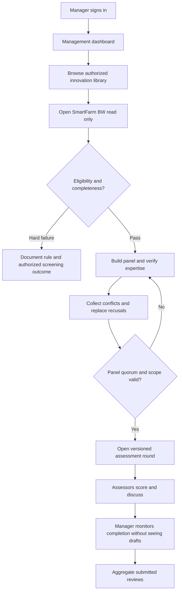
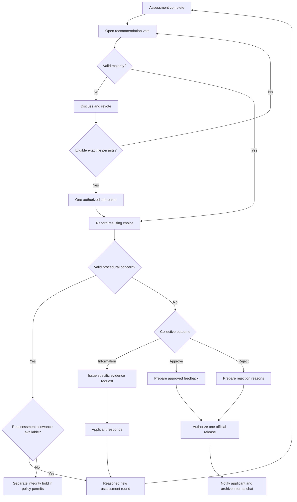
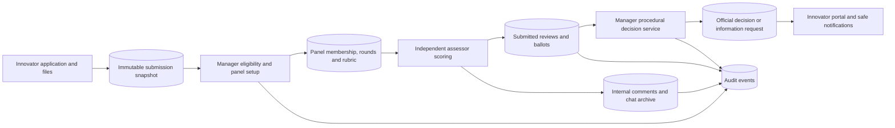
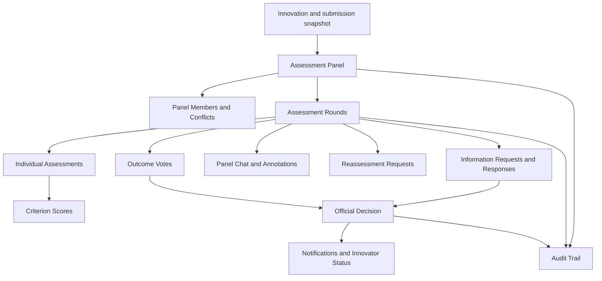

# CEDA Innovation Portal

## Assessment Manager / Lead Assessor User Flow, Screens, Governance and Data Flows

**Functional and UI/UX specification | Version 1.0 | 19 November 2026**  
**Audience:** UI/UX designers, web and mobile developers, database/API developers, QA, security reviewers and CEDA process owners.  
**Scope:** The Assessment Manager acting as a review-panel chair or designated Lead Assessor. Includes the ordinary assessor workflow only when this manager is explicitly assigned to score.  
**Companion:** *CEDA Innovation Portal — Standard Assessor User Flow, Screens, Interactions and Data Flows*.  
**Status:** Proposed hackathon product design. Voting, eligibility and authorization rules require confirmation by CEDA; they are **not** represented as existing CEDA policy.  
**Scenario:** Mpho is the fictional Assessment Manager. Naledi Motsumi has submitted the fictional agriculture innovation *SmartFarm BW*. Thompson, Karabo and three colleagues are ordinary assessors.

## 1. Purpose and fundamental separation of duties

The public-facing CEDA Innovation website provides general information. After secure **Staff Sign In**, a user with the Assessment Manager role enters a privileged, role-based management workspace. This is **not** the Innovator Portal and is **not** a system-administrator console. It is the place where a designated manager coordinates collaborative assessments, keeps decisions fair and timely, and releases one authorized outcome to the innovator.

**Recommended product rule:** The panel's valid majority controls the substantive recommendation. The manager controls procedure, assignments, tie resolution under approved rules, one documented reassessment opportunity per round, and official outcome release. **The manager cannot silently replace another assessor's marks, edit the majority tally, or reject an innovation merely because of personal disagreement.**

### 1.1 In scope

- Staff authentication, management dashboard, shared innovation library, assignment and workload control.
- Review-panel composition, sector/expertise matching, conflict declarations, recusals, quorum and deadlines.
- Full read-only access to assigned application snapshots, file previews and permission-scoped annotations.
- Monitor independent 1–5 scoring, required comments, submitted peer reviews and configurable aggregate calculations.
- Participate in internal innovation-specific chat and anchored document comments.
- Open and govern collective voting; handle valid majorities, no-majority splits and exact ties.
- Authorize a precise request for additional information and track the innovator's response.
- Request a justified reassessment, preserve previous rounds and require a new collective result.
- Draft, approve and release applicant-facing approval/rejection notes without exposing assessor identity.
- Close and archive final decisions, discussions, annotations, ballots and audit history.
- Notifications, operational reports, manager profile/security, empty/error states, responsive interfaces.

### 1.2 Explicitly outside this role's MVP

- Creating staff accounts or changing institution-wide RBAC rules (system administrator responsibility).
- Editing applicant-submitted answers, replacing attachments or deleting evidence.
- A separate CEDA loan application, loan underwriting, fund disbursement or grant contract process.
- A human customer support representative's inbox (specified separately).
- A hidden manager veto over valid majority recommendations.
- Applicant access to confidential review-team chat, individual scores, votes, assessor names or annotations.

### 1.3 Manager versus ordinary assessor

| Capability | Standard assessor (Thompson) | Manager / chair (Mpho) |
| --- | --- | --- |
| Browse permitted innovation library | Yes | Yes, within approved portfolio scope |
| Read original submitted information | Yes, permission-scoped | Yes, permission-scoped |
| Edit applicant answers or attachments | No | No |
| Start a personal scoring form | If assigned and conflict-free | **Only** if additionally designated as a scoring assessor |
| See another assessor's unsubmitted private draft | No | No |
| See formally submitted individual scores | Yes, within panel | Yes, within panel |
| Comment on evidence and join internal chat | Yes | Yes |
| Set panel membership and review deadline | No | Yes, with audit and policy checks |
| Manage conflict recusal/replacement | Declare own conflict | Review conflicts and reassign; cannot override a genuine conflict to force participation |
| Verify quorum and open voting | No | Yes |
| Cast ordinary recommendation vote | Yes, once per eligible round | Normally **no**; only if formally enrolled as a voting assessor |
| Break an unresolved, rule-qualified tie | No | Yes **only if not already counted as an assessor**, otherwise use an independent tiebreaker rule |
| Request formal additional evidence | Suggest internally | Approve and issue the official request |
| Initiate formal reassessment | Raise concern | Yes, once per decision round with a recorded reason |
| Authorize/release official decision | No | Yes, after validating decision policy |
| Alter another person's marks or majority result | No | No |

## 2. Governance rules for the proposed MVP

These are the **agreed design direction**, subject to CEDA approval before deployment as official organizational rules.

1. **Shared discovery, controlled participation.** Authorized staff can browse innovations within their permitted sectors; a person may score or vote only when enrolled in that innovation's review panel.
2. **Independent individual assessment.** Each eligible assessor scores the approved rubric on a 1–5 scale with a required rationale. Unsubmitted score drafts remain private even to the manager.
3. **Transparency after submission.** Submitted scores, evidence comments and discussion are visible to the authorized panel, with author and timestamp. The innovator sees none of these private materials.
4. **Valid majority decides.** A choice needs more than half the eligible valid ballots in the current decision round. A 2/2/1 split is **not** a majority. Eligibility, quorum, abstentions and recusals must be explicit.
5. **Non-voting chair by default.** Mpho manages the case without casting a routine vote. If a properly qualified tie remains after defined deliberation/revote, Mpho may cast a single documented deciding vote under the policy.
6. **No double ballot.** If Mpho is also assigned as a normal assessor and votes, Mpho has **one** ordinary vote, not a second tiebreak ballot. The case uses an independently appointed eligible tiebreaker or other preapproved rule.
7. **No discretionary veto.** A valid majority cannot be rejected by a personal preference. The manager can request a single reasoned reassessment within the round or initiate a separately audited procedural hold for specific legal, eligibility, fraud or security concerns.
8. **Reassessment preserves history.** A documented reassessment opens a new versioned round. Prior scores, votes, pinned comments, chat and timestamps remain immutable and accessible only to authorized staff.
9. **Information request is not a final decision.** The manager can send a consolidated request with questions, acceptable evidence and optional deadline; new applicant evidence returns to assessment without overwriting previous submissions.
10. **Early rejection is possible only by published eligibility rules.** It requires the precise unmet eligibility rule, a recorded screening reason, the authorized manager's action, and official applicant-facing feedback. It must not become a shortcut for rejecting a weak score without collective review.
11. **One official outcome.** Only the authorized decision-release action changes the innovator's public status to Approved or Rejected and sends approved feedback. This is an assessment outcome, **not** a funding award.
12. **Closure is read-only.** Once the case is finalized, internal team chat and annotations are archived and locked. A formal new assessment or appeal (if allowed) has a linked new round with its own discussion.

### 2.1 Criteria and scoring

The official presentation supplied six assessment themes: **Strategic Alignment; Innovation and Originality; Impact Potential; Feasibility and Viability; Scalability and Sustainability; Implementation Capacity, Team Capability and Governance.** Each is scored **1 (Poor) to 5 (Excellent)**. Definitions, weights and sector-specific subcriteria are configurable and require authorization. The manager may inspect scoring and outliers but must never change a colleague's marks. Additional technical maintainability questions may be used as guidance or explicitly configured subcriteria; they must not silently replace the six required categories.

**Illustrative aggregation:** weighted individual score = Σ(score × approved weight) / Σ(weights); team criterion average uses submitted scores of eligible assessors, excluding conflicted/recused participants rather than treating them as zero. Display the number of contributing assessors, calculation, rubric version and rounding. **The numerical score is decision support, not automatic approval.**

### 2.2 Voting examples

| Vote pattern | Manager action | Applicant-facing result |
| --- | --- | --- |
| 4 Approve, 1 Reject | Verify majority, prepare feedback, release approval unless valid procedural hold/reassessment applies | Approved after authorized release |
| 4 Reject, 1 Approve | Verify majority, prepare specific rejection reasons, release | Rejected after authorized release |
| 3 Request Information, 2 Approve | Verify valid majority and issue consolidated evidence request | Additional Information Requested |
| 2 Approve, 2 Reject, 1 Request Information | No majority; convene discussion/revote between leading options per policy | No final decision yet |
| 2 Approve, 2 Reject | After policy-defined revote, eligible non-voting manager may break exact tie with written rationale | Final result after authorized release |
| Manager participated as one of four voting assessors and vote is 2–2 | Do **not** vote twice; route to independent designated tiebreaker | No final outcome before tie resolved |
| Manager identifies a missing mandatory eligibility requirement | Record the specific rule, use authorized eligibility-screening path, do not falsify vote totals | Explicit screening outcome when authorized |
| Manager disagrees with valid 4–1 approval on legitimate technical grounds | Request one reasoned reassessment and new ballot; if majority remains, respect it absent defined integrity hold | No unilateral rejection |

## 3. Manager persona and navigation

**Mpho** is responsible for the Agriculture and AgriTech assessment portfolio. Mpho is not a system super administrator and does not control the entire CEDA website. Mpho can oversee several review panels, including Thompson and Karabo on SmartFarm BW.

**Entry:** Public CEDA Innovation website → Staff Sign In → role/permission check → Assessment Manager Workspace. A single staff account may have multiple roles; changing workspace switches visible tools without circumventing API permissions.

### 3.1 Main desktop shell

- **Left navigation:** Dashboard; Innovation Library; Assessment Panels; My Decision Desk; Information Requests; Reassessments; Team Discussions; Reports & Activity; Notifications; Help & Guidance; Profile & Security.
- **Top bar:** Workspace name, scoped sector switcher (if authorized), global search, pending-decision count, alerts, profile menu, secure sign out.
- **Main area:** Workload summary, queues/tables, embedded innovation workspace, deadline indicators and state-specific action area.
- **Contextual right drawer:** Internal live discussion, document comment threads, colleague mentions or procedural history without losing the submission.
- **Responsive behavior:** On tablet use a condensed drawer; on mobile use single-column details, full-screen documents/chat and a prominent but permission-protected Decision Desk. Complex cross-assessor comparison is optimized for desktop.

### 3.2 Innovation workspace tabs

**Overview · Application · Documents · Panel & Assignments · Team Reviews · Discussion · Aggregate & Vote · Decision / Feedback · Information Requests · History.** Managers see management actions in the same shared innovation workspace used by assessors, not a disconnected second copy of the submission.

## 4. Complete scenario: Mpho manages Naledi's SmartFarm BW

1. **Staff sign-in.** Mpho opens the public site, clicks Staff Sign In, completes authentication/MFA where required, and is routed to the Assessment Manager Dashboard.
2. **Morning overview.** Dashboard cards show Unassigned Innovations, Active Panels, Waiting for Reviews, Voting Ready, Pending Authorizations, Information Responses and Completed Today. Every count reflects permission-scoped server data.
3. **Find Naledi's submission.** Mpho opens Innovation Library, filters Agriculture → Prototype → Submitted, selects SmartFarm BW and verifies the application reference, snapshot date and available documents.
4. **Screening.** Mpho checks published eligibility requirements and basic completeness. The application remains read-only; if the case fails a hard requirement, Mpho records the exact rule and uses the controlled early-screening decision path rather than silently deleting it.
5. **Create a review panel.** Mpho selects Build Assessment Panel, chooses Thompson, Karabo and three other assessors from authorized staff, reviews subject expertise/workload, records assignments, sets a review deadline and verifies the configured quorum.
6. **Handle conflicts.** Invited assessors declare any conflicts. If Karabo declares one, Mpho records the recusal, removes Karabo from eligibility and appoints a suitable replacement. Mpho cannot override the recusal to force Karabo to score.
7. **Start review.** Mpho clicks Open Assessment Round. The backend stamps the rubric version, eligible membership, review deadline and round ID. Naledi's portal may change to In Review when the actual start-of-review event is committed.
8. **Monitor without influencing drafts.** Dashboard shows each assessor's progress (Not Started, Draft in Progress, Submitted, Recused), but never displays private draft marks or text to the manager.
9. **Read evidence and collaborate.** Mpho opens the applicant's documents in secure read-only view, reads document-anchored annotations posted by the panel, and joins real-time chat. Mpho can comment on evidence but cannot alter an original upload.
10. **Overdue review.** Thompson submits; another assessor is late. Mpho uses Send Reminder, adjusts an authorized deadline with a reason or replaces an unavailable assessor with an audited membership change. Existing submitted reviews are preserved.
11. **Review aggregate.** Once the completion/quorum policy is met, Mpho sees the six criteria, per-assessor submitted ratings, all required rationales and a transparent aggregate. Any unusual scoring differences are highlighted for discussion, not automatically treated as wrongdoing.
12. **Open the voting window.** Mpho selects Start Collective Vote. Each eligible assessor chooses Approve, Reject or Request Additional Information and supplies a reason. The UI shows participation and, when policy permits, the resulting tally.
13. **Valid majority.** Thompson, Karabo and two colleagues vote Approve; the fifth votes Reject. The system displays 4 Approve / 1 Reject: majority for approval. Mpho cannot substitute Rejected.
14. **Manager raises concern.** Suppose Mpho notices the prototype tests did not explain sensor calibration. Mpho may click Request Reassessment, choose the relevant evidence, provide a substantive reason and confirm one permitted reassessment for this decision round.
15. **New documented round.** The original round is locked as history. The panel sees Mpho's reason, discusses the evidence and submits new individual assessments and votes. This is not a secret rewrite of the 4–1 result.
16. **Final majority stands.** The panel again votes 4 Approve / 1 Reject. Mpho verifies all conditions and prepares the official response. The manager must respect the result absent a separate, specifically authorized integrity/eligibility hold.
17. **Prepare release text.** In Decision / Feedback, Mpho selects the outcome dictated by the valid vote and writes applicant-facing approval notes and next steps. The interface previews exactly what Naledi will see and flags assessor names/internal comments in pasted text.
18. **Authorize and release.** Mpho clicks Release Official Outcome, reviews a confirmation modal and authenticates again if policy requires. In one server-controlled operation, the official outcome is recorded, applicant-facing status becomes Approved, a release event is logged and safe notifications are queued.
19. **Naledi sees result.** Naledi sees Approved, the released explanation and next steps in her portal. Email/in-app messages alert her without disclosing confidential panel deliberations or implying funding has been granted.
20. **Archive and follow-up.** Team chat, pinned comments, ballots and case records become read-only; Mpho can access them only while authorized. An appeal, if permitted, opens a new linked process instead of unlocking the old conversation.

### 4.1 Alternative path: additional information

If the panel's valid collective vote is **Request Additional Information**, Mpho selects specific missing items (for example, an additional calibration report), supplies contextual instructions, accepted formats, whether a response is mandatory and an optional deadline. Mpho previews the applicant-facing wording and issues the request. Naledi receives a secure notification, submits typed answers and new evidence through her portal, and obtains an acknowledgment. The case remains **active** and the internal chat remains open. Mpho then opens a new assessment round as needed, preserving the original applicant snapshot and previous assessment trail. **An information request is not a rejection.**

### 4.2 Alternative path: a valid rejection

If the panel majority rejects SmartFarm BW, Mpho cannot require an information-request cycle merely to delay rejection. The manager must prepare specific, respectful, actionable rejection reasons based on the approved assessment and must remove any assessor identity from applicant-facing text. Once formally released, Naledi sees **Rejected** and the authorized feedback. Internal chat and document annotations become archived read-only.

### 4.3 Alternative path: unresolved tie

If the team cannot obtain a majority, Mpho first initiates a moderated discussion and a documented re-vote. For an eligible two-way tie, Mpho may act as tiebreaker only if **not** already counted as a regular voting assessor on that same round. The choice and explanation are permanently recorded. If Mpho already voted as a regular assessor, the system routes to an authorized independent tiebreaker and prevents duplicate voting.

## 5. End-to-end user flows

### 5.1 From submission to a coordinated assessment

### 5.2 Voting, reassessment, tie and release

### 5.3 Data and notification flow

## 6. Screen inventory and routing

Screen IDs are stable and suitable for Figma frames, frontend routes, API tickets and QA references. **A manager can also view every standard-assessor screen within their authorization**, but additional manager privileges belong only to the screens below. A manager who is not a voting assessor sees no personal scoring editor.

| ID | Screen / view | Entry point |
| --- | --- | --- |
| AM-01 | Staff Sign In and Role Routing | Public website → Staff Sign In |
| AM-02 | First-Access Manager Guidance | First managerial login / policy update |
| AM-03 | Assessment Manager Dashboard | Staff login → Manager workspace |
| AM-04 | Innovation Library / Filtered Queue | Sidebar → Innovation Library |
| AM-05 | Innovation Management Workspace | Select innovation result |
| AM-06 | Eligibility and Completeness Screening | Workspace → Screening |
| AM-07 | Applicant Submission (Read Only) | Workspace → Application |
| AM-08 | Documents and Secure Evidence Viewer | Workspace → Documents |
| AM-09 | Assessment Panel Builder | Workspace → Panel & Assignments |
| AM-10 | Assessor Picker / Expertise and Capacity | Panel Builder → Add assessor |
| AM-11 | Conflict and Recusal Management | Panel Builder → Conflicts |
| AM-12 | Round Configuration and Start | Panel Builder → Open Round |
| AM-13 | Panel Progress / Deadlines | Dashboard or workspace → Progress |
| AM-14 | Submitted Reviews and Score Comparison | Workspace → Team Reviews |
| AM-15 | Anchored Comments / Document Threads | Evidence viewer → Comment marker |
| AM-16 | Live Panel Discussion | Workspace right drawer / Discussions |
| AM-17 | Aggregate and Rubric Analytics | Workspace → Aggregate & Vote |
| AM-18 | Collective Voting Control | Aggregate & Vote → Start Vote |
| AM-19 | Voting Results and Majority Verification | Vote window closes / Decision Desk |
| AM-20 | Tie Resolution Workspace | No majority → Resolve |
| AM-21 | Manager Reassessment Request | Decision Desk → Request Reassessment |
| AM-22 | Procedural Hold / Eligibility Exception | Decision Desk → Raise Concern |
| AM-23 | Information Request Composer | Decision Desk → Request Information |
| AM-24 | Innovator Response Review | Information Requests → Open Response |
| AM-25 | Decision Draft and Feedback Editor | Decision Desk → Prepare Outcome |
| AM-26 | Applicant-Facing Preview and Release | Feedback Editor → Review & Release |
| AM-27 | Final Outcome / Closed Record | Workspace after release |
| AM-28 | Archived Chat and Audit History | Closed workspace → History |
| AM-29 | My Decision Desk | Main sidebar |
| AM-30 | Assessment Panels Overview | Main sidebar → Assessment Panels |
| AM-31 | Information Requests Queue | Main sidebar → Information Requests |
| AM-32 | Reassessments Queue | Main sidebar → Reassessments |
| AM-33 | Reports and Team Workload | Main sidebar → Reports & Activity |
| AM-34 | Notifications Center | Top bar bell / sidebar |
| AM-35 | Help, Rubric and Policy Guidance | Main sidebar → Help |
| AM-36 | Manager Profile and Security | Profile menu |
| AM-37 | Error, Restricted and Empty States | Contextual route or API failure |

## 7. Detailed UI/UX specifications for every screen

Each screen below defines purpose, content, inputs and controls, navigation, backend effect and essential permissions/error conditions. Controls are **design requirements**, not functioning interfaces in this document.

### AM-01 — Staff Sign In and Role Routing

- **Goal / entry:** Secure staff authentication from the public site's Staff Sign In link.
- **Layout:** CEDA identity, email, password, optional second factor, Forgot Password, sign-in status; clearly label this as staff-only.
- **Actions and inputs:** Email, password, optional MFA verification; Sign In; Reset Password. Never expose whether a guessed email belongs to staff.
- **System / guardrails:** Validate session and managerial role server-side, then open AM-03. If the same account also has a standard-assessor role, show a workspace switcher without granting new permissions.
- **States / responsive:** Incorrect credentials, account disabled, MFA required, session expired; narrow-screen centered form and accessible errors.

### AM-02 — First-Access Manager Guidance

- **Goal / entry:** Introduce confidentiality, majority-vote governance, tie rules, document handling and the manager's limits before initial use.
- **Layout:** Short checklist with Read Guidance, Policy Version, Acknowledge and Continue.
- **Actions and inputs:** Required acknowledgment checkbox; opening links to full approved rubric and information-handling guidance.
- **System / guardrails:** Save staff ID, timestamp and policy version. A new critical policy version requires new acknowledgment; this does not replace formal training.
- **States / responsive:** Deny manager tools until required acknowledgment is complete; allow keyboard and screen-reader navigation.

### AM-03 — Assessment Manager Dashboard

- **Goal / entry:** Surface the portfolio's most urgent work after login.
- **Layout:** Cards for New/Unassigned, Active, Waiting for Assessors, Ready to Vote, Pending Release, Awaiting Applicant Response, Reassessment Due and Completed; recent activity and attention-needed table.
- **Actions and inputs:** Sector/date filters, Open Innovation, Assign Panel, Resume Decision, Open Message, View Queue.
- **System / guardrails:** Every figure is server-calculated within manager's authorized portfolio; empty groups show a useful explanation rather than fake data.
- **States / responsive:** Last-refresh indicator, loading placeholders, permission errors, no assigned portfolio; cards stack on mobile.

### AM-04 — Innovation Library / Filtered Queue

- **Goal / entry:** Find any submission Mpho has permission to coordinate.
- **Layout:** Search bar and sortable table with reference, title, sector, stage, date, current overall status, panel state, age and next action.
- **Actions and inputs:** Query text; sector, category, stage, state, date range and assignment filters; Reset Filters, Open, Export permitted summaries.
- **System / guardrails:** Restrict results by backend scope; do not expose confidential applicant fields in unauthorized search results or exports.
- **States / responsive:** Empty results, pagination, saved filter state, restricted rows; mobile stacked row cards.

### AM-05 — Innovation Management Workspace

- **Goal / entry:** Centralize everything about one innovation without switching contexts.
- **Layout:** Sticky heading with SmartFarm BW, reference, Agriculture, Prototype, applicant-facing status, internal round and panel readiness; tabs listed in Section 3.2.
- **Actions and inputs:** Open each tab, contact panel, start screening, build panel, visit Decision Desk; right collaboration drawer.
- **System / guardrails:** Preserve navigation position on tab changes and separate applicant-visible state from internal decision state. Controls require real server permission checks.
- **States / responsive:** Read-only after closure, unsaved draft warning, restricted case, panel not created; collapse tabs to an accessible menu on small screens.

### AM-06 — Eligibility and Completeness Screening

- **Goal / entry:** Check whether minimum formal submission and published eligibility conditions are met before starting full scoring.
- **Layout:** Required-field checklist, applicant type, innovation stage, file inventory, official eligibility rules and screening history.
- **Actions and inputs:** Mark rule Passed / Needs Clarification / Failed, attach specific evidence reference, save rationale, Continue to Panel, Raise Rule-Based Screening Outcome.
- **System / guardrails:** Screen only against approved written rules; no subjective rejection of innovation quality. Any screening rejection requires a recorded unmet rule and applicant-facing reason.
- **States / responsive:** Ambiguous proof becomes clarification; draft screening remains internal, completed screening is versioned and auditable.

### AM-07 — Applicant Submission (Read Only)

- **Goal / entry:** Read Naledi's seven-section adaptive application exactly as received.
- **Layout:** Applicant details, innovation classification, problem/solution, impact, feasibility, evidence and plain-language authorship declarations, each with section anchors and snapshot timestamp.
- **Actions and inputs:** Jump to section, search permitted text, Link Evidence, Open Documents; no editing controls.
- **System / guardrails:** Bind to immutable submitted version; any later information request response is a separate linked supplement rather than silent replacement.
- **States / responsive:** Restricted sensitive fields are redacted; long sections use accessible anchors and collapsible navigation.

### AM-08 — Documents and Secure Evidence Viewer

- **Goal / entry:** Inspect supporting files while protecting innovation confidentiality.
- **Layout:** Documents grouped by application section; title, format, uploader notes, file version, scan state, download and preview. Secure PDFs/images preview inline; PPTX/XLSX/DOCX download or approved conversion when available.
- **Actions and inputs:** Preview, Download, Open Notes, Show Protected File Instructions, Add Evidence Comment, Link to Criterion.
- **System / guardrails:** Short-lived protected file access, per-file authorization, no permanent public URLs; password secrets handled only in approved restricted channel, not plain notes.
- **States / responsive:** File scan pending, preview unavailable, unsupported format, link expired, suspected malware; never bypass scans. Mobile full-screen viewer.

### AM-09 — Assessment Panel Builder

- **Goal / entry:** Create and manage the team authorized to review SmartFarm BW.
- **Layout:** Panel roster with name, expertise, sector eligibility, membership role, invitation/accepted/declined/recused status, workload and review progress.
- **Actions and inputs:** Add Assessor, Set Chair, Remove/Replace with reason, Set Review Deadline, Save Panel, Open Round.
- **System / guardrails:** Only authorized/active staff can be added; version roster changes and preserve already submitted scores; prevent an assessor from scoring without membership and conflict clearance.
- **States / responsive:** Too few members for quorum, absent subject expertise, member already conflicted, overlapping workload; show blocking errors before opening a round.

### AM-10 — Assessor Picker / Expertise and Capacity

- **Goal / entry:** Select appropriate reviewers instead of casually assigning whoever is available.
- **Layout:** Searchable directory with permitted names, expertise tags, authorized sectors, active review counts, availability and role eligibility.
- **Actions and inputs:** Search, filter expertise/sector, select multiple, inspect short profile, Add to Panel, Cancel.
- **System / guardrails:** Directory includes only manager-selectable staff and reveals no unnecessary HR/personal records; duplicate assignments blocked server-side.
- **States / responsive:** No matching reviewers, duplicate member, suspended account; multi-select drawer on desktop and full-screen sheet on mobile.

### AM-11 — Conflict and Recusal Management

- **Goal / entry:** Resolve declared conflicts and keep biased assessors out of scoring and voting.
- **Layout:** Each declaration's status, confidential reason visible only to authorized governance staff, recusal time, replacement choices and effect on quorum.
- **Actions and inputs:** Accept Recusal, Replace Member, Ask for Clarification, Record Reason. Do not provide a shortcut to force a conflicted assessor to evaluate.
- **System / guardrails:** Conflict acceptance immediately revokes scoring and voting for that case, recalculates eligibility and stores an auditable event.
- **States / responsive:** Pending declaration blocks start, quorum failure triggers replacement prompt, access revocation updates open sessions.

### AM-12 — Round Configuration and Start

- **Goal / entry:** Freeze the current review context before assessors start work.
- **Layout:** Application snapshot ID, rubric version and criteria, panel roster, eligible voter count, quorum, submission deadlines, manager voting mode and start confirmation.
- **Actions and inputs:** Start date/deadline, policy selections from authorized configurations, Open Assessment Round / Cancel.
- **System / guardrails:** Manager cannot invent voting thresholds ad hoc for a particular applicant; select only institution-approved versioned policy. Create a unique round, notify panel and record actual start.
- **States / responsive:** Invalid member count, unacknowledged conflicts, unpublished rubric, duplicate round, stale version; confirm with a review modal.

### AM-13 — Panel Progress / Deadlines

- **Goal / entry:** Monitor work without seeing unpublished individual scoring.
- **Layout:** For each assessor: Not Started, Working Draft, Submitted, Recused or Overdue; timestamps, progress counter and deadline.
- **Actions and inputs:** Send Reminder, Adjust Deadline with reason, Replace Unavailable Member, Open Discussion, See Submitted Review.
- **System / guardrails:** Draft content remains private; reminder emails carry no confidential applicant data; replacements and deadline changes are logged and recheck quorum.
- **States / responsive:** Reviewer offline, reminder failure, deadline passed, recusal; live updates without distracting layout movement.

### AM-14 — Submitted Reviews and Score Comparison

- **Goal / entry:** Inspect finalized individual assessments without changing them.
- **Layout:** Assessor-by-criterion table (1–5), submitted rationales, evidence links, rubric version, timestamps, visible outliers and score spread.
- **Actions and inputs:** Select assessor, compare two or more submitted reviews, jump to cited document, open discussion, download permission-scoped summary.
- **System / guardrails:** Never display private draft marks. No Edit Other Score action; submitted review corrections require a formal versioned amendment mechanism.
- **States / responsive:** Incomplete panel indicates provisional totals, long tables scroll horizontally with frozen labels where practical, mobile stacked comparison.

### AM-15 — Anchored Comments / Document Threads

- **Goal / entry:** Discuss a specific passage or file visually, similar to Figma-style collaboration.
- **Layout:** File/page or text anchor, comment pin, author/time, threaded replies, mentions and resolution history.
- **Actions and inputs:** Add Comment, Reply, Mention Assessor, Mark Resolved/Reopen if allowed, Jump to Anchor.
- **System / guardrails:** Comments are assessor-only, escaped/sanitized and tied to immutable document version and assessment round; they cannot overwrite file contents.
- **States / responsive:** Unsupported format uses file-level comment, missing anchor displays fallback context, archived threads are read-only.

### AM-16 — Live Panel Discussion

- **Goal / entry:** Give panel members a real-time back-and-forth conversation for SmartFarm BW.
- **Layout:** Right drawer with innovation title, participant list, unread badges, message composer, threads, mentions and links to evidence; full-screen on mobile.
- **Actions and inputs:** Post Message, Reply, Mention, Link Document/Review, Search Within Conversation.
- **System / guardrails:** Membership-checked real-time channel; no content accessible to Naledi; messages persisted with author/time and revision history. No casual deletions that destroy audit records.
- **States / responsive:** Connection lost/retry, member removed, messages arriving while scrolled up, archive banner; never claim delivery until confirmed.

### AM-17 — Aggregate and Rubric Analytics

- **Goal / entry:** Show fair, interpretable team results after the scoring readiness rule is met.
- **Layout:** All six official criteria, averages/weights, contributor counts, score dispersion, qualitative rationale summaries and evaluation completeness indicator.
- **Actions and inputs:** Filter criterion, inspect differing opinions, open specific submitted review, Start Voting when allowed.
- **System / guardrails:** Backend authoritative calculation with denominator, rounding, policy and rubric version. Numeric score does not itself decide approval or rejection.
- **States / responsive:** Missing mandatory reviews, policy changed mid-round, assessor recused; prohibit misleading aggregate labels before eligibility rules are satisfied.

### AM-18 — Collective Voting Control

- **Goal / entry:** Begin and supervise one formal outcome ballot per eligible assessor.
- **Layout:** Voting readiness checklist, approved choices Approve / Reject / Request Additional Information, voter list, open/close dates and quorum rule.
- **Actions and inputs:** Open Voting Window, Send Voting Reminder, Close After Requirements Met, Reopen by approved new round only.
- **System / guardrails:** No manager ballot unless explicitly participating; one active vote per eligible assessor; no silent manager edits to submitted votes.
- **States / responsive:** Missing scores or quorum, deadline reached, ballot in progress, member recused; errors show exact blocking rule.

### AM-19 — Voting Results and Majority Verification

- **Goal / entry:** Verify whether the team has produced a valid collective outcome.
- **Layout:** Ballot count by option, valid/recused/abstaining count, voter rationales, majority threshold, status Pending / Valid Majority / No Majority / Tie.
- **Actions and inputs:** Verify Results, Open Team Discussion, Proceed to Feedback, Initiate Tie Resolution, Request Reassessment with rationale.
- **System / guardrails:** Vote totals are computed server-side and cannot be manually overridden; determine >50% correctly and distinguish plurality from majority.
- **States / responsive:** 2/2/1 no majority, quorum lost, late ballots, manager doubled as assessor; display explicit policy-based remedy.

### AM-20 — Tie Resolution Workspace

- **Goal / entry:** Resolve unresolved votes fairly without introducing arbitrary veto power.
- **Layout:** Round history, option counts, discussion evidence, re-vote log and badge indicating who is eligible to break a specific tie.
- **Actions and inputs:** Schedule Re-Vote, Record Moderated Discussion, Cast Tiebreaker Vote (only if manager is eligible), Refer to Independent Tiebreaker.
- **System / guardrails:** If Mpho already voted normally, disable a second tiebreak action. Record outcome and reasons with immutable event and actor.
- **States / responsive:** No majority but not a resolvable tie, missing quorum, recused chair, unresolved independent tiebreaker; keep applicant status unchanged.

### AM-21 — Manager Reassessment Request

- **Goal / entry:** Raise one substantive documented concern and start a transparent new round.
- **Layout:** Current ballot summary, reason categories, relevant criterion/evidence selector, detailed reason, one-per-round allowance indicator and expected next action.
- **Actions and inputs:** Select Concern, Write Why, Link Supporting Evidence, Preview Reason, Request Reassessment, Cancel.
- **System / guardrails:** Require detailed rationale and permission checks; cannot erase old ballot, cannot request unlimited repeats, cannot secretly convert Approval to Rejected.
- **States / responsive:** Allowance exhausted, round already released, request conflicts with policy, identical concurrent requests; show blocked state and proper escalation route.

### AM-22 — Procedural Hold / Eligibility Exception

- **Goal / entry:** Handle specific legal, fraud, security or mandatory eligibility issues separately from opinion disagreement.
- **Layout:** Defined exception type, applicable policy/eligibility clause, supporting evidence, responsible governance contact, hold status and due-for-review date.
- **Actions and inputs:** Raise Hold, Record Evidence, Refer for Independent Check, Clear Hold with Reason, View Hold History.
- **System / guardrails:** Cannot fabricate a final rejection based on a hold; strict reason and audit requirements; restrict sensitive investigations to authorized staff; block public release while a valid hold is unresolved.
- **States / responsive:** Hold pending, resolved, declined, time-expired; the design must not create an unlimited private veto.

### AM-23 — Information Request Composer

- **Goal / entry:** Send Naledi one coherent, precise request rather than fragmented assessor messages.
- **Layout:** Request title, linked innovation, list of missing items (text questions or evidence), instructions, accepted types, reason, optional deadline, message preview.
- **Actions and inputs:** Add Item, Mark Required/Optional, Attach Section Reference, Set Deadline, Save Draft, Preview, Send Official Request.
- **System / guardrails:** Validate at least one actionable request item; requesting extra files may exceed original four-file-per-section limit through the controlled request channel. No direct public disclosure of assessor identities.
- **States / responsive:** Empty request blocked, repeated request conflict, expired application, notification queue failure; save is private until sent.

### AM-24 — Innovator Response Review

- **Goal / entry:** Inspect the applicant's answer to an official additional-information request.
- **Layout:** Original request and item checklist, Naledi's response text, newly uploaded files and notes, response timestamp and request status.
- **Actions and inputs:** Acknowledge Response, Mark Item Resolved/Missing, Request Follow-up per policy, Open New Assessment Round, Compare Versions.
- **System / guardrails:** Evidence is linked to the request and immutable; maintain scan checks, panel access controls and prior submission versions.
- **States / responsive:** Partial response, late response, corrupt or rejected upload, applicant offline; do not automatically reject solely for a delayed response unless an approved rule exists.

### AM-25 — Decision Draft and Feedback Editor

- **Goal / entry:** Translate the valid collective outcome into a professional, understandable communication for Naledi.
- **Layout:** Locked recommended outcome, vote summary, clear reason fields, strengths/improvements, required next steps, optional official letter attachment and release checklist.
- **Actions and inputs:** Enter applicant-facing explanation, next steps, add authorized supporting letter, Save Draft, Preview as Innovator.
- **System / guardrails:** Outcome choice follows valid policy result; reject notes are mandatory for a rejection; approval next steps must not promise funding. Flag inadvertent disclosure of assessor names or confidential remarks.
- **States / responsive:** Missing rationale, policy conflict, unreleased technical concern, stale vote; feedback draft does not change applicant status.

### AM-26 — Applicant-Facing Preview and Release

- **Goal / entry:** Verify precisely what the applicant will see before committing an official outcome.
- **Layout:** Preview of Naledi's status badge, feedback page, decision letter if any, email notification subject/body and release effect summary.
- **Actions and inputs:** Back to Edit, Confirm and Release, optional reauthentication; reason for exceptional release if policy permits.
- **System / guardrails:** Server rechecks eligible majority/tie resolution, quorum, holds, decision draft, permissions and idempotency. Release is atomic and audit logged; applicant email is queued, not assumed delivered.
- **States / responsive:** Already released, concurrent manager action, stale ballot, delivery provider failure, auth expiry; do not report success until committed.

### AM-27 — Final Outcome / Closed Record

- **Goal / entry:** Display the outcome, status and released applicant feedback once decision is final.
- **Layout:** Approved / Rejected; reference, release timestamp, authorized manager, vote tally, released feedback, applicant-visible letter and archive links.
- **Actions and inputs:** View Official Feedback, Download Authorized Internal Summary, View Archive, Start Formal New Process if policy permits.
- **System / guardrails:** No editing of final outcome; changes require a new linked authorized process with revision history.
- **States / responsive:** Notification pending/failed independent of official success, revoked manager authorization, appeal flag; chat composer disabled.

### AM-28 — Archived Chat and Audit History

- **Goal / entry:** Make completed assessments reviewable without allowing history to be rewritten.
- **Layout:** Timeline of screening, roster, conflicts, scores submitted, comments, votes, manager holds, reassessments, information requests, official release and message archives.
- **Actions and inputs:** Filter by event type/round, Search Authorized History, Open Archived Conversation, Export Redacted Audit Record if permitted.
- **System / guardrails:** Tamper-evident version/audit retention, strict access to internal data, retention schedule approved by CEDA; ordinary users/innovators cannot see this history.
- **States / responsive:** Archived read-only banner, expired retention (if applicable), restricted event, very long history pagination.

### AM-29 — My Decision Desk

- **Goal / entry:** Give Mpho a prioritized list of cases requiring a managerial action.
- **Layout:** Groups: Need Panel, Waiting on Reviews, Ready to Vote, Resolve Tie, Reassessment Requested, Feedback Draft, Ready to Release, On Hold.
- **Actions and inputs:** Open Case, Assign, Send Reminder, Resolve, Preview Feedback, Release when allowed; multi-filter by sector/age/urgency.
- **System / guardrails:** Do not provide one-click bulk approval/rejection; each official outcome needs case-level checks and applicant-facing rationale.
- **States / responsive:** Stale statuses update in real time; task completed on another tab disappears after confirmation.

### AM-30 — Assessment Panels Overview

- **Goal / entry:** Oversee staffing, availability and case ownership across multiple innovations.
- **Layout:** Panels grouped by innovation, lead/manager, members, sector, status, quorum, deadlines and review workload.
- **Actions and inputs:** Open Panel, Rebalance Work, View Conflicts, Assign Replacement, View Team Activity.
- **System / guardrails:** Assignment changes require reasons and audit, and cannot force a conflicted individual into a case.
- **States / responsive:** Overallocated reviewer, no qualified replacement, missing quorum, cross-sector access limitation.

### AM-31 — Information Requests Queue

- **Goal / entry:** Track all outstanding innovator information requests under Mpho's portfolio.
- **Layout:** Innovation, request reference, date sent, due date, applicant response status, mandatory outstanding items and recent communication.
- **Actions and inputs:** Open Request, Review Response, Send Reminder, Extend Deadline with recorded reason, Close when resolved.
- **System / guardrails:** Reminders and email reveal no confidential details; changes to due dates follow configured policy; original request remains immutable.
- **States / responsive:** Partially answered, overdue, no deadline, returned file scan failure, response received.

### AM-32 — Reassessments Queue

- **Goal / entry:** Monitor current and historical formally reopened rounds.
- **Layout:** Innovation, source round, new round, initiator and justification, affected criteria, panel completion, new vote and current deadline.
- **Actions and inputs:** Open New Round, View Old Round, Notify Panel, View Status, Resolve when complete.
- **System / guardrails:** Limit the formal manager reassessment action by policy; preserve all old versions, keep applicant-facing outcomes distinct from internal re-evaluation.
- **States / responsive:** Waiting on assessor, new evidence pending, manager request denied by exhausted allowance, archived previous round.

### AM-33 — Reports and Team Workload

- **Goal / entry:** Provide operational visibility without leaking confidential innovation content.
- **Layout:** Counts by sector/stage/status, review aging, average review duration, assigned workload, assessment completion, outcomes and pending applicant responses.
- **Actions and inputs:** Set date range, sector and panel filters; export permissioned aggregate report; open underlying authorized case.
- **System / guardrails:** Aggregates based on real records and data minimization; never publish confidential internal scores publicly or treat the manager dashboard as the public CEDA impact statistics page.
- **States / responsive:** No records, small sample caveats, long-running export, permission denied; accessible charts plus tables.

### AM-34 — Notifications Center

- **Goal / entry:** Keep Mpho aware of managerial work without relying on inbox email alone.
- **Layout:** Grouped event feed for unassigned innovation, recusal, review submitted, overdue deadline, vote ready, tie, new applicant response and released outcome.
- **Actions and inputs:** Open Target, Mark Read, Filter Unread, notification preferences.
- **System / guardrails:** Server-generated events with deep links requiring reauthorization; no confidential proposal text in generic push or email previews.
- **States / responsive:** Duplicate/retried events deduplicated by event ID; revoked role results in restricted link, not data leakage.

### AM-35 — Help, Rubric and Policy Guidance

- **Goal / entry:** Explain authorized decision rules, criteria and process limits consistently.
- **Layout:** Searchable guide to six criteria, 1–5 scale, majority examples, conflicts, ties, reassessment, screening, document handling and contact routes.
- **Actions and inputs:** Search Help, Open Guidance, Ask Approved Support, Report Policy Ambiguity.
- **System / guardrails:** Use approved and versioned institutional guidance, not unrestricted AI guesses, for mandatory governance rules.
- **States / responsive:** Policy unavailable/out of date, user lacks access, offline; show correct escalation route instead of inventing a rule.

### AM-36 — Manager Profile and Security

- **Goal / entry:** Manage personal account settings and session hygiene.
- **Layout:** Name and work contact (admin-controlled where required), role/scope summary, authorized workspace selector, MFA status, active sessions, notification choices and sign out.
- **Actions and inputs:** Update allowed preferences, Change Password, Manage MFA, Sign Out, Review Sessions.
- **System / guardrails:** Cannot self-grant manager access, sector scope or extra voting rights. Authorization changes take effect across sessions.
- **States / responsive:** MFA recovery, invalid session, update failure, access revoked; accessible account controls.

### AM-37 — Error, Restricted and Empty States

- **Goal / entry:** Ensure predictable outcomes when actions fail or permissions change.
- **Layout:** Page- and component-level states for No Assigned Portfolio, No Results, Unauthorized Innovation, Quorum Not Met, Draft Not Saved, Tie Unresolved, Decision Already Released, Connection Lost.
- **Actions and inputs:** Retry, Return to Dashboard, Contact Authorized Admin, Inspect Blocking Criteria; never show an enabled action that cannot succeed.
- **System / guardrails:** Do not reveal existence of restricted documents; classify 403/404 safely, support idempotent retries and prevent accidental duplicate release.
- **States / responsive:** All supported screen sizes, keyboard access, informative text (not only red color), preservation of pending draft inputs.

## 8. Modals, sidebars, popovers and confirmation patterns

No manager-only action should be implemented as an unlabeled button with no confirmation, context or server validation.

| ID | UI element | Trigger | Required behavior |
| --- | --- | --- | --- |
| MU-01 | Staff workspace switcher | Multiple authorized roles | Choose Assessor vs Manager; role verified on every server request, never client-only. |
| MU-02 | Filter drawer | Library / Decision Desk filters | Sector, stage, state, age, assignment; Apply / Reset / Cancel. |
| MU-03 | Build panel side sheet | Add or change reviewers | Expertise, workload, member eligibility, roster preview; Save / Cancel. |
| MU-04 | Conflict disclosure dialog | Assessor recusal submitted | Confidential explanation, quorum effect, replace member; cannot force participation. |
| MU-05 | Start round confirmation | Open Assessment Round | Snapshot, rubric version, participants, quorum and deadlines; explicit Confirm. |
| MU-06 | Reminder / deadline dialog | Send reminder or change deadline | Recipient, deadline, reason; do not expose confidential case in generic email. |
| MU-07 | Evidence preview overlay | Open document | Authorized preview/download, zoom, page navigation, comments, fallback when unsupported. |
| MU-08 | Evidence comment popover | Highlight PDF or file entry | Anchor, comment, tag teammate, Post / Cancel; only internal participants. |
| MU-09 | Team chat drawer | Chat icon / mention | Realtime messaging; right drawer on desktop; full-screen on mobile; locked after closure. |
| MU-10 | Rubric explanation popover | Help on criterion | Official definition, 1–5 examples and approved evidence, versioned. |
| MU-11 | Open vote modal | Start Collective Vote | Show panel readiness, voting quorum, deadline and eligible participants. |
| MU-12 | Vote results inspector | Inspect collective result | Submitted ballots, calculations, rationales and blocking policy checks. |
| MU-13 | Tie action dialog | Tie/no majority | Distinguish discussion/re-vote from authorized tiebreak; disable double vote. |
| MU-14 | Reassessment modal | Request Reassessment | Required substantive reason, evidence refs, round allowance and irreversible record effect. |
| MU-15 | Integrity hold modal | Raise legal/eligibility issue | Specific policy clause, evidence, reason, expiry/check owner; no arbitrary veto. |
| MU-16 | Request information builder | Additional Information outcome | Repeatable item list, required response, accepted file formats, optional deadline. |
| MU-17 | Applicant-facing preview | Prepare feedback | Status, official rationale, next steps and sanitized notification preview. |
| MU-18 | Release confirmation modal | Confirm Official Outcome | Exact result, case reference, policy checks, consequences and final confirm. |
| MU-19 | Archived conversation banner | Final authorized outcome | Composer disabled; links to prior rounds; no post-closure message entry. |
| MU-20 | Save / error toast | Save or server mutation | Confirm success only after backend commit; retry failures, prevent duplicate requests. |
| MU-21 | Session expiry modal | Expired token mid-action | Reauthenticate, recover draft where permitted, never resend secret through insecure channels. |

**Accessibility:** Dialogs trap focus and return it to their trigger; buttons have text labels and keyboard focus; Escape cancels reversible overlays; dangerous actions require explicit choices and are never triggered by a plain toast. Live chat must not steal focus when new messages arrive.

## 9. State model and lifecycle ownership

Do **not** collapse the three following state concepts into one field:

- **Applicant-facing innovation status:** Draft, Submitted, In Review, Additional Information Requested, Evaluation in Progress, Approved, Rejected (or the final policy-approved names).
- **Internal assessment-round status:** Screening, Panel Formation, Scoring Open, Waiting for Assessors, Ready to Vote, Voting Open, No Majority, Pending Authorization, Reassessment Open, Closed.
- **Manager task status:** Unassigned, Action Required, Waiting on Panel, Waiting on Applicant, Ready to Release, Archived.

### 9.1 Transition table

| Internal state | Trigger | Next state | Manager permission and checks |
| --- | --- | --- | --- |
| New submission | Open permitted case | Screening | Read submitted snapshot, check eligibility. |
| Screening | Pass eligibility | Panel Formation | Record screening version and results. |
| Screening | Approved hard-rule failure | Screening Outcome Released | Required rule, reason and authorized release event. |
| Panel Formation | Quorum, conflicts, rubric validated | Scoring Open | Open round; time and policy snapshots saved. |
| Scoring Open | Required scores incomplete | Waiting for Assessors | Remind/reassign per policy; draft scores still private. |
| Waiting for Assessors | Required submitted reviews complete | Ready to Vote | Compute authoritative aggregates. |
| Ready to Vote | Manager opens ballot | Voting Open | Freeze eligible roster; notify participants. |
| Voting Open | Valid majority recorded | Pending Authorization | Verify recommendation and feedback; manager cannot change tally. |
| Voting Open | No majority / exact tie | No Majority | Convene revote or eligible tiebreak process. |
| Pending Authorization | Formal one-time reassessment | Reassessment Open | Required rationale; preserve prior round. |
| Reassessment Open | New round configured | Scoring Open | New round ID and clear instructions to panel. |
| Pending Authorization | Valid Information recommendation | Awaiting Applicant Response | Issue specific evidence request; do not close chat. |
| Awaiting Applicant Response | Applicant sends valid response | Response Received | Notify panel; review new immutable response. |
| Response Received | Manager resumes evaluation | Scoring Open | New or re-opened formally versioned round per policy. |
| Pending Authorization | Authorize approval | Approved / Closed | Atomic outcome release; archive internal chat. |
| Pending Authorization | Authorize rejection | Rejected / Closed | Mandatory reasons; atomic release and archive. |
| Closed | Authorized appeal/new process | New Linked Process | No rewriting old rounds or discussions. |

### 9.2 Eligibility and majority calculation

For each ballot, the server stores the **approved policy version**, eligible participant roster, quorum, recusal/abstention treatment and allowed choice set. The system must never infer a majority from a plurality or count a recused reviewer as a negative vote. A configurable minimum reviewer count is recommended (for example, three qualified assessors for a normal panel); the final quorum number is a **CEDA governance decision**, not a fact from the briefing.

The manager may reassign panel membership before/within a round only under documented rules. If eligibility changes mid-vote, the system should invalidate or restart voting according to a recorded policy rather than silently recalculate an irreversible result.

### 9.3 Release consistency

The backend should authorize and commit the final decision, final feedback snapshot, release timestamp, applicant status change and immutable audit event in a single transaction. Email and push messages are dispatched through a retryable notification outbox **after** commit. An email failure cannot erase a valid official decision, and a network retry cannot create two releases.

## 10. Logical data model and ER relationships

This model is a recommended implementation contract, **not** a claim about CEDA's existing database. It extends the standard-assessor data model and reuses innovator submission/document entities. Supabase/PostgreSQL can implement it with RLS, server-owned functions and append-only audit records.

### 10.1 Entities and key fields

| Entity | Important fields | Relation / protection |
| --- | --- | --- |
| `staff_users` | `id`, `name`, `work_email`, `active`, `mfa_state` | Managed by authorized administration; never modified by an assessor. |
| `staff_role_grants` | `user_id`, `role`, `sector_scope`, `issued_by`, `expires_at` | Server-enforced role and portfolio scope. |
| `innovations` | `id`, `reference`, `owner_id`, `sector`, `stage`, `applicant_status` | Innovator-owned; manager reads scoped record. |
| `submission_snapshots` | `id`, `innovation_id`, `version`, `answers`, `submitted_at` | Immutable applicant submission version. |
| `document_versions` | `id`, `snapshot_id`, `section_id`, `storage_key`, `scan_state`, `mime` | Confidential private storage; short-lived authorization. |
| `screening_checks` | `id`, `innovation_id`, `rule_id`, `result`, `reason`, `manager_id`, `time` | Versioned official eligibility rule and evidence. |
| `assessment_panels` | `id`, `innovation_id`, `manager_id`, `sector`, `status`, `policy_version` | One active panel per configured evaluation process. |
| `panel_members` | `panel_id`, `staff_id`, `participation_role`, `membership_state`, `joined_at` | Unique scoped membership; cannot score without eligibility. |
| `conflict_declarations` | `panel_id`, `assessor_id`, `has_conflict`, `reason`, `reviewed_at` | Sensitive restricted data; recusal updates eligibility. |
| `assessment_rounds` | `id`, `panel_id`, `round_number`, `rubric_version`, `state`, `start`, `deadline`, `source_round_id` | Versioned rounds; past rounds never overwritten. |
| `rubric_versions` | `id`, `version`, `criteria`, `weights`, `scoring_policy` | Approved/configured only by authorized governance role. |
| `individual_assessments` | `id`, `round_id`, `assessor_id`, `status`, `version`, `submitted_at` | Private drafts; submitted records readable to authorized panel. |
| `criterion_scores` | `assessment_id`, `criterion_id`, `score_1_to_5`, `reason`, `evidence_refs` | Integrity-checked 1–5 values with explanations. |
| `outcome_votes` | `id`, `round_id`, `voter_id`, `choice`, `rationale`, `submitted_at` | One active ballot per eligible participant; no duplicate chair vote. |
| `vote_tiebreaks` | `id`, `round_id`, `chair_id`, `choice`, `reason`, `policy_rule` | Only when permitted; audit authoritative. |
| `reassessment_requests` | `id`, `source_round_id`, `requested_by`, `reason`, `evidence_refs`, `new_round_id` | Limited and documented; old data immutable. |
| `procedural_holds` | `id`, `innovation_id`, `category`, `policy_rule`, `reason`, `status`, `reviewer_id` | Restricted integrity procedure; cannot replace majority. |
| `information_requests` | `id`, `innovation_id`, `round_id`, `items`, `due_at`, `issued_at`, `status` | Official applicant-visible request, with attachments separate. |
| `information_responses` | `id`, `request_id`, `applicant_id`, `answers`, `document_refs`, `submitted_at` | Append-only evidence and receipt. |
| `document_annotations` | `id`, `document_version_id`, `round_id`, `anchor`, `author_id`, `thread_id`, `status` | Internal comments with version-stable anchor. |
| `panel_messages` | `id`, `round_id`, `author_id`, `reply_to`, `content`, `archived_at` | Real-time, internal-only, read-only after closure. |
| `decision_drafts` | `id`, `round_id`, `proposed_result`, `public_feedback`, `version`, `edited_by` | Manager-only draft not applicant-visible. |
| `official_decisions` | `id`, `innovation_id`, `round_id`, `result`, `feedback_snapshot`, `released_by`, `released_at` | Unique authoritative released outcome with immutable history. |
| `notification_outbox` | `id`, `event_type`, `recipient_id`, `payload_safe`, `status`, `attempt_count` | Retries safe; no confidential payload in email previews. |
| `audit_events` | `id`, `actor_id`, `resource`, `action`, `before_hash`, `after_hash`, `created_at` | Access controlled, tamper-evident and retained under approved policy. |

### 10.2 Logical ER diagram

### 10.3 Server-side service contracts

| Server action | Input / precondition | Outcome / audit event |
| --- | --- | --- |
| `listManagerInnovations` | Manager session, permitted filters, pagination | Scope-filtered queue with counts; no unauthorized details. |
| `getCaseWorkspace` | Innovation ID, valid manager scope | Read-only application, panel state and permitted actions. |
| `screenEligibility` | Innovation, approved rule IDs, findings/reasons | Audited pass/clarify/fail result, no unofficial deletion. |
| `setPanelMembers` | Panel ID, staff IDs, roles, reason and expected version | Validated roster revision and member notifications. |
| `acknowledgeRecusal` | Declaration ID, authorized action | Disables member scoring/voting and recalculates quorum. |
| `openAssessmentRound` | Panel, rubric/policy version, deadline | Creates unique round, locks context, records start. |
| `getManagerReviewProgress` | Panel/round | Completion metadata only for drafts; submitted scores once eligible. |
| `startCollectiveVote` | Round, completion/quorum valid | Unique voting window and frozen eligibility snapshot. |
| `computeVoteResult` | Round and policy version | Auditable majority/tie/no-majority result; never client-calculated authorization. |
| `castManagerTiebreak` | Exact eligible tie, manager has not voted ordinarily | One reasoned deciding ballot and audit event. |
| `requestReassessment` | Round, reason, evidence references, allowance | New linked round; prior round immutable. |
| `raiseProceduralHold` | Policy clause, issue/evidence, governance scope | Temporary hold with review route, not hidden vote replacement. |
| `issueInformationRequest` | Valid majority choice, actionable items, optional due date | Secure applicant request and notification outbox. |
| `getInformationResponse` | Request ID and panel authorization | New immutable applicant response and linked files. |
| `saveDecisionDraft` | Valid candidate outcome and public feedback, expected version | Manager-only draft; no applicant status change. |
| `releaseOfficialDecision` | Valid vote, no unresolved holds, authorized role, idempotency key | One atomic official outcome + feedback + status + audit + outbox. |
| `getCaseAudit` | Case/round filters, authorized scope | Paged read-only timeline and permitted export. |

## 11. Sequence of data movement

1. Naledi submits versioned innovation information and protected files. The **innovator** owns her application; no staff member edits its submitted snapshot.
2. Mpho signs in. Backend resolves active manager role, approved portfolio scope and case access.
3. Mpho screens eligibility against **approved rules**, logs any findings, and creates a review panel and membership records.
4. On round start, backend snapshots rubric/policy version, conflict-clear eligible assessors, quorum and deadlines; participant notifications are queued safely.
5. Assessors save private drafts and submit final individual evaluations with required rationales. Manager sees private-draft status only, never their draft scores.
6. Uploaded file previews use short-lived protected access. Document-pinned comments and panel messages are stored separately and broadcast only to authorized panel participants.
7. Once the completion/quorum condition is met, the server computes submitted-score aggregates; the manager opens a controlled voting window.
8. Eligible assessors cast one documented choice each. The server computes majority/no-majority/tie using the versioned policy and stores each eligible ballot.
9. If additional information is chosen, Mpho sends consolidated items to Naledi, who responds through her portal; a new evidence snapshot is linked, old data retained and assessment resumes.
10. If reassessment is justified and allowed, Mpho logs the specific concern, starts a linked round and the panel re-evaluates without rewriting the old result.
11. Mpho prepares only the official applicant-facing feedback consistent with the valid collective decision. A preview checks for reviewer identity leakage and unintended funding promises.
12. Authorization service revalidates policy and commits final result, immutable feedback, release timestamp, applicant-facing status and audit event together; notifications are queued separately.
13. The innovator's portal shows the official outcome and approved feedback. Email/in-app messages reference the innovation but contain no private internal discussions.
14. Upon final release, internal team chat and document comments are archived read-only, subject to approved retention and continued staff authorization.

## 12. Authorization and confidentiality matrix

| Resource or action | Standard assessor | Assessment Manager / Lead | Innovator |
| --- | --- | --- | --- |
| Authorized submitted applications | View in scope | View in scope | Own submission |
| Applicant documents | Read/preview in scope | Read/preview in scope | Own uploads |
| Change submitted applicant facts | No | No | No, except separate authorized supplement |
| Private unsubmitted assessment draft | Own only | Own only if also scoring; **not** peers' drafts | No |
| Submitted assessor scores / rationales | Panel only | Panel only | No |
| Figma-style annotations and team chat | Panel only | Panel only | No |
| Add/remove panel members | No | Yes with constraints | No |
| Resolve conflicts, quorum and deadlines | No | Yes with audit | No |
| Cast ordinary assessor vote | Yes when eligible | Only if separately enrolled; once | No |
| Manager tiebreak | No | Only eligible non-voting chair | No |
| Change peer votes or individual scores | No | No | No |
| Request official additional evidence | Suggest only | Issue after valid process | Respond to own request |
| Request formal reassessment | Raise concern | Limited reasoned action | No direct manager control |
| Authorize final applicant outcome | No | Yes when all checks pass | No |
| Read archived panel discussion | Authorized panel scope only | Authorized scope only | Never |
| View released official feedback | Yes if authorized | Yes | Own only |

Security includes authenticated role and case checks on **every** API/storage access, Supabase RLS or equivalent, encrypted data in transit and at rest, short-lived file URLs, audit logs, anti-injection controls for comments, rate limits, file scanning, conflict-aware membership, idempotent outcome release, and explicitly approved retention. Password-protected upload credentials must use a restricted secret-sharing mechanism rather than ordinary team chat.

## 13. Failure handling and edge cases

| Situation | Expected system response |
| --- | --- |
| No qualified reviewers available for Agriculture | Block round start, suggest eligible replacements or escalate staffing; never invent a reviewer. |
| Conflict declaration reduces panel below quorum | Suspend opening voting until authorized replacement or approved quorum adjustment. |
| Reviewer loses access during a session | Stop live chat, scoring, preview and file links immediately; show restriction. |
| Manager has also voted as an assessor | Disable manager's tiebreak action for that round; request independent tie rule. |
| 2–2–1 vote split | Treat as no majority, not as a 2-vote approval; hold discussion/revote. |
| Valid 4–1 approve while manager wants reject | No unilateral rejection; optionally one documented reassessment within policy. |
| Reassessment requested twice in same allowed round | Second request blocked; show recorded prior reason and formal integrity-hold route only for distinct qualifying concerns. |
| Manager tries to change an assessor's score | Refuse in UI and API; preserve original and emit security audit event as appropriate. |
| Assessor submits after voting has closed | Reject invalid late ballot or move to an explicitly opened new round; no silent backdating. |
| Applicant withdraws submission during assessment | Follow configured withdrawal policy and notify panel; never erase the historical record silently. |
| Applicant responds with oversized or unsafe file | Quarantine/reject file, explain resubmission; do not bypass scanning to view. |
| PPTX preview fails | Provide secure download where authorized or converted PDF if approved; keep file-level notes available. |
| Email delivery fails after official approval | Preserve Approved status and receipt; retry email from outbox without duplicate release. |
| Manager double-clicks Release | Idempotency key results in one official outcome and one audit chain. |
| Another manager releases while Mpho is editing | Version conflict; refresh official state, preserve safe draft text without overriding released outcome. |
| Chat open when case closes | Disable composer in real time and show Archived — Read Only; retain readable history. |
| Case reopened on approved appeal | Create new linked round and chat; original decision and discussion remain immutable. |
| Data retention period ends | Apply approved legal hold/deletion policy consistently; 'archived' does not mean indefinite retention. |

## 14. Accessibility, responsiveness and usability

- **Desktop first for management:** left navigation, detailed panel/vote tables, central case tabs and optional right-side discussion drawer.
- **Tablet:** responsive columns and condensed navigation; score comparison remains scrollable with clear row labels.
- **Mobile:** essential manager actions remain usable but high-density review tables may require a guided summary; use full-screen secure document preview and chat.
- **Keyboard:** all tab controls, vote summaries, dialogs, file evidence links and collaboration threads operable without a mouse.
- **Screen readers:** semantic headings and forms, announcements of saved/released state, accessible label and interpretation for every 1–5 score, textual voting summaries.
- **System status honesty:** no 'Approved', 'Released', 'Saved' or 'Message Sent' shown before authoritative backend confirmation.
- **Connection loss:** preserve local draft text while clearly identifying unsaved changes; reauthenticate and retry safely when reconnected.
- **Accessible confidentiality:** no secure details in hover-only text; notifications must not expose private info in lock-screen previews.

## 15. Functional acceptance criteria and QA tests

- **MC-01:** A non-manager cannot access manager-only routes or invoke manager APIs.
- **MC-02:** Manager search/filter cannot reveal innovations outside assigned sector/portfolio.
- **MC-03:** Manager opens SmartFarm BW and sees an immutable, submitted applicant snapshot.
- **MC-04:** Manager cannot edit, delete or replace Naledi's submitted answers or files.
- **MC-05:** Manager can create a panel only from authorized active staff and cannot create duplicate member rows.
- **MC-06:** Declared conflicts prevent the conflicted assessor's scoring/vote and trigger quorum recalculation.
- **MC-07:** Round cannot open without authorized rubric/policy, quorum and conflict clearance.
- **MC-08:** Manager sees peer assessment **draft status** but cannot read private draft scores or rationales.
- **MC-09:** Submitted scores become readable to authorized panel peers with author, timestamp and rubric version.
- **MC-10:** Manager cannot alter any colleague's submitted mark or rationale by UI or forged API request.
- **MC-11:** Each official criterion uses the approved 1–5 scale and required scoring explanation.
- **MC-12:** Aggregates identify policy version, denominator, weighting and excluded recused members.
- **MC-13:** Starting a voting window requires the configured assessment completion/quorum condition.
- **MC-14:** Exactly one active ordinary ballot per eligible assessor is allowed in one round.
- **MC-15:** A vote pattern of 2/2/1 is no majority and cannot trigger official approval.
- **MC-16:** A 4–1 approval cannot be replaced by manager rejection without a qualifying procedural action.
- **MC-17:** Manager reassessment requires explicit reason/evidence and respects one-request-per-round policy.
- **MC-18:** Reassessment preserves prior scores, votes, comments, conversation and decision history.
- **MC-19:** A manager already counted as voting assessor cannot cast a duplicate tiebreak vote.
- **MC-20:** An eligible tiebreak action requires a qualified tie and a recorded rationale.
- **MC-21:** An early screening rejection cites a published eligibility requirement and authorized reason.
- **MC-22:** Official information request contains actionable item(s) and preview, with correct applicant status.
- **MC-23:** Applicant response retains new upload notes and links files to the request without replacing original evidence.
- **MC-24:** Manager cannot release outcome while quorum, valid vote, hold, feedback or permission checks fail.
- **MC-25:** Final approval/rejection requires applicant-facing notes and cannot imply automatic funding.
- **MC-26:** Released feedback excludes assessor names, private score breakdown and internal discussion.
- **MC-27:** Server commits one authoritative outcome and queues email/in-app notification safely.
- **MC-28:** Double submission, retries and concurrent manager tabs cannot create duplicate official decisions.
- **MC-29:** Final outcome moves panel chat and annotations to read-only archive in existing active sessions.
- **MC-30:** A closed case cannot be modified except through a separately authorized linked process.
- **MC-31:** Audit records capture assignment, conflict, score/vote submission, tie, reassessment, release and archive actions.
- **MC-32:** When manager access is revoked, existing document URLs and deep links cease to work.
- **MC-33:** Document previews and live messages enforce authorized scope and confidential data protection.
- **MC-34:** Dashboard/report counts are derived from real state rather than static mock metrics.
- **MC-35:** Manager workflows, dialogs, notifications, review tables and chat satisfy keyboard and mobile usability checks.

## 16. Delivery priorities for the hackathon

| Priority | Must function end to end | Enhancement after core is stable |
| --- | --- | --- |
| P0: Foundation | Secure manager routing, portfolio scope, library, read-only submissions, private evidence access, assignment and conflict checks. | Sophisticated auto-assignment or workload optimization. |
| P0: Assessment | Round creation, six-criterion rubric, private assessor drafts, submitted team reviews, truthful aggregates. | Sector-specific rubric libraries and analytic calibration dashboards. |
| P0: Collaboration | Internal team chat, pinned PDF/image or file-level comments, authorized membership and audit. | Richer selections/annotations across every Office file format. |
| P0: Governance | Valid majority, no-majority/tie resolution, one reasoned reassessment, manager-only authorization. | More configurable multi-committee governance models. |
| P0: Applicant interaction | Additional information request, response uploads, official approval/rejection feedback, status updates and safe notifications. | Automatic translation, advanced template libraries. |
| P0: Closure | Immutable official outcome, read-only archived chat, versioned event history. | Long-term legal hold, appeals automation and retention scheduling. |
| P1: Operations | Workload reports, notification center, manager profile/help and responsive UI. | SLA prediction, advanced sector benchmarking and export analytics. |

For a competition demonstration, present **one coherent cross-role scenario**: Naledi submits SmartFarm BW → Mpho forms panel → Thompson and peers score/chat/annotate → 4–1 approval vote → Mpho authorizes → Naledi receives status/feedback → internal chat archives. Also demonstrate the two branches **Request Additional Information** and **Reassessment/Tie** using controlled test data. All paths should interact with real backend records, not static front-end animations.

## 17. Decisions requiring CEDA validation

1. Official six criteria wording, any weights, definitions and approved sector-specific scoring subcriteria.
2. Minimum panel size, quorum, abstention handling, roster changes during an active round and whether managers are normally non-voting chairs.
3. Whether designated Lead Assessor and Assessment Manager are the **same functional role** or distinct appointable roles in CEDA governance. This document unifies them in a single MVP role with per-case chair assignment.
4. Exact majority policy for three-way voting, number of revotes and eligibility for managerial or independent tiebreaking.
5. Whether a manager may authorize routine decisions without an additional sign-off, as proposed, and which exceptional holds require governance review.
6. Rules and grounds for single manager-requested reassessment; whether a renewed round is mandatory after applicant evidence.
7. Exact hard eligibility rules allowing an early screening rejection; permitted applicant-facing reasons.
8. What applicant-facing assessment feedback may include; official letter template and legal wording stating approval is not funding.
9. Document preview/download types, access to protected files, personal-data minimization, retention and appeal policy.
10. Staff portfolio scope and whether sector-spanning panels can be formed by cross-portfolio managers.

## 18. UI/UX and engineering handoff checklist

The design package must include desktop/tablet/mobile frames for **AM-01 through AM-37** and overlay states **MU-01 through MU-21**. It must depict (a) a manager with no voting privileges, (b) a manager also assigned as a scorer, (c) a case with a valid majority, (d) a 2/2/1 no-majority case, (e) an unresolved eligible tie, (f) a manager's reasoned reassessment, (g) a formal additional-information response, (h) an early eligibility-screening failure, and (i) archived read-only conversations. Each CTA should map to a permission, API transaction, notification and audit event. Tests should cover simultaneous sessions, retries, mobile keyboard/focus, confidential file links and rescinded staff roles.

**End of Assessment Manager / Lead Assessor specification.** This is a role-specific companion to the Standard Assessor and Innovator specifications. It does not define the System Administrator or Human Support Representative portals.
