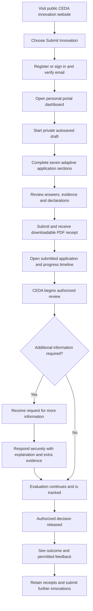
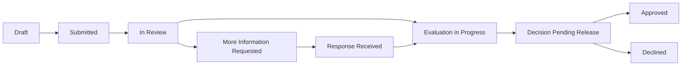
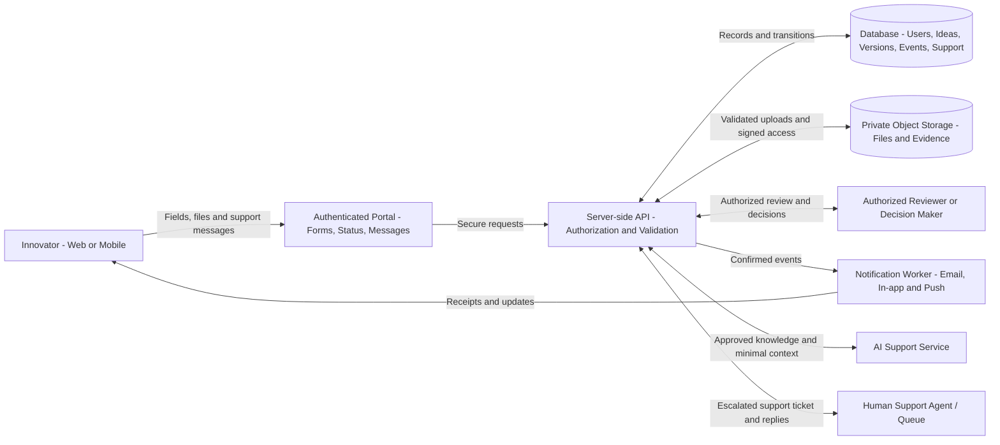

# CEDA INNOVATION PORTAL

**Innovator Journey, Application Forms, Data Flow and Screen Specifications**

Development-ready functional and UX specification \| Website + signed-in portal + mobile experience

| **Document metadata** | **Details**                                                                                                                           |
|-----------------------|---------------------------------------------------------------------------------------------------------------------------------------|
| Prepared for          | Autobots Dev \| CEDA Innovation Hackathon                                                                                             |
| Version               | 1.0 – Proposed design specification                                                                                                   |
| Date                  | 19 November 2026                                                                                                                      |
| Primary persona       | Innovator: individual or authorized representative of a registered company                                                            |
| Purpose               | Define the complete innovator experience from public discovery through assessment outcome, including AI and human support             |
| Boundary              | Innovation submission and assessment only. No loan origination, credit evaluation, funding disbursement or grant-management workflow. |

| **Decision status** The functionality below is an implementation proposal based on team discussion and CEDA hackathon materials. It is not a statement that CEDA currently uses these workflows. Legal notices, eligibility rules, branding assets and public impact figures require CEDA approval before production release. |
|-------------------------------------------------------------------------------------------------------------------------------------------------------------------------------------------------------------------------------------------------------------------------------------------------------------------------------|

## How to use this document

Designers can use the numbered screen inventory to produce wireframes and UI states. Frontend developers can implement navigation and validation from the screen contracts. Backend developers can implement the data flow, event behavior, permissions and acceptance criteria. The walkthrough defines the expected end-to-end experience.

# Contents

1\. Product boundary and core principles

2\. Public website versus signed-in innovator portal

3\. Innovator persona and complete real-world walkthrough

4\. User journey and navigation map

5\. Adaptive submission form: exact fields and uploads

6\. Submission proof, status changes and feedback

7\. AI assistant and human support workflow

8\. Screen-by-screen UX specification

9\. Modal, drawer, sidebar and notification behavior

10\. Data flow and logical data model

11\. Security, privacy and confidential information

12\. Mobile adaptation, accessibility and interruption recovery

13\. Acceptance criteria and build handoff

14\. Open configuration decisions and source alignment

# 1. Product boundary and core principles

The product has two connected but visually distinct surfaces: a public CEDA Innovation website visible without an account, and an authenticated Innovator Portal used to submit, manage and track confidential innovations. The mobile application exposes the signed-in innovator experience using the same backend.

- Allow individuals (including unregistered founders) and authorized registered-company representatives to submit at any innovation maturity level.

- Assess ideas and innovations; do not implement funding applications, lending forms, bank-account collection, loan balances, credit decisions or disbursements.

- Use structured fields for searchable facts and conditional document uploads for detailed evidence. No requirement to copy entire existing reports into text boxes.

- Preserve drafts automatically, record immutable submitted versions and generate independently verifiable submission receipts.

- Provide real status tracking, a secure application-specific conversation, controlled revision requests, and authorized feedback release.

- Offer contextual AI help with human escalation and saved support history, without exposing confidential submissions to an unrestricted model.

- Use verified public content and approved aggregate statistics only; confidential innovations are never listed on the public site by default.

| **Important distinction** An assessment marked “Approved” indicates a positive innovation assessment outcome only. It does not promise financing, a partnership, intellectual-property registration or a commercial contract. |
|-------------------------------------------------------------------------------------------------------------------------------------------------------------------------------------------------------------------------------|

# 2. Public website versus signed-in innovator portal

## 2.1 Public website (not logged in)

Goal: explain CEDA innovation services, establish trust and guide suitable visitors toward registration. This is a full public-facing website, not a login form with a hero banner.

| **Public area**                 | **Contents and behavior**                                                                                                                                                                                                               |
|---------------------------------|-----------------------------------------------------------------------------------------------------------------------------------------------------------------------------------------------------------------------------------------|
| Homepage                        | Hero with CEDA innovation proposition and Submit Innovation CTA; how-it-works overview; pathways for individuals and companies; sectors; security summary; verified impact statistics if available; frequently asked questions; footer. |
| About CEDA / Innovation         | Overview of CEDA and innovation initiative, purpose, who can apply, strategic context including Botswana Vision 2036 where approved; verified content managed by CEDA.                                                                  |
| How It Works                    | Illustrated 4–6-step process from account creation to final feedback, with explanation of applicant evidence and status tracking.                                                                                                       |
| Eligibility / Submission Guide  | Who may submit; idea through scaling stages; required versus conditional documents; file types and limits; how submitted information is safeguarded.                                                                                    |
| Innovation Sectors / Impact     | Supported sectors and CEDA-approved public aggregate metrics. Never display actual applicant innovations or sensitive files without explicit lawful publication approval.                                                               |
| FAQ / Help                      | Searchable FAQs, AI assistant, human support entry, contact details and technical help; no account required for general questions.                                                                                                      |
| Contact / Accessibility / Legal | Approved contact channels, privacy notice, terms, accessibility statement and report-an-issue option.                                                                                                                                   |
| Authentication entry            | Sign In and Create Account links. Submit Innovation routes unauthenticated visitors to sign-in / registration with intent preserved.                                                                                                    |

Public desktop header: CEDA logo \| Home \| About \| How It Works \| Eligibility \| Help \| Sign In \| Submit Innovation. Public mobile header: logo + menu drawer + visible Submit Innovation CTA. Public footer: approved contact, legal, accessibility and support links.

## 2.2 Transition into the innovator portal

> **1.** Visitor selects Submit Innovation. If unauthenticated, show Sign In / Create Account with return destination captured.
>
> **2.** Visitor registers with basic contact information and verifies email, or signs in using an existing account.
>
> **3.** On successful authentication, redirect to /portal/dashboard or an equivalent protected route; public marketing navigation is replaced by the personal portal shell.
>
> **4.** Portal displays the logged-in name, application counters, New Innovation Application CTA, notifications, messages, support and account controls.
>
> **5.** Visitors may return to the public website using a clearly labelled “View CEDA Website” link without losing their account session or draft.

| **UX boundary** The portal should feel like a dedicated product workspace, not another page of the marketing website. Reuse brand identity, but use a different navigation hierarchy and denser operational components. |
|-------------------------------------------------------------------------------------------------------------------------------------------------------------------------------------------------------------------------|

## 2.3 Signed-in portal navigation

| **Desktop sidebar** | **Primary purpose**                                                            |
|---------------------|--------------------------------------------------------------------------------|
| Dashboard           | Application counts, action required, recent activity, New Application CTA      |
| My Innovations      | Drafts and submitted innovation records, filtering and search                  |
| Messages            | Application-related secure conversations                                       |
| Notifications       | All alerts, read status, deep links                                            |
| Help & Support      | AI assistant, live/async human support, past support tickets, knowledge guides |
| Profile & Security  | Personal details, authentication and notification preferences                  |
| View CEDA Website   | Return to public information                                                   |
| Sign Out            | End session and clear authenticated client state                               |

Desktop portal top bar: current page title, optional contextual breadcrumbs, notification bell, support launcher and profile menu. Mobile portal: bottom navigation for Dashboard, Innovations, Messages, Notifications, and Profile; Help/AI remains one tap away via persistent assistive action or Help tab.

# 3. Innovator persona and complete real-world walkthrough

Illustrative persona: Naledi Motsumi, an individual innovator in Gaborone with two collaborators. Her idea, SmartFarm BW, is an agricultural sensor-and-software solution at the Prototype stage. All names and application reference numbers below are examples.

**01 \| Discover** Naledi searches for “CEDA innovations” and lands on the public homepage. She reads what the portal does, how innovation evaluation works, who may submit and the confidentiality summary. She selects Submit Innovation.

**02 \| Account creation** Because she is not signed in, she is taken to Create Account. She enters legal name, email, +267 phone number and password, accepts platform/privacy terms, and verifies her email. No Omang upload is demanded at account creation.

**03 \| First dashboard** She lands in her portal. The empty state shows zero innovations, a “Start New Application” button, a short step guide, recent alerts (none), and Help / Ask CEDA Assistant. She selects Start New Application.

**04 \| Private draft** The system creates a unique draft ID. The application wizard opens with seven named steps, a section progress indicator, Save status, Back, Continue and Save & Exit. Successful text changes are autosaved; uploaded documents are preserved after server confirmation.

**05 \| Applicant details** Naledi chooses Individual, confirms prefilled profile fields, selects Gaborone, enters her area of expertise, selects collaborators: Yes, and provides their names, responsibilities and contributions. Company fields are not shown.

**06 \| Innovation overview** She enters SmartFarm BW, selects Agriculture, adds Hardware and Software, chooses Prototype, enters a concise searchable summary, indicates the region and saves.

**07 \| Problem and originality** She explains water wastage and the sensor-assisted solution. She selects beneficiary categories and says there are existing products, then explains how hers differs. She says testing exists and gives a concise result summary. She uploads a test PDF, architecture PPTX and prototype image, each with its own title and note.

**08 \| Impact and strategy** She indicates farmers and agricultural businesses as beneficiaries, describes water conservation and job opportunities, then enters estimated jobs for years 1, 3 and 5 with assumptions. She does not claim these are already achieved.

**09 \| Feasibility and growth** Because her innovation is a prototype, she sees prototype-specific questions about what functions, test results, dependencies and next milestones. She uploads a business-plan PDF and an XLSX financial model instead of retyping every financial figure. She gives short, structured 1-, 3- and 5-year outlooks.

**10 \| Additional evidence** She provides a video demonstration URL rather than uploading a large video. She can add other relevant files within each section’s 4-file cap and include a description and password-protected-file indicator.

**11 \| Explain a field** Unsure what “scalability” means, she taps the field’s “?” helper. The CEDA Assistant opens as an in-context side panel and explains the question in plain language, using the approved guidance for the current step without accessing other applicants’ data.

**12 \| Human support** She asks for a human. The assistant presents Connect to Human Support. A live agent takes over in the same conversation if available; otherwise a ticket is created. Her application remains on the same step and retains saved data.

**13 \| Review and declarations** She answers plain-language authorship and consent questions. The review screen shows a summary of seven sections, attachments, missing requirements and Edit links. If identity verification is required by configured eligibility policy, it occurs at this protected pre-submission checkpoint.

**14 \| Final submit** She confirms the legal declarations and selects Submit Innovation. The system validates required data/files, atomically creates a locked submitted version, records a timestamp, and returns success only after backend confirmation.

**15 \| Proof of submission** A success page displays SmartFarm BW, applicant name, “Submitted”, timestamp and a unique reference such as CEDA-INN-2026-00142. She downloads a PDF acknowledgment containing the reference, receipt timestamp and attachment manifest. An email and in-app notification confirm receipt.

**16 \| Track** Her dashboard shows Total: 1 and Submitted: 1. My Innovations lists SmartFarm BW, and its detail screen has Overview, Submitted Answers, Documents, Progress Timeline, Messages and Feedback tabs. She cannot silently edit the locked version.

**17 \| Review begins** An authorized reviewer triggers Start Review. Backend authorization accepts the transition, records an event and updates Naledi’s status to In Review on web/mobile, with in-app and email notification.

**18 \| More information** The review team requests sensor calibration evidence. Naledi sees Additional Information Requested, opens the application-specific conversation, types an explanation and uploads a supplemental report. The extra upload is attached to the request, outside the initial four-file section cap.

**19 \| Evaluation and result** Naledi sees an accurate evaluation progress state, not private scores. Once an authorized decision is released, she gets an alert and sees Approved or Declined, with approved-for-release assessment feedback and any downloadable formal outcome notice.

**20 \| Ongoing use** She returns to search applications, create a second draft, view old receipts, revisit support messages, manage notification preferences and access the CEDA public site. Each application has independent status, files, messages and audit history.

# 4. User journey and navigation map

Figure 1. Innovator user-flow diagram with submission, follow-up and decision branches.

## 4.1 Important alternate flows

| **Situation**                   | **Expected behavior**                                                                                                                           |
|---------------------------------|-------------------------------------------------------------------------------------------------------------------------------------------------|
| Already has an account          | Sign in and resume any drafts. No duplicate account or duplicate application required.                                                          |
| Email not verified              | Show verification pending, resend with throttle and support link; cannot finalize submission until verification policy passes.                  |
| Connection lost mid-form        | Previously confirmed autosaved fields persist; user returns to the same step with last-save timestamp; unconfirmed changes are clearly flagged. |
| Upload interrupted              | Show Incomplete / Retry; never say Saved before storage acknowledgment; avoid duplicate file records on retry.                                  |
| Validation fails                | Highlight relevant field, preserve all inputs, show inline errors and link to incomplete sections.                                              |
| Two tabs editing same draft     | Warn of newer version / conflict; do not overwrite edits silently; use draft version checks.                                                    |
| Submission double-click / retry | Use idempotency keys; create one submitted version and one reference, not duplicates.                                                           |
| Support offline                 | Issue a ticket number, show expected contact channel and notify when an agent replies. Do not promise instant support.                          |
| Evaluator requests files        | Create scoped request with due date if configured, secure reply and extra evidence; do not unlock the original submission.                      |
| Outcome not yet released        | Display status and safe guidance; hide evaluator private notes, provisional scores and pending decisions.                                       |

# 5. Adaptive submission form: exact fields and uploads

Required means required by the proposed product design; it is not a newly announced CEDA legal requirement. Conditional fields appear only when applicant type, innovation stage or an earlier answer makes them relevant. Configuration should allow administrators to update approved questions and guidance without changing frontend code.

## 5.1 Registration versus application

| **At registration**                                                  | **Within application / later verification**                                                                           |
|----------------------------------------------------------------------|-----------------------------------------------------------------------------------------------------------------------|
| Full legal name; email; phone; password; consent; email verification | Individual/company identity and innovation-specific information                                                       |
| No salary, marital status, loan balance or bank statement            | Company evidence only if company chosen; Omang only if policy requires at a protected submission / verification stage |

## Step 1 – Applicant information

| **Field / question**                        | **Control**                                                           | **Need** | **Behavior / evidence**                                           |
|---------------------------------------------|-----------------------------------------------------------------------|----------|-------------------------------------------------------------------|
| Applicant type                              | Single-select chips: Individual / Registered company                  | Yes      | Determines all conditional fields                                 |
| Full name / email / phone                   | Prefilled text / email / phone (editable via profile where permitted) | Yes      | Persistent account record; capture submission snapshot            |
| District / region                           | Single-select dropdown                                                | Yes      | Botswana districts / location appropriate to applicant            |
| Experience or expertise                     | Short text + optional selectable disciplines                          | Yes      | Simple language and examples                                      |
| Working with others?                        | Yes / No                                                              | Yes      | If Yes: collaborator list                                         |
| Collaborator list                           | Repeatable name, role, contribution, contact optional                 | Cond.    | Individual path; explicit authorization / consent where necessary |
| Registered company name                     | Text                                                                  | Cond.    | Company path only                                                 |
| Company registration number                 | Text                                                                  | Cond.    | Company path only                                                 |
| Business sector and representative position | Dropdown + text                                                       | Cond.    | Company path only                                                 |
| Authority to submit                         | Checkbox / plain-language declaration                                 | Cond.    | Company representative confirms authority                         |
| Company registration certificate            | Document upload                                                       | Cond.    | Company path, as required by validated submission rules           |

## Step 2 – Innovation overview

| **Field / question**        | **Control**                            | **Need** | **Behavior / evidence**                                                                            |
|-----------------------------|----------------------------------------|----------|----------------------------------------------------------------------------------------------------|
| Innovation title            | Text (suggested 5–120 characters)      | Yes      | Unique title not required; prevent empty/gibberish entries                                         |
| Short summary               | Textarea (suggested 80–500 characters) | Yes      | Searchable overview, not full technical proposal                                                   |
| Primary sector              | Dropdown                               | Yes      | ICT, Agriculture, Health, Education, Energy, Manufacturing, Finance, Transport, Environment, Other |
| Secondary sectors           | Multi-select chips                     | Optional | Interdisciplinary innovation                                                                       |
| Innovation type             | Multi-select chips                     | Yes      | Software, Hardware, Product, Service, Process, Other                                               |
| Current stage               | Single-select chips                    | Yes      | Idea, R&D, Prototype, Pilot, Operational, Scaling                                                  |
| Technology / method         | Tags / short text                      | Yes      | Allow Not yet determined for idea stage                                                            |
| Intended region / geography | Dropdown + multi-select                | Yes      | Gaborone/district, Botswana, regional/international                                                |

## Step 3 – Problem, solution and originality

| **Field / question**             | **Control**                            | **Need**               | **Behavior / evidence**                                   |
|----------------------------------|----------------------------------------|------------------------|-----------------------------------------------------------|
| Problem being addressed          | Textarea (approx. 100–2000 chars)      | Yes                    | Describe context and importance                           |
| Who experiences the problem?     | Multi-select beneficiary chips + Other | Yes                    | Farmers, youth, businesses, students, patients, etc.      |
| How solution works / would work  | Textarea                               | Yes                    | Practical mechanism in applicant’s words                  |
| Existing alternatives?           | Yes / No / Unsure                      | Yes                    | Conditional follow-up                                     |
| What exists / what is different? | Textarea                               | Cond.                  | If Yes/Unsure, explain alternatives and differentiation   |
| Tested with users?               | Yes / No                               | Yes                    | If Yes: test type, participants, lessons                  |
| Section evidence                 | Up to 4 documents / images + notes     | Optional / conditional | Research, architecture, comparative study, testing photos |

## Step 4 – Impact and strategic alignment

| **Field / question**          | **Control**                                    | **Need** | **Behavior / evidence**                      |
|-------------------------------|------------------------------------------------|----------|----------------------------------------------|
| Who benefits?                 | Multi-select chips + explanation               | Yes      | Target beneficiaries                         |
| Benefit to Botswana           | Textarea                                       | Yes      | Economic, social or public-good value        |
| Expected deployment footprint | Dropdown / multi-select                        | Yes      | Local, national, regional, international     |
| Could create jobs?            | Yes / No / Unsure                              | Yes      | Show estimates when Yes                      |
| Jobs in 1, 3, 5 years         | Number inputs + assumptions notes              | Cond.    | Clearly labeled estimates, not verified jobs |
| Youth or women empowerment    | Yes / No / Unsure + explanation                | Yes      | Alignment dimension                          |
| Environmental impact          | Positive / Neutral / Negative / Unsure + notes | Yes      | Address potentially adverse effects          |
| Impact evidence               | Up to 4 files + descriptions                   | Optional | Surveys, letters, reports, studies           |

## Step 5 – Feasibility, stage and growth

| **Field / question**             | **Control**                       | **Need** | **Behavior / evidence**                               |
|----------------------------------|-----------------------------------|----------|-------------------------------------------------------|
| Implementation approach          | Textarea                          | Yes      | How it will be delivered                              |
| Resources / skills needed        | Multi-select + text               | Yes      | People, technology, infrastructure, equipment         |
| Main risks and mitigations       | Textarea                          | Yes      | Operational, technical, compliance                    |
| 1-, 3-, 5-year milestones        | Three short text areas            | Yes      | Milestones tailored to stage; estimates accepted      |
| Current stage evidence           | Conditional stage-specific fields | Cond.    | See stage matrix below                                |
| Business plan available?         | Yes / No; if Yes attach document  | Optional | PDF/DOCX/PPTX                                         |
| Financial projections available? | Yes / No; if Yes attach document  | Optional | PDF/PPTX/XLSX; typed financial model not mandatory    |
| Growth assumptions               | Short notes / textarea            | Yes      | Describe reasoning, not falsely precise forecasts     |
| Feasibility evidence             | Up to 4 files + descriptions      | Optional | Technical plan, feasibility study, projections, tests |

## Step 6 – Supporting evidence

| **Field / question**              | **Control**                                   | **Need**           | **Behavior / evidence**                                        |
|-----------------------------------|-----------------------------------------------|--------------------|----------------------------------------------------------------|
| Supplemental evidence per section | File library with section category            | Optional           | Max 4 original files per section; no duplicate upload required |
| Document title/category           | Text + dropdown for each file                 | Yes if file exists | Evaluation context                                             |
| Document explanation              | Textarea for each file                        | Optional           | What reviewer should look for                                  |
| Password protected?               | Yes / No per file                             | Yes if file exists | Never store plaintext password in normal notes                 |
| Access / unlock process           | Restricted guidance + separate secret channel | Cond.              | Only if file protected; do not bypass malware controls         |
| Demo video                        | HTTPS URL + title + notes                     | Optional           | External link only; warn on access / privacy settings          |
| Evidence mapping                  | One or more related sections                  | Optional           | Reference same file record in multiple areas                   |

## Step 7 – Ownership declarations and final review

| **Field / question**                | **Control**                                  | **Need** | **Behavior / evidence**                                          |
|-------------------------------------|----------------------------------------------|----------|------------------------------------------------------------------|
| Did you develop this yourself?      | Yes / No / Partly                            | Yes      | Plain language                                                   |
| Other contributors?                 | Yes / No + collaborator details              | Yes      | If Yes, show roles and permission confirmation                   |
| Permission to submit?               | Yes / No                                     | Yes      | Cannot submit if no permission                                   |
| Shared publicly before?             | Yes / No / Not sure                          | Yes      | Follow-up notes when Yes / Not sure                              |
| Existing agreements on use/sharing? | Yes / No / Not sure                          | Yes      | Optional secure evidence / explanation                           |
| Submission accuracy declaration     | Checkbox                                     | Yes      | Must affirm                                                      |
| Privacy and confidentiality notice  | Link + checkbox confirmation                 | Yes      | Explain access and legal limits; no false IP registration claims |
| Identity verification checkpoint    | Conditional Omang / other accepted method    | Cond.    | Only if configured and necessary; never in basic signup          |
| Review / final submit               | Read-only summary, Edit links, Submit button | Yes      | Server validation and locked snapshot                            |

## 5.2 Stage-dependent questions

| **Selected stage** | **Conditional questions / examples**                                    | **Evidence expectations**                                                      |
|--------------------|-------------------------------------------------------------------------|--------------------------------------------------------------------------------|
| Idea               | What would a first prototype prove? What assumptions need validation?   | Concept note optional; never demand revenue or completed tests.                |
| R&D                | What research has been done? Which findings support the concept?        | Research summary/report where available.                                       |
| Prototype          | What is built and functional? What testing has been completed?          | Demonstration, photos, technical notes or test report.                         |
| Pilot              | How many real users/locations? What feedback and measurable results?    | Pilot summary / customer feedback, where available.                            |
| Operational        | Actual customers/users, operations, jobs, income/costs where applicable | Actual evidence separated from forecast, with privacy-safe supporting reports. |
| Scaling            | Existing traction, capacity, new markets, resources and growth plan     | Growth plan and figures that the applicant can substantiate.                   |

## 5.3 File upload constraints and behavior

- Four original files per application section (server-enforced); each file has title, category, description/notes, original filename, size, MIME validation, upload time and storage status.

- Accepted initial formats: PDF, DOCX, PPTX, XLSX, JPG/JPEG and PNG. Proposed default maximum: 10 MB per file, configurable. Videos are HTTPS links, not direct uploads.

- Each completed upload uses private storage with authenticated access checks and confirms “Saved” only after the server has committed the file and metadata.

- Replace/remove before submission through version-aware actions. No silent overwriting; after submit, preserve original snapshot and attachments.

- Reviewer-requested supplemental files use a separate request-specific upload collection and do not consume the original 4-file quota.

- PDF/image previews may be browser-based with protected access. DOCX/PPTX/XLSX may offer secure download and optional server-side converted preview; never assume universal native preview.

- Password-protected files are visibly marked. Unlock secret must be shared in a separate tightly restricted channel; encrypted/protected files may not be malware-scannable or previewable until unlocked. Quarantine or reject if safe handling is unavailable.

- Video URLs should be validated and have clear permission guidance; unlisted links are not equivalent to private content; no sensitive data automatically forwarded to external video services.

# 6. Submission proof, status changes and feedback

## 6.1 Atomic final submission and receipt

> **1.** Client sends final-submit request with application draft ID, expected version and idempotency token.
>
> **2.** Backend verifies identity, ownership, declared consent, mandatory/conditional form completion, upload readiness and safe scan status.
>
> **3.** Backend commits a unique application reference, read-only submitted snapshot, submitted-at timestamp, attachment manifest, and status event as one consistent transaction (or an equivalent reliable workflow).
>
> **4.** Only after successful commit: display confirmation page and permit authenticated PDF receipt download. Generate notifications asynchronously using an event/outbox mechanism.
>
> **5.** Email and in-app notices carry the reference number and secure sign-in link, not confidential content or public-access files. Email failure must not undo a confirmed submission.

| **Receipt field**            | **Example / rule**                                                                          |
|------------------------------|---------------------------------------------------------------------------------------------|
| Receipt heading              | Innovation Submission Acknowledgment (not approval)                                         |
| Reference                    | CEDA-INN-2026-00142 (illustrative; unique generated code)                                   |
| Applicant                    | Naledi Motsumi; individual or company as represented at submission                          |
| Innovation                   | SmartFarm BW                                                                                |
| Timestamp                    | 19 November 2026, date/time shown in Africa/Gaborone plus stored UTC                        |
| Status                       | Submitted                                                                                   |
| Supporting evidence manifest | Names/types of files accepted at submission; avoid embedding confidential document contents |
| Receipt integrity            | Reference and immutable submission version identifier; optional verification code/checksum  |
| Disclaimers                  | Acknowledges receipt only; no promise of approval, funding or IP registration               |

## 6.2 Status model and applicant-facing meanings

Figure 2. Proposed status progression, including additional-information loop and final-release control.

| **Public status**                | **Triggered by**                             | **What innovator sees**                                                                            |
|----------------------------------|----------------------------------------------|----------------------------------------------------------------------------------------------------|
| Draft                            | Application created and not finalized        | Editable saved application and completion status                                                   |
| Submitted                        | Backend confirms final submit                | Receipt, reference, locked submitted version                                                       |
| In Review                        | Authorized reviewer explicitly starts review | Updated status / timestamp; safe notification                                                      |
| Evaluation in Progress           | Evaluation activity officially initiated     | Progress indication, not private scores or reviewer deliberation                                   |
| Additional Information Requested | Authorized reviewer sends formal request     | Secure request text, response action, due date if applicable                                       |
| Response Received                | Applicant submits requested response         | Confirmation and timeline event; further review resumes                                            |
| Decision Pending Release         | Internal decision prepared but not released  | Do not expose confidential result; applicant-facing display may continue as Evaluation in Progress |
| Approved / Declined              | Authorized decision-maker releases outcome   | Visible result, authorized feedback, outcome document if provided                                  |

All changes are backend-driven and written to an immutable event log with actor, time, previous state, new state and reason as applicable. An evaluator recommendation must not automatically expose a final approval.

## 6.3 Application detail tabs

- Overview — title, reference, category, stage, submission date, current status, next action.

- Submitted Answers — section-by-section read-only final application; later approved revisions are separate versions.

- Documents — grouped attachments, previews/downloads according to access, revision request evidence.

- Progress Timeline — accurate event history with time and safe actor label; no unreleased scoring.

- Messages — secure thread linked to this application, with reply and permitted attachments.

- Feedback / Outcome — final authorized feedback only, outcome letter if made available.

# 7. AI assistant and human support workflow

This support system is a committed product capability. It must work on public pages for general FAQs and inside the signed-in portal for contextual field-by-field assistance. The human handoff must be operational, not a mock chatbot.

## 7.1 AI behavior and boundaries

- The AI uses a controlled, versioned knowledge base containing approved portal navigation, field explanations, help text, submission rules, validation, file constraints, stages, status definitions and support procedures.

- Inside a form, context may include current screen, section ID, field ID, applicant type and innovation stage. It should not send the full proposal, documents, passwords or other innovators’ data to the model by default.

- Answers explain the question in plain language, give examples relevant to the applicant stage and refer to the actual configured validation rule; provide a “Show me this field” navigation action where safe.

- If user asks about their own status, use a server-authorized read endpoint. Never let the model infer or fabricate application decisions, evaluation scores, policy exceptions or deadlines.

- Clearly label AI responses as AI assistance, offer “Talk to a person” at all times, state uncertainty, and escalate when rules are missing or questions require human judgment.

- Log the necessary minimal support transcript with consent/retention controls; prohibit model training on confidential proposal content without an approved lawful basis.

## 7.2 Human escalation states

| **Step**          | **Naledi experience**                                                          | **Support-side behavior**                                                         |
|-------------------|--------------------------------------------------------------------------------|-----------------------------------------------------------------------------------|
| Ask               | Open Ask CEDA Assistant on current section; type “What does scalability mean?” | AI responds using field-specific approved help                                    |
| Escalate          | Tap “Connect to Human Support” or ask for an agent                             | Server creates support conversation/ticket with safe context and linked user      |
| Available agent   | In-chat notice “Connecting you”; agent name when accepted                      | Support queue routes request; authorized agent accepts and sees consented history |
| Agent unavailable | Ticket number and accurate offline/response guidance                           | Ticket queued; SLA/status configured; notification on reply                       |
| Live conversation | Same chat window; clear Human Support label; send and receive messages         | Agent replies in real time, optionally transfers/escalates                        |
| Return later      | Find transcript and ticket under Help & Support \> My Conversations            | Conversation persists with access control and audit                               |
| Resolve / reopen  | Read resolution; reopen within policy or create follow-up                      | Agent closes ticket and optionally collects satisfaction feedback                 |

## 7.3 Help entry points

Public site: floating “Ask CEDA Assistant” button plus FAQ / Help page. Form: “?” helper beside complicated fields, which opens assistant with field ID and draft help question. Portal shell: persistent Support icon and Help & Support navigation. Mobile: single support entry in header or bottom sheet; preserve the current form step on close.

# 8. Screen-by-screen UX specification

Each ID is a handoff identifier for wireframes, routing, API mapping and testing. A screen includes its key content, controls, navigation and edge cases. Modals and drawers are specified further in Section 9.

## 8.1 Public website screens

### PUB-01 Public Homepage

**Purpose:** Build understanding and direct visitors to submit

| **Area**                 | **Specification**                                                                                                                                                                          |
|--------------------------|--------------------------------------------------------------------------------------------------------------------------------------------------------------------------------------------|
| Layout / visible content | CEDA hero, innovation mission, How It Works steps, eligible applicant types, featured sectors, secure-submission overview, approved impact statistics (if verified), FAQs, CTA and footer. |
| Fields / controls        | Header links, Submit Innovation, Sign In, Ask Assistant, Browse sectors, FAQ expanders.                                                                                                    |
| Actions / navigation     | Submit → auth or dashboard; About / How It Works / Eligibility / Help routes.                                                                                                              |
| Modals / states / errors | Mobile hamburger drawer, pending navigation state, unavailable-stat fallback; never invent metrics.                                                                                        |

### PUB-02 About / CEDA Innovation

**Purpose:** Explain CEDA and purpose of innovation initiative

| **Area**                 | **Specification**                                                                                                              |
|--------------------------|--------------------------------------------------------------------------------------------------------------------------------|
| Layout / visible content | Approved organizational description, initiative goals, strategic alignment, role of innovation assessment, process boundaries. |
| Fields / controls        | Internal nav and Submit CTA.                                                                                                   |
| Actions / navigation     | Go to guide, submit, contact.                                                                                                  |
| Modals / states / errors | Content managed/approved; publication date or source where needed.                                                             |

### PUB-03 How It Works

**Purpose:** Explain stages before account creation

| **Area**                 | **Specification**                                                                                                            |
|--------------------------|------------------------------------------------------------------------------------------------------------------------------|
| Layout / visible content | Step narrative: register, draft, attach evidence, submit/receipt, evaluation, feedback and progress; sample status timeline. |
| Fields / controls        | Step sections, examples, Start Application.                                                                                  |
| Actions / navigation     | Register/sign in while preserving intent.                                                                                    |
| Modals / states / errors | No promises of guaranteed review timeframe or funding.                                                                       |

### PUB-04 Eligibility & Submission Guide

**Purpose:** Clarify individuals/companies and stage-based evidence

| **Area**                 | **Specification**                                                                                                                 |
|--------------------------|-----------------------------------------------------------------------------------------------------------------------------------|
| Layout / visible content | Applicant types, six stage definitions, required documents, 4-file/section policy, formats and video links, safeguarding summary. |
| Fields / controls        | Stage selector, expanders, FAQ links, Submit CTA.                                                                                 |
| Actions / navigation     | Go to auth; launch support.                                                                                                       |
| Modals / states / errors | Rules displayed from configurable policy, not hardcoded conflicting copy.                                                         |

### PUB-05 Sectors and Impact

**Purpose:** Explain relevant sectors and published outcomes

| **Area**                 | **Specification**                                                                                      |
|--------------------------|--------------------------------------------------------------------------------------------------------|
| Layout / visible content | Sector directory with descriptions; approved aggregate numbers only; explicit publication eligibility. |
| Fields / controls        | Category chips, search/filter.                                                                         |
| Actions / navigation     | Explore guide/submit.                                                                                  |
| Modals / states / errors | No confidential submission directory.                                                                  |

### PUB-06 FAQ & Public Help

**Purpose:** Answer pre-registration questions

| **Area**                 | **Specification**                                       |
|--------------------------|---------------------------------------------------------|
| Layout / visible content | Searchable FAQ groups, contact details and AI launcher. |
| Fields / controls        | Search, FAQ expanders, human support request.           |
| Actions / navigation     | Answer → reference article or support conversation.     |
| Modals / states / errors | Offline support ticket if unavailable.                  |

### PUB-07 Contact & Legal

**Purpose:** Contact, privacy and access information

| **Area**                 | **Specification**                                                                                          |
|--------------------------|------------------------------------------------------------------------------------------------------------|
| Layout / visible content | Approved support channels, office details as verified, privacy/terms, accessibility, general inquiry form. |
| Fields / controls        | Contact form, legal links.                                                                                 |
| Actions / navigation     | Submit inquiry; view policies.                                                                             |
| Modals / states / errors | Consent and spam protection.                                                                               |

## 8.2 Authentication and first-use screens

### AUTH-01 Sign In

**Purpose:** Enter the protected portal

| **Area**                 | **Specification**                                                                             |
|--------------------------|-----------------------------------------------------------------------------------------------|
| Layout / visible content | Brand header, email/password fields, Show password, Forgot password, Create Account.          |
| Fields / controls        | Email, password, submit, password reset link.                                                 |
| Actions / navigation     | Successful login → dashboard or preserved submit destination.                                 |
| Modals / states / errors | Invalid credentials (non-disclosing), loading, locked/limited attempts, verification pending. |

### AUTH-02 Create Account

**Purpose:** Create an innovator identity

| **Area**                 | **Specification**                                                              |
|--------------------------|--------------------------------------------------------------------------------|
| Layout / visible content | Full name, email, +267 mobile, password/confirm, privacy and terms checkboxes. |
| Fields / controls        | Validated text/password fields and Create Account.                             |
| Actions / navigation     | On submit → verify email.                                                      |
| Modals / states / errors | Duplicate email handled without account enumeration; inline password rules.    |

### AUTH-03 Verify Email

**Purpose:** Confirm ownership of registration email

| **Area**                 | **Specification**                                                                           |
|--------------------------|---------------------------------------------------------------------------------------------|
| Layout / visible content | Instructions and masked email, code or verification-link handling, resend control, support. |
| Fields / controls        | Verify, Resend, Change Email.                                                               |
| Actions / navigation     | Verified → dashboard / pending destination.                                                 |
| Modals / states / errors | Expired token, incorrect code, cooldown, reconnect.                                         |

### AUTH-04 Forgot / Reset Password

**Purpose:** Recover authenticated access securely

| **Area**                 | **Specification**                                                      |
|--------------------------|------------------------------------------------------------------------|
| Layout / visible content | Email request, safe acknowledgment, reset-token flow and new password. |
| Fields / controls        | Request link, new password, confirm, Back to Login.                    |
| Actions / navigation     | Valid reset → login.                                                   |
| Modals / states / errors | Expired/used token; no disclosure of account existence.                |

### AUTH-05 First-Time Dashboard Empty State

**Purpose:** Start a first private application

| **Area**                 | **Specification**                                                                                         |
|--------------------------|-----------------------------------------------------------------------------------------------------------|
| Layout / visible content | Greeting, zero counters, New Application, quick process overview, news/alerts if approved, support entry. |
| Fields / controls        | Start Application, Guide, AI.                                                                             |
| Actions / navigation     | Start → APP-01; guide → PUB-04/help.                                                                      |
| Modals / states / errors | Skeleton loading, incomplete onboarding, error retry.                                                     |

## 8.3 Application wizard screens

### APP-01 Application Start / Applicant Type

**Purpose:** Start a recoverable private draft

| **Area**                 | **Specification**                                                                                                                   |
|--------------------------|-------------------------------------------------------------------------------------------------------------------------------------|
| Layout / visible content | Wizard header 1/7, applicant type chips, prefilled identity, individual/company dynamic form, collaborators list or company fields. |
| Fields / controls        | Text/dropdowns, Yes/No chips, Add Team Member, upload company certificate as conditional, Continue, Save & Exit.                    |
| Actions / navigation     | Continue → APP-02; Save & Exit → Drafts; Back to Dashboard.                                                                         |
| Modals / states / errors | Discard draft confirm; company conditional fields; unsaved indicator; eligibility hint.                                             |

### APP-02 Innovation Overview

**Purpose:** Capture the searchable innovation record

| **Area**                 | **Specification**                                                                                          |
|--------------------------|------------------------------------------------------------------------------------------------------------|
| Layout / visible content | Title, summary, sector, secondary sectors, type, stage selector, district/geography and technology/method. |
| Fields / controls        | Text/textarea, dropdowns, chips, field “?” helpers.                                                        |
| Actions / navigation     | Continue → APP-03; Back; autosave.                                                                         |
| Modals / states / errors | Other sector text appears conditionally; stage-change confirmation if prior stage-specific answers exist.  |

### APP-03 Problem & Solution

**Purpose:** Understand need, mechanism and originality

| **Area**                 | **Specification**                                                                                           |
|--------------------------|-------------------------------------------------------------------------------------------------------------|
| Layout / visible content | Problem, target users, solution, existing alternatives, differentiation, user testing and evidence section. |
| Fields / controls        | Long text, Yes/No/Unsure, add file(s), per-file notes, protected file toggle.                               |
| Actions / navigation     | Continue → APP-04; file view/remove/replace pre-submit.                                                     |
| Modals / states / errors | Four-file cap; validation; incomplete file; trusted upload scanner.                                         |

### APP-04 Impact & Alignment

**Purpose:** Capture projected benefits and criteria

| **Area**                 | **Specification**                                                                                                                            |
|--------------------------|----------------------------------------------------------------------------------------------------------------------------------------------|
| Layout / visible content | Beneficiary chips, Botswana impact, geography, jobs Yes/No/Unsure, estimates with assumptions, youth/women/environment answers and evidence. |
| Fields / controls        | Multi-select, year 1/3/5 numeric fields, text, uploads.                                                                                      |
| Actions / navigation     | Continue → APP-05; autosave.                                                                                                                 |
| Modals / states / errors | If jobs No/Unsure hide numeric estimates; show negative environmental impact explanation.                                                    |

### APP-05 Feasibility & Growth

**Purpose:** Collect stage-relevant feasibility and forecasts

| **Area**                 | **Specification**                                                                                                                                    |
|--------------------------|------------------------------------------------------------------------------------------------------------------------------------------------------|
| Layout / visible content | Stage-specific panels for Idea / R&D / Prototype / Pilot / Operational / Scaling; implementation, resources, risks, milestones, documents and notes. |
| Fields / controls        | Conditional text/number, plan Yes/No, projection Yes/No, PDF/PPTX/XLSX upload.                                                                       |
| Actions / navigation     | Continue → APP-06; per-field AI help.                                                                                                                |
| Modals / states / errors | Clear actual-versus-estimated labels; preserve hidden prior answers safely if stage changes.                                                         |

### APP-06 Supplementary Evidence

**Purpose:** Organize files and video references

| **Area**                 | **Specification**                                                                                                                      |
|--------------------------|----------------------------------------------------------------------------------------------------------------------------------------|
| Layout / visible content | Evidence collection grouped by section, file title/category/description, protected indicator, external video link(s), scanning status. |
| Fields / controls        | Add/replace/remove file pre-submit, attach notes, add video URL, preview/download.                                                     |
| Actions / navigation     | Continue → APP-07; cross-link file to another section.                                                                                 |
| Modals / states / errors | Four original files per section, upload resumed/retry, invalid format, suspicious files quarantined.                                   |

### APP-07 Declarations & Review

**Purpose:** Inspect entire application and submit once

| **Area**                 | **Specification**                                                                                                                                |
|--------------------------|--------------------------------------------------------------------------------------------------------------------------------------------------|
| Layout / visible content | Section checklist and jump-to-edit, saved file manifest, authorship questions, privacy/IP notice, conditional identity checkpoint, final submit. |
| Fields / controls        | Yes/No/Partly, checkboxes, Edit Section, Submit Innovation.                                                                                      |
| Actions / navigation     | Submit → confirmation; Back → correct issue.                                                                                                     |
| Modals / states / errors | Incomplete section modal/inline errors; double-submit prevention; server-side revalidation.                                                      |

### APP-08 Submission Success + Receipt

**Purpose:** Give dependable proof of receipt

| **Area**                 | **Specification**                                                                                                                         |
|--------------------------|-------------------------------------------------------------------------------------------------------------------------------------------|
| Layout / visible content | Success heading, reference ID, applicant/innovation, submission timestamp, Submitted status, receipt download, email confirmation notice. |
| Fields / controls        | Download Receipt PDF, View Application, Back to Dashboard.                                                                                |
| Actions / navigation     | To PORT-03 or dashboard.                                                                                                                  |
| Modals / states / errors | If email delayed show submission is still valid; receipt generation retry via portal.                                                     |

## 8.4 Portal operations after submission

### PORT-01 Dashboard

**Purpose:** Give action-oriented overview

| **Area**                 | **Specification**                                                                                                                           |
|--------------------------|---------------------------------------------------------------------------------------------------------------------------------------------|
| Layout / visible content | Applicant name, total/draft/submitted/review/completed counts, action-required list, recent applications, recent notifications, create CTA. |
| Fields / controls        | Create, application cards, notification drill-down, Help.                                                                                   |
| Actions / navigation     | Open My Innovations / application detail / support.                                                                                         |
| Modals / states / errors | No-stat skeletons, empty state, error retry, privacy-safe counts.                                                                           |

### PORT-02 My Innovations

**Purpose:** Find and manage multiple ideas

| **Area**                 | **Specification**                                                                                                |
|--------------------------|------------------------------------------------------------------------------------------------------------------|
| Layout / visible content | List/table/card views, title, reference, sector, stage, date, status, last activity, drafts, search and filters. |
| Fields / controls        | Search, status/sector/stage chips, sort, New Application, Resume Draft.                                          |
| Actions / navigation     | Draft → wizard saved step; submitted → PORT-03.                                                                  |
| Modals / states / errors | No matches, pagination, access checks.                                                                           |

### PORT-03 Application Detail — Overview

**Purpose:** Show submitted record and next action

| **Area**                 | **Specification**                                                                                               |
|--------------------------|-----------------------------------------------------------------------------------------------------------------|
| Layout / visible content | Header with reference/status; tabs: Overview, Answers, Files, Timeline, Messages, Feedback; next-action banner. |
| Fields / controls        | Tab switching, Download Receipt, action buttons as permitted.                                                   |
| Actions / navigation     | Navigates to PORT-04 through PORT-08.                                                                           |
| Modals / states / errors | No edit of submitted snapshot; authorization on every tab.                                                      |

### PORT-04 Submitted Answers

**Purpose:** Read submitted application exactly as received

| **Area**                 | **Specification**                                                               |
|--------------------------|---------------------------------------------------------------------------------|
| Layout / visible content | Seven read-only form sections with submission-version identifier and timestamp. |
| Fields / controls        | Expand/collapse sections, Download Receipt.                                     |
| Actions / navigation     | Back to Overview; view supporting evidence.                                     |
| Modals / states / errors | Future requested updates shown as separately identified amendments.             |

### PORT-05 Documents & Evidence

**Purpose:** View submitted file manifest and supplemental evidence

| **Area**                 | **Specification**                                                                                                            |
|--------------------------|------------------------------------------------------------------------------------------------------------------------------|
| Layout / visible content | Files grouped by original sections, version, description, protected indicator, virus/safety state, preview/download actions. |
| Fields / controls        | Open preview, download, see file notes.                                                                                      |
| Actions / navigation     | Access via short-lived authorized file delivery.                                                                             |
| Modals / states / errors | Access denied, no preview for protected file, expired link reissue.                                                          |

### PORT-06 Progress Timeline

**Purpose:** Give transparency without leaking internal evaluation

| **Area**                 | **Specification**                                                                                             |
|--------------------------|---------------------------------------------------------------------------------------------------------------|
| Layout / visible content | Timeline with draft created, submitted, review started, requests, responses, evaluation and released outcome. |
| Fields / controls        | Timeline event expansion.                                                                                     |
| Actions / navigation     | Follow event link to message or receipt.                                                                      |
| Modals / states / errors | Show only releasable events, correct timezone/date.                                                           |

### PORT-07 Application Messages & Requests

**Purpose:** Respond safely to CEDA follow-up

| **Area**                 | **Specification**                                                                                                                    |
|--------------------------|--------------------------------------------------------------------------------------------------------------------------------------|
| Layout / visible content | Application-specific thread, request cards, due date when configured, message input, additional upload section and seen/sent states. |
| Fields / controls        | Reply, attach evidence to request, submit response.                                                                                  |
| Actions / navigation     | Response → review resumes; event and notification recorded.                                                                          |
| Modals / states / errors | Chat is not general support; disabled new messages if policy disallows after closure.                                                |

### PORT-08 Feedback & Final Outcome

**Purpose:** Explain released decision

| **Area**                 | **Specification**                                                                                                                         |
|--------------------------|-------------------------------------------------------------------------------------------------------------------------------------------|
| Layout / visible content | Approved/Declined outcome only after authorization; structured released comments, summary, recommendations, optional official PDF letter. |
| Fields / controls        | View details, download letter, ask permitted clarification.                                                                               |
| Actions / navigation     | Return to app overview or messages.                                                                                                       |
| Modals / states / errors | Pre-release empty state, no raw private evaluator notes.                                                                                  |

### PORT-09 Notifications Center

**Purpose:** See updates across applications

| **Area**                 | **Specification**                                                                                 |
|--------------------------|---------------------------------------------------------------------------------------------------|
| Layout / visible content | Unread count, list with type, reference, timestamp, concise safe preview, read/archive state.     |
| Fields / controls        | Mark read, filter, open link, preferences.                                                        |
| Actions / navigation     | Deep-link to app or support ticket after auth.                                                    |
| Modals / states / errors | Email/push cannot be treated as sole record; never expose confidential documents in notification. |

### PORT-10 Profile, Security & Preferences

**Purpose:** Manage identity and delivery channels

| **Area**                 | **Specification**                                                                                                 |
|--------------------------|-------------------------------------------------------------------------------------------------------------------|
| Layout / visible content | Profile contact, verified email, phone, password change, sign-out sessions where supported, notification choices. |
| Fields / controls        | Edit permitted contact fields, verify changes, change password, logout.                                           |
| Actions / navigation     | Return to dashboard.                                                                                              |
| Modals / states / errors | Audit sensitive changes; prior submitted application snapshot retained.                                           |

## 8.5 AI and human support screens

### SUP-01 AI Chat Panel / Mobile Sheet

**Purpose:** Explain current page or field without leaving work

| **Area**                 | **Specification**                                                                                                                                     |
|--------------------------|-------------------------------------------------------------------------------------------------------------------------------------------------------|
| Layout / visible content | Assistant title and AI label, chat history, suggested prompts, current field context label, responses with approved help reference, Connect to Human. |
| Fields / controls        | Ask, suggested question, follow link to field, minimize/close, escalate.                                                                              |
| Actions / navigation     | Stay on current route; if escalate → SUP-02.                                                                                                          |
| Modals / states / errors | No answer / uncertainty → human; no confidential documents passed automatically.                                                                      |

### SUP-02 Escalation Confirmation

**Purpose:** Move conversation to staff assistance

| **Area**                 | **Specification**                                                                                           |
|--------------------------|-------------------------------------------------------------------------------------------------------------|
| Layout / visible content | Summary of question and minimal shared context; disclosure of what will be shared; live availability state. |
| Fields / controls        | Connect Now, Create Ticket, Cancel.                                                                         |
| Actions / navigation     | If agent online → SUP-03; else SUP-04.                                                                      |
| Modals / states / errors | Explicit informed handoff; urgent safety/security concerns can follow dedicated support routing.            |

### SUP-03 Live Human Chat

**Purpose:** Provide interactive agent replies

| **Area**                 | **Specification**                                                                                                   |
|--------------------------|---------------------------------------------------------------------------------------------------------------------|
| Layout / visible content | Clearly named human representative, live chat thread, conversation header, delivery timestamps and end chat action. |
| Fields / controls        | Send message, attach allowed support evidence, end conversation.                                                    |
| Actions / navigation     | Return to current form; transcript saved.                                                                           |
| Modals / states / errors | Agent unavailable / disconnect → safe queueing and notification.                                                    |

### SUP-04 Support Ticket / Queue Status

**Purpose:** Support when live staff unavailable

| **Area**                 | **Specification**                                                                                               |
|--------------------------|-----------------------------------------------------------------------------------------------------------------|
| Layout / visible content | Ticket reference, request summary, waiting/active/resolved state, reply notification and response instructions. |
| Fields / controls        | Reply, view conversation, close/reopen when permitted.                                                          |
| Actions / navigation     | Open My Conversations or portal page.                                                                           |
| Modals / states / errors | No false human-online promise; scheduled SLA only when configured.                                              |

### SUP-05 Help & Support Hub

**Purpose:** One place for help resources

| **Area**                 | **Specification**                                                                    |
|--------------------------|--------------------------------------------------------------------------------------|
| Layout / visible content | Searchable guides, popular questions, Ask Assistant, Talk to Human, support history. |
| Fields / controls        | Search, help topic, start chat, view ticket.                                         |
| Actions / navigation     | Open SUP-01 or SUP-06.                                                               |
| Modals / states / errors | Support can be used even without an active application.                              |

### SUP-06 My Support Conversations

**Purpose:** Restore prior interactions

| **Area**                 | **Specification**                                                                  |
|--------------------------|------------------------------------------------------------------------------------|
| Layout / visible content | Conversations list with AI/human labels, ticket status, last reply, dates, search. |
| Fields / controls        | Open conversation, reply where permitted.                                          |
| Actions / navigation     | To existing ticket.                                                                |
| Modals / states / errors | Retention/privacy rules and access restrictions apply.                             |

# 9. Modal, drawer, sidebar and notification behavior

| **Component**                            | **When / trigger**                           | **Expected interaction**                                                                           |
|------------------------------------------|----------------------------------------------|----------------------------------------------------------------------------------------------------|
| Public mobile menu drawer                | Hamburger from public header                 | Shows full public nav and Submit CTA; close on route change / Escape.                              |
| Portal desktop sidebar                   | Signed-in desktop app                        | Stable app navigation, active state, collapsible if needed; Help entry visible.                    |
| Portal mobile bottom navigation          | Signed-in mobile app                         | Five frequent destinations; support launcher available without obscuring primary CTA.              |
| AI chat side panel / mobile bottom sheet | Help icon or persistent Ask Assistant button | Opens over the current screen, not destructive; preserves focus and draft state; can minimize.     |
| File upload details modal                | After selecting a file                       | Title, category, description, protected toggle, Save; upload pending/saved/error states.           |
| Secure document preview dialog           | Preview action                               | Access-check + expiring delivery; PDF/image preview and safe download; no unsafe 3rd-party editor. |
| Replace/remove attachment confirmation   | User edits pre-submission file               | Shows change and retention impact; permits undo where practical; never alters locked version.      |
| Save & Exit confirmation                 | Wizard exit if local unsaved changes         | Confirm last sync and draft preservation; warn if upload incomplete.                               |
| Stage change confirmation                | Changing stage after stage-specific answers  | Explains changed questions and retains history; prevents accidental loss.                          |
| Final submission confirmation            | Click Submit Innovation                      | Summarizes consequences: locked official submission and no edit except requested revisions.        |
| Submission success screen                | Backend commits submission                   | Reference number, timestamp, Download Receipt, View Application, dashboard link.                   |
| Support escalation dialog                | Request human from AI                        | Informs user what minimal context will be shared; options to connect or queue ticket.              |
| Notification bell dropdown               | Portal header bell                           | Latest alerts, unread count, Mark Read, View All; accessible keyboard behavior.                    |
| Session expiration dialog                | Session is expiring or expired               | Safely preserve local unsent input where possible, require reauthentication before writes.         |
| Help / tooltip beside field              | Tap/click “?”                                | Short plain-language definition, example, Ask Assistant action.                                    |

# 10. Data flow and logical data model

## 10.1 Context and security boundary

The innovator operates via web or mobile. All confidential reads/writes pass through authenticated server-side authorization checks. No direct public link grants access to an innovation solely because its reference number is known. Background jobs deliver notifications; support AI sees approved help information and minimal context only.

Figure 3. Logical data-flow diagram; arrows indicate approved service exchanges, not direct database access from the client.

## 10.2 Stepwise data flow

| **Event**         | **What enters / leaves**                                           | **Persistent records / checks**                                                                  |
|-------------------|--------------------------------------------------------------------|--------------------------------------------------------------------------------------------------|
| Create account    | Name/email/phone and authentication credential; verification event | Auth identity, profile, consent version; rate limiting and verified email.                       |
| Start draft       | New application request                                            | Draft ownership record, initial version, timestamps.                                             |
| Save a form field | Section field data + draft version                                 | Validated structured answers; ownership check; idempotent version update.                        |
| Upload file       | Binary to private storage after validation, then metadata + notes  | Scan/safety status, upload state, owner, section, draft version, content hash; no public bucket. |
| Submit            | Final form snapshot + attachment references + declarations         | Authoritative submitted version, reference, event log and receipt; transaction-safe.             |
| Notify            | Backend event → notification service → email/in-app/push           | Outbox job, delivery attempts, preference and status; no confidential content.                   |
| Track             | Authorized GET current status, events and safe feedback            | Access-checked views per role and release flag.                                                  |
| Request evidence  | Authorized request and linked thread                               | Request metadata, due date if any, applicant-visible message and audit.                          |
| Respond           | Text + supplemental file IDs                                       | Immutable response entry, request-specific evidence, event and notification.                     |
| AI help           | Question, field ID and approved context                            | Knowledge retrieval, bounded tool calls, redacted support logs.                                  |
| Human support     | Escalation + approved support history                              | Ticket, assignment, messages, resolution and timestamps.                                         |
| Release outcome   | Authorized decision-release action                                 | Published outcome flag, allowed feedback, timestamp and notification.                            |

## 10.3 Logical entities required

| **Entity / store**                               | **Essential purpose**                                                                                 |
|--------------------------------------------------|-------------------------------------------------------------------------------------------------------|
| users / profiles                                 | Account identity and safe contact data; independent of immutable submitted applicant snapshot.        |
| applicant_organizations / team_members           | Registered company information, authorized representatives, collaborator contributions.               |
| innovations / applications                       | Owner, type, sector, stage, current state and timestamps.                                             |
| application_answers / field_definitions          | Structured inputs, conditional question metadata and schema version.                                  |
| application_versions                             | Saved drafts and immutable submitted snapshot; prevent silent modification.                           |
| files / file_section_links                       | Private storage key, document notes, section association, safe status and original version.           |
| video_links                                      | External HTTPS URL, title, notes and consent/privacy warning acknowledgment.                          |
| review_requests / responses                      | Official further-information requests, linked responses and supplemental files.                       |
| status_events / audit_events                     | Actor, action, reason, from/to state, time and version for traceability.                              |
| evaluation_assignments / evaluations / decisions | Reviewer access and resulting decisions; applicant reads only released subset.                        |
| conversations / messages                         | Application-specific secure correspondence, separate from support tickets.                            |
| support_tickets / support_messages               | AI-to-human handoff, queue/agent assignment, resolution and history.                                  |
| knowledge_articles / field_help                  | Approved AI/help knowledge, versioned instructions and article status.                                |
| notification_events / deliveries                 | In-app alerts, email/push deliveries, retries and read state.                                         |
| receipts                                         | Immutable reference/version manifest and PDF receipt artifact or reproducible server-side generation. |

# 11. Security, privacy and confidential information

## 11.1 Security expectations

- Encrypt data in transit (TLS) and at rest; use server-side credential management and do not commit secrets to code or mobile bundles.

- Enforce least privilege with role-based access plus per-application assignment/ownership checks and database Row Level Security where applicable.

- Never expose sensitive draft contents, evaluation results or uploaded files via public search, public buckets, predictable URLs or application references.

- Use private file storage with short-lived access tokens, authorized previews/downloads, virus scanning and MIME/content validation; limit file types and sizes.

- Protect from XSS/SQL injection/CSRF as applicable; validate all user-provided text and links; rate-limit auth, assistant, tickets, upload and export endpoints.

- Use purpose-limited access for support agents; AI must not have broad database credentials or arbitrary database querying.

- Protect submission integrity with immutable versions, append-only audit events, controlled reviewer actions and an idempotent submit endpoint.

- Provide clear privacy notice, retention and deletion rules, support transcript governance, secure backups and operational monitoring.

- Ensure all emails/push notifications are brief and do not contain confidential attachments, detailed proposal contents, passwords or file access secrets.

- Use clear security incident and authorized access review processes; avoid promising absolute secrecy or intellectual-property rights that the platform cannot legally create.

## 11.2 Ownership wording for non-specialists

Ask: “Did you create this innovation yourself?”, “Did others help?”, “Do you have permission to submit?”, “Have you shared it publicly?”, and “Are there agreements about who may use or share it?” Do not require formal IP registration. Display an understandable notice explaining who may view submissions and for what assessment purpose; legal text must be approved by CEDA.

## 11.3 Data minimization for identity

Omang verification is intentionally not part of initial account creation. Enable it only when validated CEDA eligibility/verification policy requires identity assurance. Collect the minimum necessary fields, show purpose/consent, restrict storage/access and do not assume automated document OCR or external identity verification exists.

# 12. Mobile adaptation, accessibility and interruption recovery

## 12.1 Responsive experience

| **Feature**            | **Desktop web**                                        | **Mobile app**                                                                |
|------------------------|--------------------------------------------------------|-------------------------------------------------------------------------------|
| Public marketing pages | Full top navigation, content sections                  | If implemented as web: responsive menu; native app may link to public website |
| Portal navigation      | Permanent or collapsible left sidebar + top bar        | Bottom navigation / compact header; Help action always reachable              |
| Seven-step wizard      | Side stepper or top progress and wide form             | One-column sections, sticky progress and bottom action bar                    |
| Document uploads       | Drag/drop + file picker + status chips                 | Native picker/photos + progress/retry + notes screen                          |
| Application status     | Timeline/tabs visible side-by-side where space permits | Stacked cards and scrollable tabs                                             |
| AI assistance          | Right-side drawer that keeps form visible              | Full-height sheet or dedicated chat screen with return-to-form                |
| Human chat             | Same conversation drawer, explicit agent identity      | Native real-time chat, keyboard-aware composer                                |
| Receipt                | Download/Open PDF                                      | Open/share/save receipt using native document handling                        |

## 12.2 Accessibility and quality

- All inputs have persistent visible labels, help text and accessible error messages; do not depend solely on placeholder text.

- Use keyboard focus order, readable contrast, screen-reader announcements, accessible dialog focus trapping and meaningful button labels.

- Provide validation messages next to fields; keep previously completed sections even if a network error occurs.

- Upload progress must show Pending / Uploading / Scanning / Saved / Failed; enable retry on failure and preserve confirmed uploads.

- Show last saved time plus optimistic typing indicators, but never mark server-unsaved changes as Saved.

- Use timezone-consistent displayed timestamps; the database stores UTC with Botswana local time shown where relevant.

- Handle large text, slow internet, background/foreground app transitions and expired sessions without silent data loss.

# 13. Acceptance criteria and build handoff

The following tests constitute a functional baseline for the innovator-facing scope. A designer can map each scenario to screen frames; developers can map it to UI components and API tests.

| **ID** | **Verifiable acceptance behavior**                                                                                  |
|--------|---------------------------------------------------------------------------------------------------------------------|
| AC-01  | Unauthenticated visitor can browse public home, About, How It Works, Guide and Help without creating an account.    |
| AC-02  | Submit Innovation preserves destination and routes unauthenticated visitor to sign-up/sign-in.                      |
| AC-03  | Verified account signs in to distinct protected innovator dashboard shell.                                          |
| AC-04  | Individual applicant sees individual fields, not company registration fields.                                       |
| AC-05  | Company applicant sees company and representative fields and authorization declaration.                             |
| AC-06  | Changing stage displays correct conditional questions without silent loss of previously entered information.        |
| AC-07  | Every section autosaves validated fields and resumes from last confirmed progress after logout/reconnect.           |
| AC-08  | A successfully uploaded file is stored privately and marked Saved only after confirmed backend completion.          |
| AC-09  | No more than 4 original files are accepted per section; reviewer-request supplemental uploads use separate quota.   |
| AC-10  | Accepted documents include PDF/DOCX/PPTX/XLSX/JPG/JPEG/PNG; rejected formats show actionable errors.                |
| AC-11  | Demo videos accept valid URLs only; platform does not store raw video binaries.                                     |
| AC-12  | Each file supports metadata, notes and protected indicator; plaintext unlock secret never appears in general notes. |
| AC-13  | Applicant can replace a draft attachment; submitted evidence is immutable and versioned.                            |
| AC-14  | Applicant can submit at Idea stage without prototype, revenue or formal IP registration.                            |
| AC-15  | Financial projections can be uploaded as spreadsheet/presentation rather than retyped in full.                      |
| AC-16  | Final review flags missing fields/unsafe uploads and links to correction without clearing saved data.               |
| AC-17  | Final submission creates exactly one authoritative reference and immutable snapshot after retries/double-clicks.    |
| AC-18  | Success page and PDF receipt show reference, title, applicant, timestamp and receipt-not-approval disclaimer.       |
| AC-19  | Email/in-app confirmation is queued; email delivery failure does not reverse recorded submission.                   |
| AC-20  | Dashboard and My Innovations immediately list the submitted record and accurate status.                             |
| AC-21  | Selecting Start Review by authorized staff changes applicant-visible status to In Review.                           |
| AC-22  | No user can view another applicant’s private idea by guessing a reference or file URL.                              |
| AC-23  | An official information request appears in an application-specific conversation with a response upload option.      |
| AC-24  | Response and supplemental files are linked to the request and preserve submitted baseline.                          |
| AC-25  | Approved/Declined remains hidden until authorized decision release; released feedback is visible afterward.         |
| AC-26  | Notification bell, notification center, email and mobile alert open correct authenticated record.                   |
| AC-27  | Contextual “?” help explains an exact form field using approved knowledge and current stage.                        |
| AC-28  | User can ask AI for human support; real agent sees queued request and can reply in the same logical thread.         |
| AC-29  | If no agent is available, user gets a support ticket reference and can later see the reply.                         |
| AC-30  | AI/support access follows least privilege and does not expose confidential documents automatically.                 |
| AC-31  | Mobile and web show same applications/statuses from same backend and allow draft continuation.                      |
| AC-32  | All dialog/sidebar controls support mobile layouts and appropriate keyboard/screen reader behavior.                 |

## 13.1 Handoff checklist

- Design: public homepage, about/guide/help, auth, portal shell, all seven wizard steps with individual/company and stage variants, success receipt, application tabs, notifications, AI-human chat and mobile states.

- Backend: identity/profile, schema-driven form definition, safe autosave/versioning, file pipeline, final-submit transaction, receipt generation, status transitions, message/request threads, AI help retrieval, agent queue and notification event delivery.

- QA: seed two demo applicants (individual prototype and company early-stage), reviewer, decision maker and human support agent; demonstrate complete real-time end-to-end flow without bypassing security.

# 14. Open configuration decisions and source alignment

The following implementation settings should remain configurable pending agreement or approval. This section records boundaries transparently rather than inventing official CEDA policy.

| **Setting**                           | **Recommended design / status**                                                                       |
|---------------------------------------|-------------------------------------------------------------------------------------------------------|
| Omang validation                      | At protected pre-submission/eligibility checkpoint only if CEDA requires it; not basic registration.  |
| Eligibility beyond individual/company | Use CEDA-approved legal rules; do not infer from loan application checklists.                         |
| File limits                           | Team working decision: max 4 original files per section; suggested 10 MB each, configurable.          |
| Supported formats                     | PDF, DOCX, PPTX, XLSX, JPG/JPEG, PNG; video hyperlinks only.                                          |
| Stage definitions                     | Proposed six categories; editable labels/help content after policy review.                            |
| Workflow statuses                     | Proposed names and transitions; must be ratified for clarity and decision governance.                 |
| Public success metrics                | Publish only validated, authorized aggregate figures; hide placeholders until real data exists.       |
| Assessment scoring                    | CEDA hackathon material specifies six categories, scoring 1–5 and comments; weights not specified.    |
| Notification channel                  | In-app and email; mobile push when technically supported and consented.                               |
| Human support SLA                     | Do not invent; show availability / queue status from actual service.                                  |
| Outcome letter                        | Optional if authorized CEDA letter format and decision-release procedure are defined.                 |
| AI model / content handling           | Architecture must meet confidentiality policies; approved knowledge base and restricted retrieval.    |
| IP / legal wording                    | Written plain-language declarations require CEDA/legal review; no claim of automatic IP registration. |
| Funding                               | Explicitly excluded from this innovation assessment MVP.                                              |

## 14.1 Relationship to challenge brief

The challenge materials call for a centralized repository, multi-level evaluation, real-time tracking, feedback/iteration, reporting and robust protection of sensitive information. They specify six evaluation categories: Strategic Alignment; Innovation & Originality; Impact Potential; Feasibility & Viability; Scalability & Sustainability; and Implementation Capacity, Team Capability & Governance. This document concentrates on the innovator-facing experience and the interfaces required for that experience to function end to end. Admin/evaluator UI, reporting design and full evaluator scoring specifications should be documented separately, not silently treated as completed here.

The clarification meeting excerpt explicitly states that CEDA is not prescribing a day-to-day process flow; teams may design their own flow provided it supports centralized submissions, evaluator review, secure innovator communication and tracking. The workflow in this document is therefore a proposed operating model rather than an official existing CEDA process.

| **Final scope statement** Deliver a full public innovation information website and a secure, functional signed-in Innovator Portal (web + mobile), including context-sensitive AI guidance, real human support, adaptive submissions, evidence, submission receipts, progress tracking and released feedback. Funding applications remain out of scope. |
|---------------------------------------------------------------------------------------------------------------------------------------------------------------------------------------------------------------------------------------------------------------------------------------------------------------------------------------------------------|
