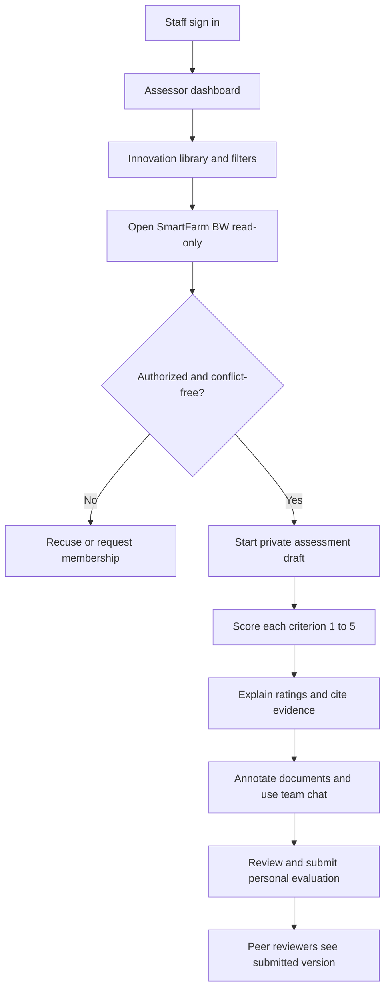
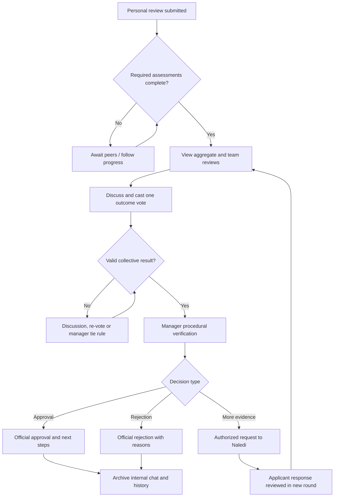
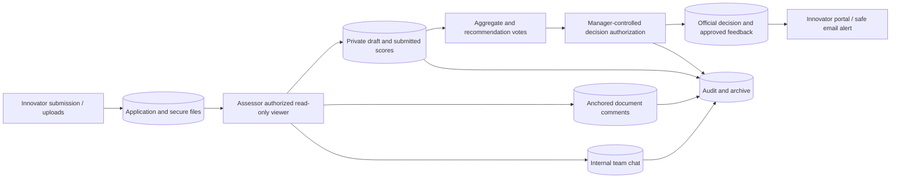

# CEDA Innovation Portal

## Standard Assessor User Flow, Screens, Interactions and Data Flows

**Functional and UI/UX specification | Version 1.0 | 19 November 2026**  
**Audience:** UI/UX designers, frontend developers, backend developers, quality assurance and CEDA process owners.  
**Scope:** Regular innovation assessor only. The Assessment Manager, administrative staff and human support representative are referenced solely at workflow boundaries; their own portals are outside this specification.  
**Status:** Proposed product design for validation with CEDA; not a statement of CEDA's existing operating rules.  
**Example:** Thompson is a fictional assessor reviewing Naledi Motsumi's fictional agriculture innovation, SmartFarm BW.

## 1. Purpose and boundaries

This is the **assessor-side companion** to the separate Innovator Portal specification. The public CEDA informational website remains available to everyone, while staff authentication opens an internal, role-based workspace. Unlike the innovator's account, the standard assessor account cannot edit the innovator's application, administer users, assign committee managers, approve the official decision for release, or access confidential proposals outside its authorized scope.

The assessor experience must make four activities feel like **one continuous workspace**: examine submitted evidence, score independently, collaborate transparently with other authorized assessors, and take part in a collective recommendation. Final authorization belongs to the separately governed decision workflow.

### 1.1 Included in scope

- Staff sign-in and ordinary assessor navigation; dashboard, notifications, profile and help.
- Discoverable innovation library with filters; access and self-join/assignment checks before assessment.
- Read-only application and secure previews/downloads of supporting evidence.
- Section-level and document-anchored comments with threaded replies, plus a separate live team chat.
- Conflict-of-interest declaration, 1–5 criterion scores, evidence-based reasons, draft saving and submission.
- Team-review comparison, aggregate results, voting, requests for additional information and reassessment.
- Read-only final outcome, archived conversations, audit history, failure/empty states and mobile adaptation.

### 1.2 Deliberately excluded

- Admin-created assessor accounts, organization-wide permissions, permanent role management and committee setup.
- Manager-only operations: appointing reviewers, breaking ties, deciding reassessment requests, overriding release holds or authorizing final communication.
- Public marketing pages and the innovator's own form-entry flow (documented separately).
- Human support agent dashboard, funding disbursement, contracts and grant administration.

### 1.3 Key design decisions and assumptions

| Topic | Proposed behavior for this assessor specification |
| --- | --- |
| Shared visibility | Authorized assessors browse a common library of submissions within permitted sectors/scopes; visibility does **not** itself grant scoring permission. |
| Assessment participation | The assessor joins or receives an assignment through a configured rule; if assignment is required, a request goes to the authorized coordinator. |
| Individual integrity | Draft ratings and rationales are private to their author until formally submitted; submitted versions become visible to the authorized panel. |
| Scoring scale | Each configured criterion is scored **1 = Poor** through **5 = Excellent**, with a required reason and optional evidence references. |
| Aggregation | Display raw criterion/team results and configured weighted totals; **no numeric threshold silently approves or rejects** an innovation. |
| Collective outcome | Assessors cast one recorded recommendation vote: **Approve**, **Reject**, or **Request Additional Information**. The majority and tie rules are configurable and must be ratified by CEDA. |
| Manager's involvement | Ordinary assessors do not press “Release Final Outcome.” A manager coordinates procedural checks, ties and authorization. If that manager also participates as an assessor, their ballot must not be counted twice. |
| Reassessment | A manager-initiated, reasoned reassessment creates a new revision/round and preserves earlier scores, votes and messages. |
| Confidentiality | Applicant sees the official outcome and approved feedback only; internal names, individual marks, annotations, chat, votes and private rationales are not released. |
| Completion | On a final authorized approval or rejection, the team's discussion and annotations become read-only and archived, never silently deleted. |

## 2. Person, context and navigation

**Persona:** Thompson, a CEDA staff assessor who is not an Assessment Manager or Lead Assessor. Thompson has secure staff credentials, permission to discover agriculture innovations and authorization to join or be assigned to SmartFarm BW. Naledi is the applicant. Karabo and three other assessors are his peers. The numerical examples below are illustrative, not actual assessments.

### 2.1 Entry and navigation hierarchy

**Public CEDA Innovation Website → Staff Sign In → Role check → Assessor Workspace.** A staff-only authenticated view must never be confused with the public promotional site or the applicant portal. On desktop, use a left primary sidebar, top bar, large central workspace and an optional right collaboration drawer. On mobile, substitute a menu drawer/compact navigation and full-screen panels for document reading and chat.

| Primary sidebar item | Destination and content |
| --- | --- |
| Dashboard | Personalized workload, assessment cards, pending actions and recent activity. |
| Innovation Library | Search/filter authorized submitted innovations; open read-only profiles and join/assignment actions. |
| My Assessments | Drafts, submitted individual reviews, waiting-on-team, reassessments and completed records. |
| Discussions | Threads and conversations for innovations the assessor may access; unread mentions. |
| Notifications | Assignment requests, submitted peer reviews, mentions, voting windows, information responses and decisions. |
| Help & Guidance | Rubrics, scoring descriptions, privacy rules and support contact. |
| Profile & Security | Account details, notification preferences, password/session controls and sign out. |

**Innovation workspace tabs:** Overview · Application · Documents · My Assessment · Team Reviews · Discussion · Collective Decision · History. Hide or disable actions based on state while explaining why; do not remove authorized read-only history.

## 3. Thompson's complete narrative journey

1. **Access:** Thompson selects Staff Sign In, authenticates and lands on his assessor dashboard. A first-time or new-role assessor acknowledges internal confidentiality guidance.
2. **Discovery:** He opens Innovation Library, searches “SmartFarm” or filters Agriculture → Prototype → Submitted/In Assessment. He can view the list within his authorization scope.
3. **Read-only inspection:** He selects SmartFarm BW, examines Naledi's answers and previews research, business plan, drawings and prototype evidence. Originals are immutable to him.
4. **Start gate:** He selects Start My Assessment. The portal checks assessment membership and requires a conflict-of-interest declaration before creating his draft. A conflicted assessor recuses and cannot score.
5. **Independent scoring:** Thompson scores each criterion 1 to 5, writes why, attaches evidence references and saves a private draft. He can navigate back to the application without losing draft inputs.
6. **Evidence-specific collaboration:** He highlights a PDF passage or selects a document/section anchor and leaves a comment; a peer can reply within the thread. Anchors must survive page zoom and preserve version references.
7. **Real-time conversation:** He opens the Team Discussion drawer and sends a general message about sensor testing. This chat is separate from pinned comments; peers receive mentions and unread badges.
8. **Submit personal assessment:** He reviews the ratings and signs off his individual review in a confirmation dialog. Once submitted, peers can see the immutable version, author and submission time.
9. **Compare and discuss:** He opens Team Reviews to see Karabo's submitted scores and rationale. He can discuss disagreements and add reply threads without altering a peer's marks.
10. **Wait for panel readiness:** If other required reviews are incomplete, he sees progress (e.g., “3 of 5 submitted”) and cannot falsely treat the aggregate as final.
11. **Aggregate and vote:** When the required reviews are in, Thompson inspects criterion averages and the configured composite result, then records one of three recommendation votes with a required explanation.
12. **Decision review:** He sees the panel's recommendation and vote split, but **cannot authorize** or publish it. A manager handles ties, procedural concerns and final release under the approved rules.
13. **If more information is requested:** Thompson may suggest specific questions or required documents internally. An authorized role formally sends a consolidated request to Naledi. When she uploads the response, Thompson receives a notification, reviews the new evidence and updates his assessment in a recorded round.
14. **If a reassessment is initiated:** Thompson sees the manager's documented reason, the new assessment round and prior read-only records. He performs another independent scoring/recommendation cycle without overwriting round one.
15. **If approved or rejected:** Thompson views the official decision and released feedback in read-only form. Team chat, document threads, scores and votes are archived as read-only. Naledi sees none of the confidential discussion.
16. **Later review:** Thompson can revisit the archived assessment if still authorized. A formal appeal or new assessment creates a linked round with its own discussion rather than reopening the completed chat.

## 4. User flow diagrams

The following Mermaid diagrams are directly renderable in GitHub and compatible Markdown editors. The Word version includes equivalent visual diagrams.

### 4.1 Discovery, review and individual submission

### 4.2 Collective recommendation and closure

### 4.3 Evidence, scoring, collaboration and notification data flow

## 5. Rules for assessment, voting and outcome visibility

### 5.1 Individual rubric and scoring

For each configured criterion store `criterion_id`, `rubric_version`, `score` (integer 1–5), `justification` (required), optional `evidence_refs`, author, draft/submitted state and timestamps. The default illustration uses equal criterion weights; CEDA should approve the actual set of criteria, category-specific rubrics, weights and pass/fail eligibility rules **before implementation**.

| Illustrative criterion | What assessors consider | Typical evidence |
| --- | --- | --- |
| Feasibility | Can it realistically work with identified resources and constraints? | Prototype tests, implementation plan, proof of concept. |
| Scalability | Can the innovation expand without disproportionate cost or risk? | Adoption model, operating capacity, expansion strategy. |
| Technical implementation | Are architecture, dependencies, integrations and delivery plan realistic? | Technical plan, demonstrations, dependencies. |
| Maintenance and sustainability | Can the innovation be operated, maintained and financially sustained? | Support plan, costs, staffing, risks and mitigations. |
| Novelty and value | What is meaningfully different and valuable? | Comparisons, research, intellectual-property explanation. |
| Economic, environmental or social impact | Are projected benefits plausible and supported? | Impact narrative, projections, beneficiaries. |

**Illustrative formula:** individual criterion average = sum of criterion scores / number of scored criteria. If weights are approved, weighted score = sum(score × criterion weight) / sum(weights); the team composite is computed from the defined set of submitted assessor scores using an explicit, versioned formula. Missing/recused assessors are not treated as zero. All displayed scores identify denominator, rounding and rubric version. A score is **not** an automatic approval decision.

### 5.2 Voting and tie handling

- One eligible assessor gets one active recommendation vote per decision round. Votes are recorded with rationale, author, timestamps and version.
- In a three-option vote, simple majority means more than half of eligible, participating voters favor the same option; a plurality alone does not count as a majority. Abstentions/recusals must be defined in the governance settings before calculation.
- A tied vote or no-majority split is not automatically approved. The panel discusses and re-votes, or the Assessment Manager applies the formally approved tie rule with a recorded explanation.
- An Assessment Manager may perform procedural checks and a limited, justified reassessment according to CEDA's agreed policy, not secretly replace peers' marks. Manager authorization is separate from Thompson's permissions.
- Rejection can occur directly after a valid collective assessment or through an authorized eligibility-screening path; an information request is **not** compulsory before rejection.
- A request for more information is an intermediate workflow state. It must list clear questions, accepted response formats, destination and optional deadline; after a response, retain earlier rounds and resume assessment.

### 5.3 Which information is public, shared or private?

| Information | Thompson's private draft | Authorized fellow assessors | Naledi (innovator) |
| --- | --- | --- | --- |
| Original submitted application | Read-only | Read-only | Own submission |
| Thompson's unsubmitted ratings | Thompson only | Not visible | Not visible |
| Thompson's submitted scores and reasons | Visible | Visible | Not visible |
| Inline annotation and threaded replies | Visible | Visible within assigned scope | Not visible |
| Internal live team messages | Visible | Visible within assigned scope | Not visible |
| Aggregate and vote split | Visible after readiness | Visible after readiness | Not visible |
| Official outcome and cleared feedback | Visible | Visible | Visible once released |
| Internal audit log | Relevant permitted entries | Relevant permitted entries | Not visible |

## 6. Screens: definition of done

Screen IDs are stable references for design files, routes, development tickets and QA tests. **Thompson is always the ordinary assessor.** Whenever a manager-only control is referenced, Thompson sees a read-only status or no permission to execute that control.

### 6.1 Screen inventory

| ID | Screen / view | Primary entry |
| --- | --- | --- |
| AS-01 | Staff Sign In | Public site → Staff Sign In |
| AS-02 | First-Access Guidance | First authorized login / policy update |
| AS-03 | Assessor Dashboard | Initial route after authentication |
| AS-04 | Innovation Library | Main navigation |
| AS-05 | Library Filters and Results | Library search/filter action |
| AS-06 | Innovation Workspace Shell | Innovation result selection |
| AS-07 | Innovation Overview | Workspace → Overview |
| AS-08 | Read-Only Application | Workspace → Application |
| AS-09 | Evidence and Document Library | Workspace → Documents |
| AS-10 | Secure Document Viewer and Annotations | Select document |
| AS-11 | Start Assessment / Eligibility Gate | Start My Assessment |
| AS-12 | Individual Assessment Editor | Workspace → My Assessment |
| AS-13 | Review and Submit Assessment | Submit My Assessment |
| AS-14 | My Assessments | Main navigation |
| AS-15 | Team Reviews | Workspace → Team Reviews |
| AS-16 | Anchored Comment Thread | Document pin / comment link |
| AS-17 | Live Team Discussion | Right drawer / Discussions |
| AS-18 | Team Readiness and Aggregate | Reviews completed / team view |
| AS-19 | Collective Recommendation Vote | Workspace → Collective Decision |
| AS-20 | Recommendation Result / Pending Authorization | After vote |
| AS-21 | Information Request Drafting / Visibility | Information required workflow |
| AS-22 | Innovator Response Review | Applicant submits additional evidence |
| AS-23 | Reassessment Round | Manager opens a new review round |
| AS-24 | Final Outcome (Read Only) | Outcome authorized |
| AS-25 | Archived Discussion and Audit History | Closed innovation → History |
| AS-26 | Notifications Center | Bell / navigation |
| AS-27 | Assessor Profile and Security | Profile menu |
| AS-28 | Help, Scoring Guidance and Support | Help navigation |
| AS-29 | Error, Restricted and Empty States | Contextual error/empty states |

### AS-01 — Staff Sign In

**Goal:** Authenticate CEDA staff and route to the correct role-based destination.

**Information and layout:** CEDA branding, staff email, password, show/hide control, Sign In button, password-recovery link, help link, confidentiality reminder.

**Assessor actions:** Submit credentials; use configured second factor if enabled; recover credentials through official flow; sign out from previously authenticated session.

**Overlays and controls:** Inline field errors, invalid-credentials notice, session-expired banner; no secret account existence disclosure.

**Rules and validation:** Rate-limit login attempts; never display assessor dashboard before staff role is verified. Redirect innovators to their portal, not staff screens.

**Navigation:** Successful login → AS-02 when policy acknowledgement is needed, otherwise AS-03.

**Responsive/mobile behavior:** Single-column form; full-width targets, keyboard and autofill compatible.

### AS-02 — First-Access Guidance

**Goal:** Ensure a new assessor understands confidentiality and scoring ethics.

**Information and layout:** Summary of confidentiality, conflict-of-interest policy, assessment rubric links, acknowledgement checkbox, Continue button.

**Assessor actions:** Read guidance, open policy details, acknowledge current policy version and proceed.

**Overlays and controls:** Policy details expandable section; linked printable guidance.

**Rules and validation:** Acknowledgement must be explicit and versioned; no implied acceptance just by scrolling.

**Navigation:** Continue → AS-03; future policy changes can re-trigger this screen.

**Responsive/mobile behavior:** Scrollable content, sticky Continue action only after required acknowledgement.

### AS-03 — Assessor Dashboard

**Goal:** Show Thompson exactly what requires attention.

**Information and layout:** Greeting; summary cards for available-to-review, my drafts, submitted reviews, pending votes, reassessment requests; action list; latest messages and notifications; recent innovations.

**Assessor actions:** Open innovation, resume draft, follow unread mention, view queue, view completed assessment.

**Overlays and controls:** Card drilldowns, task-status chips, notification popover, empty-state guidance.

**Rules and validation:** Metrics are scoped to Thompson and his authorized teams; timestamps accurate; no fictional counters.

**Navigation:** Library → AS-04; draft → AS-12; team message → AS-17; notifications → AS-26.

**Responsive/mobile behavior:** Cards stack; recent actions prioritize above analytics; no horizontal overflow.

### AS-04 — Innovation Library

**Goal:** Provide shared, searchable visibility to authorized submitted innovations.

**Information and layout:** Search input, sector/category/stage/status/date filters, sort selector, result count, list/grid toggle, innovation cards with title/sector/stage/date/status and permission-aware action.

**Assessor actions:** Search by title/reference; select agriculture; sort by newest; open SmartFarm BW; clear filters.

**Overlays and controls:** Filter drawer, result preview and empty-state reset; optional saved views.

**Rules and validation:** Show only submissions within access scope; discovery does not auto-enroll Thompson as reviewer.

**Navigation:** Select SmartFarm BW → AS-06; refine filters → AS-05.

**Responsive/mobile behavior:** Single-column result cards and bottom-sheet filters.

### AS-05 — Library Filters and Results

**Goal:** Let assessors narrow a large queue without losing context.

**Information and layout:** Sector multi-select, innovation type, development stage, submitted date range, assessment status, assigned/unassigned toggle if allowed, sort and Apply/Reset.

**Assessor actions:** Apply filters and see result count update; remove a single active filter chip; restore last valid search.

**Overlays and controls:** Filter drawer with Apply, Reset, Cancel; zero-results illustration with reset action.

**Rules and validation:** Filters must not become access-control bypasses. Results and counts must be server-authorized and paginated.

**Navigation:** Apply → AS-04 results; open selected submission → AS-06.

**Responsive/mobile behavior:** Full-height sheet with sticky Apply and Reset.

### AS-06 — Innovation Workspace Shell

**Goal:** Maintain a single context while reading, scoring and discussing.

**Information and layout:** Sticky innovation title/reference/status, sector and stage, read-only submission banner, tab strip, breadcrumb back to library, primary action based on assessor state, optional right discussion drawer.

**Assessor actions:** Switch between Overview, Application, Documents, My Assessment, Team Reviews, Discussion, Collective Decision and History.

**Overlays and controls:** Confirm-leave dialog only when unsaved edits exist; action menu for authorized functions; collaboration drawer.

**Rules and validation:** Tab permission gates; if the assessment is closed, hide scoring actions but preserve review/history access.

**Navigation:** Overview → AS-07; Application → AS-08; Documents → AS-09; Start → AS-11.

**Responsive/mobile behavior:** Tabs horizontally scroll or collapse into a tab selector; discussion full-screen.

### AS-07 — Innovation Overview

**Goal:** Give a concise understanding before detailed inspection.

**Information and layout:** Innovation title, abstract, sector, stage, current status, submission receipt reference, problem/solution synopsis, evidence checklist, review-team status and next required action.

**Assessor actions:** Read summary, expand synopsis, jump to a section, open evidence, choose Start My Assessment.

**Overlays and controls:** Quick-view cards; section jump menu; status explanation popover.

**Rules and validation:** Hide protected applicant details not required for review; never expose internal notes to innovator routes.

**Navigation:** Full details → AS-08; evidence → AS-09; start → AS-11.

**Responsive/mobile behavior:** Compact summary cards, persistent overflow menu for actions.

### AS-08 — Read-Only Application

**Goal:** Expose the exact submitted application without allowing edits.

**Information and layout:** Seven expandable applicant sections (applicant info; innovation info; problem/solution; impact; feasibility/growth; additional evidence; declarations/final review), metadata and version stamp.

**Assessor actions:** Read and expand answers, jump to particular section, open associated files, copy permitted excerpts for internal citation.

**Overlays and controls:** Accordion sections; context link to comment on section; document preview links.

**Rules and validation:** Every field is immutable for assessors; preserve submitted values and version; redact restricted identity details where policy requires.

**Navigation:** Open supporting file → AS-10; return to Overview → AS-07.

**Responsive/mobile behavior:** Accessible accordions; avoid overly long unbroken forms.

### AS-09 — Evidence and Document Library

**Goal:** Organize and safeguard all documents that were actually submitted.

**Information and layout:** Files grouped by original application section, file name/type/size/upload date/version, secure View and permitted Download actions, malware-scan state.

**Assessor actions:** Open PDF/image, preview supported presentation or spreadsheet, inspect document metadata, add file-level comment.

**Overlays and controls:** Preview viewer, file detail side panel, unsupported format notice and secure download confirmation if needed.

**Rules and validation:** No edit/replace/delete; never generate public file URLs; scanned/unsupported files must show safe error.

**Navigation:** View → AS-10; evidence anchor → AS-16.

**Responsive/mobile behavior:** File cards with clear file types; preview full-screen.

### AS-10 — Secure Document Viewer and Annotations

**Goal:** Make evidence review and Figma-like anchored collaboration practical.

**Information and layout:** Viewer canvas, page navigation, zoom, filename/version, file-level thread count, highlight/anchor toolbar, annotation pins, list of threads, optional chat drawer.

**Assessor actions:** Select text or point on page; add anchored comment; reply, resolve/reopen if permitted; cite selected evidence in assessment; jump to another pin.

**Overlays and controls:** Comment composer, anchored thread panel, hide/show pins control, zoom toolbar, fallback file-level comments for unsupported types.

**Rules and validation:** Use immutable document-version coordinates/text anchors. Assessors may annotate overlay only, never edit underlying documents. Escape unsafe file content.

**Navigation:** Comment thread → AS-16; scoring → AS-12; documents → AS-09.

**Responsive/mobile behavior:** Zoom/pan safe; comment list separate from touch canvas; no tiny pins.

### AS-11 — Start Assessment / Eligibility Gate

**Goal:** Enforce correct participation and impartiality before scoring.

**Information and layout:** Review membership status, rubric version, expected responsibilities, conflict-of-interest Yes/No declaration with explanatory details, Begin button.

**Assessor actions:** Declare no conflict, join/accept eligible assignment, start draft; declare conflict and recuse; request assignment if outside panel.

**Overlays and controls:** Conflict disclosure modal, recusal confirmation, assignment-request state.

**Rules and validation:** A conflict blocks scoring and creates restricted audit event. Membership check is server-enforced; no self-assignment unless policy allows it.

**Navigation:** Authorized no-conflict → AS-12; pending request → AS-07 view-only.

**Responsive/mobile behavior:** Single-purpose modal or simple page; avoid rushed consent.

### AS-12 — Individual Assessment Editor

**Goal:** Capture private ratings, reasons and evidence references.

**Information and layout:** Rubric checklist, each 1–5 radio scale with defined labels, required rationale, optional evidence citation, save indicator, individual score summary, unsaved changes guard.

**Assessor actions:** Score feasibility and other criteria, link evidence/pins, save draft, resume later, navigate back to source document, review entries before submitting.

**Overlays and controls:** Rubric help popover; evidence picker; autosave status; discard-unsaved dialog; submission preview.

**Rules and validation:** Scores integer 1–5; mandatory criterion and rationale validations; server-version concurrency guard; drafts private until submission.

**Navigation:** Review → AS-13; document evidence → AS-10; My Assessments → AS-14.

**Responsive/mobile behavior:** One criterion card at a time or collapsible groups; always show save status.

### AS-13 — Review and Submit Assessment

**Goal:** Let Thompson verify the exact review becoming visible to peers.

**Information and layout:** Summary of all scores/reasons, missing-item warnings, calculated illustrative result, version, explicit “Submit My Assessment” action.

**Assessor actions:** Inspect/modify entries, confirm final submission; cancel and return to private draft.

**Overlays and controls:** Submit-confirmation modal describing visibility and version lock; success confirmation.

**Rules and validation:** Only valid complete drafts can submit; submission idempotent; keep version and UTC timestamp; peer visibility starts after server success.

**Navigation:** Submitted → AS-15 / AS-14; cancel → AS-12.

**Responsive/mobile behavior:** Readable summary with collapsible long justifications.

### AS-14 — My Assessments

**Goal:** Track personal draft, submitted and completed review responsibilities.

**Information and layout:** Tabs: Draft, Submitted, Awaiting Team, Reassessment, Completed; search, status, due date if assigned, innovation cards, progress and last activity.

**Assessor actions:** Resume draft, inspect submitted review, navigate to pending vote, review reassessment request.

**Overlays and controls:** Sort/filter controls; zero-state for each tab; optional alert for approaching due date.

**Rules and validation:** No access to another assessor’s private draft; deadline indicators are not fabricated.

**Navigation:** Resume → AS-12; submitted → AS-15; vote → AS-19.

**Responsive/mobile behavior:** Segmented categories or dropdown; avoid excessive badges.

### AS-15 — Team Reviews

**Goal:** Enable transparency after each assessor formally submits.

**Information and layout:** Table of submitted assessor names, criterion scores, rationales, timestamp/version; compare panels; waiting-review count; links to annotations.

**Assessor actions:** Compare Thompson and Karabo; filter by criterion; open explanation and referenced evidence; discuss differences.

**Overlays and controls:** Side-by-side compare view and open-evidence drawer.

**Rules and validation:** Submitted-only reviews appear. Never allow Thompson to edit others’ reviews, votes or timestamps.

**Navigation:** Thread → AS-16; discuss → AS-17; readiness → AS-18.

**Responsive/mobile behavior:** Stack individual review cards; compare via selectable reviewers.

### AS-16 — Anchored Comment Thread

**Goal:** Make a specific evidence point discussable and auditable.

**Information and layout:** Original quoted context or document coordinate, thread author/timestamp, replies, mentions, resolve state, link to source/version.

**Assessor actions:** Reply, mention teammate, add reference, resolve/reopen as permitted, jump back to evidence.

**Overlays and controls:** Contextual popover or right drawer; nested replies are clearly associated with anchor.

**Rules and validation:** Assessors-only content; archived threads read-only; never remove original evidence anchor history.

**Navigation:** Return to AS-10 or section context; broad chat → AS-17.

**Responsive/mobile behavior:** Full-height thread sheet with fixed reply composer.

### AS-17 — Live Team Discussion

**Goal:** Support fast internal conversation without replacing evidence comments.

**Information and layout:** Real-time timeline, named senders, date separators, message composer, mentions, unread position, relevant innovation header, pinned evidence links.

**Assessor actions:** Send/reply to messages, mention a teammate, follow reference to document or score, mark read.

**Overlays and controls:** Collapsible right chat drawer / full discussion page, typing indicator where available, reconnection notice.

**Rules and validation:** Chat only available to authorized panel; persisted messages and audit; closed/archived rounds read-only; no applicant access.

**Navigation:** Evidence links → AS-10; Team Reviews → AS-15; history → AS-25.

**Responsive/mobile behavior:** Full-screen chat view with keyboard-safe composer.

### AS-18 — Team Readiness and Aggregate

**Goal:** Show whether the panel can proceed and how results were calculated.

**Information and layout:** Required vs submitted reviewer count, missing reviewer statuses, criterion average/weighted composite, rubric version, spread/outliers, score distribution.

**Assessor actions:** Inspect aggregate, compare individual submitted reviews, wait or follow notification, enter vote when eligible.

**Overlays and controls:** Breakdown popover explaining calculation; missing-reviewer indicator.

**Rules and validation:** Only show “Ready for Vote” after configured completion/quorum rules. No auto-approval based on the composite alone.

**Navigation:** Ready → AS-19; reviews → AS-15.

**Responsive/mobile behavior:** Aggregate cards and accessible tables, not chart-only information.

### AS-19 — Collective Recommendation Vote

**Goal:** Record Thompson’s formal recommendation without granting final release authority.

**Information and layout:** Team summary, vote options Approve / Reject / Request Additional Information, required rationale, supporting evidence links, voting policy summary.

**Assessor actions:** Choose exactly one option, write reasons, confirm vote; if “more info,” propose exact documents/questions internally.

**Overlays and controls:** Confirm-vote modal; rationale entry; draft suggestion of missing evidence.

**Rules and validation:** One active vote per eligible assessor per round; manager authorization separate; votes cannot be silently rewritten; validity checked server-side.

**Navigation:** Success → AS-20; discussion → AS-17.

**Responsive/mobile behavior:** Large distinct choices with explanatory text; confirmation explicit.

### AS-20 — Recommendation Result / Pending Authorization

**Goal:** Make voting transparent while preventing premature applicant-facing claims.

**Information and layout:** Recorded votes and rationale, majority/no-majority/tie state, panel recommendation, status “Pending Authorization,” permitted next actions.

**Assessor actions:** Review result, discuss or join formally reopened vote if permitted, see request to reassess; do not release decision.

**Overlays and controls:** Voting-result breakdown, tie-warning panel, manager-action status description.

**Rules and validation:** A plurality is not presented as majority; do not show Approved/Rejected to innovator until authorized.

**Navigation:** More info → AS-21; reassessment → AS-23; final → AS-24.

**Responsive/mobile behavior:** Plain text summaries alongside any vote visualization.

### AS-21 — Information Request Drafting / Visibility

**Goal:** Help assessors specify evidence gaps without directly contacting the innovator outside process.

**Information and layout:** Internal suggestions list, required question/description, supporting reference, desired file type, optional deadline, request status and authorized final wording.

**Assessor actions:** Propose missing documents, comment on proposed request, inspect issued official request; wait for Naledi’s response.

**Overlays and controls:** Add suggested item modal, compare draft vs final read-only request.

**Rules and validation:** A standard assessor does not send the official request; manager/authorized role consolidates and releases it. No leaked reviewer identity.

**Navigation:** Applicant response → AS-22; decision → AS-20.

**Responsive/mobile behavior:** Expandable request items with clear status and due date if set.

### AS-22 — Innovator Response Review

**Goal:** Connect newly supplied evidence to the exact information request.

**Information and layout:** Official request, each response item and file, submission timestamp, original submission snapshot, difference/added evidence indicators.

**Assessor actions:** Read Naledi response, preview new documents, annotate in the active round, update assessment when rules permit.

**Overlays and controls:** Response-file viewer, reply-to-request evidence anchors, notification deep-link.

**Rules and validation:** Prior rounds remain immutable; no replacement of old uploaded originals; response must be linked to request ID.

**Navigation:** Evidence → AS-10; new round → AS-23 or AS-12 per workflow.

**Responsive/mobile behavior:** Each request and answer grouped; keep long attachments collapsible.

### AS-23 — Reassessment Round

**Goal:** Make reconsideration transparent and distinct from historical decisions.

**Information and layout:** Round number, triggering reason, previous read-only results, current rubric, new evidence, assessors and deadline if set.

**Assessor actions:** Read manager reason, inspect new information, rescore required criteria and resubmit a fresh version, discuss in new round.

**Overlays and controls:** Previous vs current comparison, new-round banner, round selector.

**Rules and validation:** Only an authorized manager/system transition starts a new round; no overwrite of earlier votes, comments or chat.

**Navigation:** Rescore → AS-12; team review → AS-15; new vote → AS-19.

**Responsive/mobile behavior:** Prominent round label to avoid confusion.

### AS-24 — Final Outcome (Read Only)

**Goal:** Allow staff to view the authorized decision without altering or releasing it themselves.

**Information and layout:** Official decision, release time, sanitized applicant-facing feedback, next steps, limited internal audit references, link to archived assessment.

**Assessor actions:** Read final outcome, inspect released letter when permitted, open history; cannot revise/withdraw from standard assessor role.

**Overlays and controls:** Download released outcome if permitted; immutable outcome banner.

**Rules and validation:** Applicant sees sanitized released feedback only, never team identities or private discussion.

**Navigation:** History → AS-25; library → AS-04.

**Responsive/mobile behavior:** Readable outcome card, clear distinction between official feedback and internal record.

### AS-25 — Archived Discussion and Audit History

**Goal:** Preserve the complete rationale without keeping finished chats writable.

**Information and layout:** Chronological event log, rounds, original/updated scores, submissions, annotations, vote records, final action, archived chat, accessible document versions.

**Assessor actions:** Search/filter historical events, inspect read-only messages, export authorized audit extract if explicitly permitted.

**Overlays and controls:** Round selector, history detail drawer, “Archived — Read Only” banner.

**Rules and validation:** No new messages/edits/deletions after final authorization. Access governed by retention and role policy; appeals create linked rounds.

**Navigation:** Return to AS-24 / AS-06; linked appeal → new reassessment record.

**Responsive/mobile behavior:** Chronological cards with clear event time and actor.

### AS-26 — Notifications Center

**Goal:** Keep Thompson aware of meaningful changes without duplicating confidential content in email.

**Information and layout:** Unread/all tabs; assignments, peer review completed, mentions, vote opened, response uploaded, round started, official outcome released; timestamps and target links.

**Assessor actions:** Open notification, mark as read, adjust preferences, deep-link to original permitted screen.

**Overlays and controls:** Bell popover, full notifications page, batch mark-read action.

**Rules and validation:** Notification metadata must be access-checked at click time; restricted messages do not disclose proposal content.

**Navigation:** Deep-link to AS-06/AS-17/AS-19/AS-22/AS-24 as appropriate.

**Responsive/mobile behavior:** Readable list with clear priority and unread indicators.

### AS-27 — Assessor Profile and Security

**Goal:** Provide personal settings without role-escalation capability.

**Information and layout:** Name, verified work email, assigned sectors/read-only role, security settings, sign-in activity if permitted, notification preferences, logout.

**Assessor actions:** Update allowed profile data, change password through identity provider, set notification channels, sign out.

**Overlays and controls:** Session-expiry dialog, preference saves, password link.

**Rules and validation:** Cannot promote own role, edit access scope, or alter immutable review identity.

**Navigation:** Back to AS-03; logout → AS-01.

**Responsive/mobile behavior:** Simple settings sections and accessible toggles.

### AS-28 — Help, Scoring Guidance and Support

**Goal:** Reduce assessor confusion with trustworthy, rubric-aligned assistance.

**Information and layout:** Official rubric instructions, criterion meanings and example evidence, privacy policy, technical help link, support ticket channel, system status where available.

**Assessor actions:** Search FAQs, open rubric, request technical help, report broken preview or access problem.

**Overlays and controls:** Context help popover inside scoring, support request modal.

**Rules and validation:** Help guidance must not fabricate assessment rules. Human support cannot silently edit assessor marks.

**Navigation:** Contextual return to AS-12 or prior screen.

**Responsive/mobile behavior:** Searchable help; downloadable guidance where authorized.

### AS-29 — Error, Restricted and Empty States

**Goal:** Make failures understandable and avoid data loss or unauthorized disclosure.

**Information and layout:** No assigned innovations, no matching results, missing permission, expired session, offline/autosave interrupted, scan pending, unsupported preview, service error.

**Assessor actions:** Retry, reset filter, contact administrator, reauthenticate, download when permitted, preserve unsent draft locally only within approved security constraints.

**Overlays and controls:** Non-destructive error banner, retry action, session-expiry modal, loading skeleton.

**Rules and validation:** Never present a failed save as successful, expose restricted metadata or submit a duplicate assessment on retry.

**Navigation:** Return to last authorized context or AS-03 / AS-01.

**Responsive/mobile behavior:** Error messages actionable, short and keyboard/assistive-tech accessible.

## 7. Modals, drawers, popovers and in-app feedback

These transient elements are part of the implementation scope, not optional decoration. Modal/drawer focus trapping, accessible names, keyboard Escape behavior and unsaved-state warnings should be specified and tested.

| Component ID | Type | Trigger | Required content and behavior |
| --- | --- | --- | --- |
| UI-01 | Modal | Start My Assessment | Membership check, conflict declaration, recuse/continue; cannot bypass. |
| UI-02 | Modal | Declare conflict | Capture reason; prevent scoring and record restricted audit event. |
| UI-03 | Modal | Submit Assessment | Summarize that ratings become visible to the authorized panel; Confirm/Cancel; reject invalid form. |
| UI-04 | Drawer | Filter Library | Multi-select fields, Apply, Reset, Cancel; preserve draft selection. |
| UI-05 | Full-screen overlay | Preview Evidence | Secure document display, zoom, pagination, close/back, file metadata. |
| UI-06 | Popover | Add anchored comment | Context/anchor preview, text composer, Cancel/Post; submit only when valid. |
| UI-07 | Right drawer / full-screen panel | Team Discussion | Real-time messages, mentions, replies, unread marker and archive banner. |
| UI-08 | Thread panel | Open annotation pin | Anchored quote/position, messages, replies, resolve state. |
| UI-09 | Popover | Rubric help icon | Exact criterion definition, meaning of 1–5 ratings and permitted evidence. |
| UI-10 | Modal | Evidence picker | Link a submitted section/file/page/comment to a score rationale. |
| UI-11 | Modal | Cast recommendation vote | Confirm option, mandatory rationale and no manager release privileges. |
| UI-12 | Drawer | View team score comparison | Selected assessor, criterion-by-criterion marks, notes, citations. |
| UI-13 | Modal | Suggest information request | Missing document/question, explanation, optional file type/deadline suggestion; internal only. |
| UI-14 | Banner | New reassessment round | Reason, round number, previous round link; old data remains immutable. |
| UI-15 | Banner | Outcome finalized | Read-only status, released feedback and archived chat link. |
| UI-16 | Modal | Session expiration / unsaved draft | Explain autosave state and secure re-authentication or recovery. |
| UI-17 | Toast | Save/submit/message result | Display only confirmed server result with actionable retry on failure. |

## 8. State transitions and decision ownership

| Starting state | Trigger | Next state | What Thompson can do |
| --- | --- | --- | --- |
| Submitted / discoverable | Open innovation | Viewing | Read in permitted scope; no scoring unless eligible. |
| Viewing | Valid assignment + no conflict | Assessment Draft | Score and save private entries. |
| Assessment Draft | Submit validated review | Individual Review Submitted | View and discuss; submitted version locked. |
| Individual Review Submitted | Remaining required reviewers incomplete | Waiting for Panel | See progress and messages. |
| Waiting for Panel | Quorum/completion rule met | Ready for Vote | See aggregates, cast recommendation vote. |
| Ready for Vote | Vote submitted | Vote Recorded | See recorded ballot and collective progress. |
| Vote Recorded | Valid collective recommendation | Pending Authorization | View result; cannot release. |
| Pending Authorization | Authorized request for more evidence | Additional Information Requested | Review official request; await response. |
| Additional Information Requested | Applicant responds | Response Received | Examine new evidence; participate in next round. |
| Pending Authorization | Authorized manager reassessment | Reassessment Open | Review reason; new round scores and discussion. |
| Pending Authorization | Official approval released | Approved / Closed | View outcome and read-only archive. |
| Pending Authorization | Official rejection released | Rejected / Closed | View outcome and read-only archive. |
| Approved or Rejected / Closed | Formal appeal or reopening authorized | New Linked Round | Prior closed records stay immutable. |

**Key principle:** The local status for Thompson's personal evaluation (Draft, Submitted, Reassessment Due) is distinct from the overall innovation status (In Assessment, Awaiting Information, Approved, Rejected). Do not flatten both into one vague status label.

## 9. Data model and implementation contracts

The following logical entities support the UX; names are illustrative, not a mandatory physical schema. All server mutations require authentication, scoped authorization and audit logging.

| Entity | Essential fields and relationships |
| --- | --- |
| StaffUser | id, role, name, work contact, active state, access scopes. |
| Innovation | id, reference, submission owner, sector, stage, version, overall state. |
| ApplicationSnapshot | innovation id, snapshot version, submitted timestamp, immutable answers. |
| DocumentVersion | id, innovation id, section id, storage key, MIME/type, scan state, immutable version. |
| AssessmentPanelMembership | innovation id, staff user id, role in panel, membership status, timestamps. |
| ConflictDeclaration | innovation id, assessor id, declaration, reason, version and time. |
| RubricVersion / Criterion | criterion id, label, guidance, weight, required flag, score scale. |
| AssessmentRound | innovation id, round number, trigger, reason, status, created time. |
| IndividualAssessment | round id, assessor id, draft/submitted status, version, timestamps. |
| CriterionScore | assessment id, criterion id, integer score, required reason, optional evidence references. |
| DocumentAnnotation / Comment | document version id, anchor type/location, thread id, author, text, resolution state. |
| TeamMessage | innovation id, round id, author, message, reply-to, timestamps, archive state. |
| OutcomeVote | round id, assessor id, option, rationale, version and submission time. |
| InformationRequest / Response | round id, question(s), required uploads, issuer, due time if set, response items/files. |
| OutcomeDecision | innovation id, round id, recommendation, authorization, approved public feedback, release timestamp. |
| Notification / AuditEvent | recipient/action, resource ids, visibility, event type, actor, time and immutable event payload. |

### 9.1 Important server actions (logical contracts)

| Action | Input | Secure output / effect |
| --- | --- | --- |
| `listInnovations` | Search/filter/page | Permission-scoped results; never unrestricted database rows. |
| `getInnovationSnapshot` | Innovation id | Authorized immutable applicant version and redacted view as required. |
| `getSecureDocument` | Document id/version | Short-lived protected preview/download path after authorization and scan checks. |
| `joinOrRequestReview` | Innovation id, declaration | Assignment or request state with audit; prevents unauthorized scoring. |
| `saveAssessmentDraft` | Round id, criterion scores, expected version | Atomic draft save, validation messages and new version. |
| `submitAssessment` | Draft id and expected version | Server-confirmed immutable submitted assessment (idempotent). |
| `postDocumentComment` | Document version, anchor, text | Authorized annotation thread and notification. |
| `postTeamMessage` | Innovation/round id, text | Stored real-time message, delivery event, author/time. |
| `getTeamReviewSummary` | Innovation id and round | Submitted-only reviews, aggregation methodology and readiness state. |
| `castOutcomeVote` | Round, choice, reason | One valid vote per eligible assessor; audited result. |
| `getInformationResponse` | Request id | Authorized new evidence and linked application response. |
| `getAssessmentHistory` | Innovation/round id | Authorized read-only audit with pagination. |

### 9.2 Data and event sequence

1. Innovator submits a versioned application, with metadata and document references stored in the secure backend.
2. Authenticated assessor selects an allowed submission; backend checks sector/scope for each fetch and attachment preview.
3. On Start Assessment, backend checks membership and conflict declaration, then creates a private draft tied to rubric and assessment round.
4. Draft changes are saved with optimistic version checks; after valid submission, the snapshot becomes visible to panel peers.
5. Comment and chat events are persisted in separate structures and delivered to active authorized participants over an appropriate real-time channel.
6. When completion rules are met, server computes auditable aggregates and opens a recommendation voting stage.
7. Votes determine a collective recommendation under configured policy, but no applicant-facing decision is emitted until authorized.
8. Manager-only services handle tie resolution, formal information request, justified reassessment and final release.
9. The innovator receives the official decision or action request through their portal and non-sensitive email notification.
10. On authorized final approval/rejection, round communications are marked archived and read-only; history and evidence versions remain retrievable by appropriately authorized personnel.

## 10. Permissions and privacy checks

| Capability | Thompson: standard assessor | Panel peers | Assessment Manager | Innovator |
| --- | --- | --- | --- | --- |
| Browse authorized submissions | Yes | Yes | By scope | Own only |
| Read original applicant submission | Yes, in permitted scope | Yes, in permitted scope | By scope | Own only |
| Change applicant answers/files | No | No | No in assessor workflow | Draft only; not submitted snapshot |
| Start personal assessment | If eligible / no conflict | If eligible / no conflict | If formally participating | No |
| Edit own unsubmitted scores | Yes | Yes | If participating | No |
| Edit another assessor's scores | No | No | No | No |
| See submitted peer marks | Yes within panel | Yes within panel | Authorized | No |
| Post internal document comment/chat | During active authorized round | During active authorized round | Authorized | No |
| Vote on collective recommendation | Once when eligible | Once when eligible | If designated voting member; never double-count | No |
| Submit official outcome for release | No | No | Authorized role only | No |
| Start formal reassessment | No; can request/raise concern | No; can request/raise concern | Authorized role only | No |
| Read archived internal record | Only while authorized | Only while authorized | Authorized | No |
| Read official released feedback | Yes | Yes | Yes | Yes for own submission |

**Security baseline:** Role-based access plus innovation/panel scope checks on the backend; RLS or equivalent database policies; short-lived authenticated file access; encryption in transit and at rest; versioned audit records; protection against script injection in chat/annotations; file scanning; rate limits; retention settings approved by CEDA; and no full confidential proposals in external notification content. Do not rely on disabled UI controls as the sole authorization mechanism.

## 11. Accessibility and responsive requirements

- Desktop: persistent left sidebar, top navigation, central evidence/workspace, optional collapsible right team discussion panel.
- Tablet: condensed sidebar; evidence viewer and assessment editor may use a split view when readable, otherwise switch to one panel at a time.
- Mobile: navigation drawer, single-column criteria, dedicated full-screen PDF viewer and full-screen chat; never overlap input with the keyboard.
- Keyboard and assistive technology: meaningful headings, labels for all 1–5 choices, visible focus, modal focus management, escape/close behavior, screen-reader announcements for save status and new messages.
- Use color and text/icons together for score/status meaning; preserve sufficient contrast; maintain readable 11 pt–equivalent body sizing and accessible tap targets.
- Long rubrics and comments must autosave or be recoverable; do not silently discard changes during tab switches, connectivity loss or token refresh.
- Real-time activity should not unexpectedly steal focus or auto-scroll the conversation away from content Thompson is reading.
- Document accessibility varies by uploaded format; supply accessible metadata and text fallback when the source preview is inaccessible.

## 12. Core edge cases and expected UX

| Case | Required behavior |
| --- | --- |
| Thompson is outside authorized sector | Restricted view; no document disclosure or scoring. |
| Submission appears in library but Thompson is not assigned | Read permitted summary only, or request/join via controlled workflow; no score entry. |
| Thompson declares conflict | Record recusal, hide scoring/voting, remove from quorum under approved rules. |
| Autosave fails | Persistent “Not saved” state with retry; never display “Saved” falsely. |
| Two browser tabs edit same draft | Version conflict prompt; preserve newer data and offer safe merge/reload. |
| Uploaded PDF cannot preview | Explain limitation, permit safe download if authorized, allow file-level comment. |
| Peer's review is still draft | No access to draft marks; show only completion status. |
| A reviewer becomes unavailable | Reassignment/quorum change by authorized role, recorded in audit. |
| Five votes split 2 approve / 2 reject / 1 more information | No majority; discussion/re-vote/tie procedure. Do not call 2 votes a majority. |
| An information request is still pending | Leave case active; chat and evidence review available to authorized panel. |
| Official decision releases while Thompson has chat open | Switch composer to disabled, show archived banner, retain readable history. |
| Formal reassessment after rejection | New linked round and conversation; do not unlock or overwrite closed review. |
| Email fails to deliver | Authoritative state remains in portal; queue/retry notification safely. |
| Thompson loses authorization | Stop new reads/messages/downloads immediately, including old deep links. |

## 13. Functional acceptance criteria for QA

- **AC-01:** A staff user who lacks the assessor role cannot access any assessor-only route or API.
- **AC-02:** Thompson sees only innovations allowed by access policy; filters do not expand permissions.
- **AC-03:** Opening SmartFarm BW shows submitted answers and documents but no edit controls for applicant data.
- **AC-04:** Document preview requires access and never leaks a permanent public attachment URL.
- **AC-05:** Unassigned/conflicted Thompson cannot start a score draft or cast a ballot.
- **AC-06:** A 1–5 score is selected for every required rubric criterion with a substantive required rationale.
- **AC-07:** Private draft ratings cannot be read by Karabo before Thompson submits.
- **AC-08:** A failed autosave cannot show “Saved”; refreshing a confirmed saved draft restores fields.
- **AC-09:** Submitted scores become visible to authorized peers with author and timestamp; old versions remain auditable.
- **AC-10:** Thompson cannot edit Karabo's assessment by UI manipulation or direct API requests.
- **AC-11:** A pinned document comment retains the correct file version and context and supports threaded replies.
- **AC-12:** General team chat is real time, scoped to the innovation/round and invisible to Naledi.
- **AC-13:** Completed-vs-required assessor counts update and do not treat recused members as zero scores.
- **AC-14:** Aggregate computation displays or documents rubric/weight/denominator and does not auto-release a decision.
- **AC-15:** Each eligible assessor can submit only one active recommendation vote for the same round.
- **AC-16:** A 2/2/1 split is handled as no majority and does not automatically approve/reject.
- **AC-17:** Thompson cannot submit, authorize, or release an official final outcome.
- **AC-18:** Request Additional Information requires clear missing items in the formal authorized request; Thompson's suggestions remain internal until released.
- **AC-19:** New applicant evidence is linked to the original request and preserves prior files.
- **AC-20:** A reassessment has a new round identifier and preserves previous scores, votes, comments and timestamps.
- **AC-21:** Final official approval or rejection archives team chat/document comments as read-only in active sessions and on reload.
- **AC-22:** Naledi receives only the authorized decision and sanitized feedback; assessor names, ballots and confidential comments are absent.
- **AC-23:** Closed assessments remain available for authorized audit within retention rules, without writable chat.
- **AC-24:** A user losing authorization can no longer open files via bookmarked/previous URLs.
- **AC-25:** Navigation, dialogs, score controls, document pins and chat meet keyboard and basic screen-reader usability checks.
- **AC-26:** A retry after network failure cannot create duplicate assessment submissions, votes or messages.

## 14. Delivery priorities and dependencies

| Delivery layer | Build in the initial demonstration | Subsequent hardening or scale-up |
| --- | --- | --- |
| Assessor navigation | Staff role routing, dashboard, library search/filter, innovation workspace. | Saved views, analytics and richer search. |
| Submission review | Read-only application, file list and protected preview. | Advanced spreadsheet/presentation rendering and additional accessible previews. |
| Individual scoring | Versioned rubric, 1–5 scores, reasons, private draft, submit. | Complex rubric templates and assessor calibration analytics. |
| Collaboration | Anchored PDF/image comments where technically supported; file-level fallback; live innovation chat. | More advanced Figma-like selections across all document types. |
| Collective evaluation | Panel readiness, peer review display, aggregate and vote screens. | Statistical comparison, conflict heat maps and advanced voting policy configuration. |
| Outcomes | Read-only authorized decision, request/response workflow, archive. | Appeals management and long-term records automation. |
| Security | Login, role/scope guards, file controls and audit events from day one. | External security review, performance testing and mature retention operations. |

## 15. Decisions to validate with CEDA before implementation

1. Official list of scoring criteria, individual definitions, weights and any category-specific variations.
2. Who may access all submissions within a sector, who may join an assessment panel, and who controls assignments.
3. Minimum panel size, quorum, treatment of abstentions and recusals, and exact vote-majority/tie policy.
4. Whether an Assessment Manager participates as a regular scoring assessor, or remains non-voting except in approved ties. **If a manager votes as an assessor, no duplicate tiebreak ballot without a formally specified rule.**
5. Who authorizes formal requests to innovators, final outcomes and exceptional procedural holds.
6. How many reassessment requests are permitted, how long review periods last and whether changes to a rubric reopen earlier assessments.
7. Which document types can be annotated at paragraph/page level in the MVP; unsupported formats should have file-level comments.
8. Notification methods, content restrictions, response deadlines, data retention and appeal/reopening policy.

## 16. Design handoff checklist

The Figma/design package should include desktop, tablet and mobile layouts for **AS-01 through AS-29**; the shared innovation workspace layout; each stateful overlay **UI-01 through UI-17**; form validations; permissions and disabled states; draft/submitted/archived examples; no-results and access-denied screens; annotation pin interaction and real-time chat states; team scoring tables; votes/ties/information-request/reassessment screens; keyboard/focus and high-density information examples. Developers should be able to trace every CTA to the screen, backend effect and role restriction in this document.

**End of standard assessor specification.** The Assessment Manager, system administrator and human support representative require separate role-specific specifications; they must not inherit Thompson's UI as an assumption about their authority.
