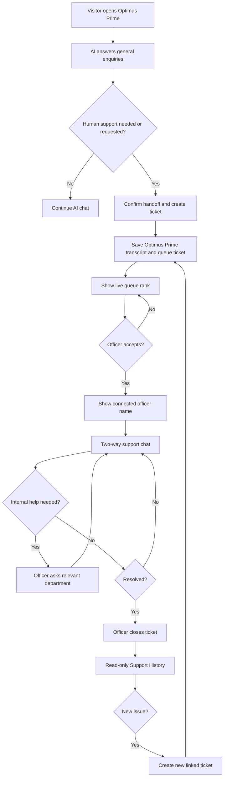
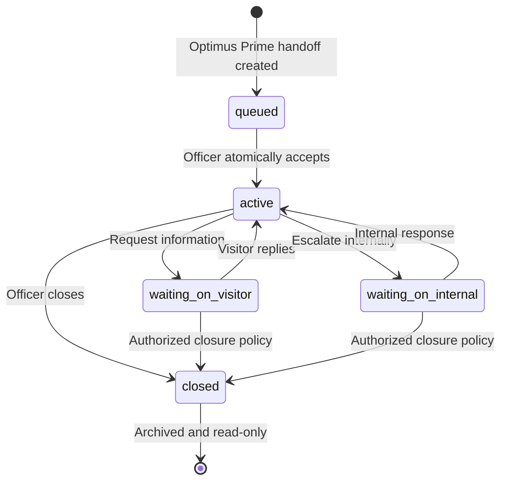

# CEDA Innovation Portal
## Support Officer Workflow, Screens and Functional Specification

**Document type:** Functional requirements and UI/UX specification  
**Role in scope:** Standard Support Officer  
**Companion experiences:** Optimus Prime AI chatbot, Innovator/visitor support, Assessment Manager escalation  
**Version:** 1.0 | **Date:** 19 November 2026  
**Status:** Proposed implementation specification; policy settings require CEDA confirmation

> **Core rule:** A visitor can chat with Optimus Prime before submitting an innovation. When Optimus Prime cannot resolve an enquiry and the visitor requests a person, the conversation becomes a persistent support ticket. The visitor sees a live queue position, then the assigned officer's name, exchanges messages in the same thread, and can read—but never write to—the ticket after the officer closes it.

---

# 1. Purpose and scope

This specification defines the complete end-to-end experience of **Maseo, a regular CEDA Support Officer**, including navigation, screens, states, buttons, modals, workflow rules, permissions, data requirements, notifications, exceptions, and acceptance criteria. It is designed to sit alongside the existing Innovator, Standard Assessor, and Assessment Manager specifications.

The Support Officer is a **human customer-support role**, not an assessor, lead assessor, assessment manager, or technical system administrator. Support can answer questions, view appropriately scoped user information, send and receive messages, route issues, document outcomes, and close tickets. Support **cannot** score, vote on, approve, reject, alter, or release innovation decisions; cannot see confidential assessor scores or team discussions; and cannot administer staff roles.

**In scope:** General pre-application questions; post-application assistance; Optimus Prime-to-human handoff; guest and authenticated users; queue numbering; concurrent officer assignments; conversations; internal notes; internal department escalations; history; search; notifications; metrics; audit and security.

**Out of scope:** Making assessment decisions, changing eligibility rules, editing submitted innovations, formal appeals management, creating AI model training datasets, unrestricted access to identity documents, and system infrastructure configuration.

# 2. Confirmed product behavior and design assumptions

| ID | Requirement / design decision | Rule |
|---|---|---|
| BR-01 | Pre-application assistance | A visitor may use Optimus Prime without ever submitting an innovation. |
| BR-02 | AI first | Optimus Prime supplies authorized knowledge-based assistance before offering a human handoff; visitors may also explicitly request a human. |
| BR-03 | Explicit handoff | A support ticket is created when a human handoff is accepted/requested. The prior Optimus Prime conversation is attached in chronological order. |
| BR-04 | Continuous customer conversation | The visitor sees the AI transcript, handoff event, and human replies in one support conversation. |
| BR-05 | Queue visibility | While waiting for acceptance, the visitor sees a live, one-based queue position and the ticket reference. |
| BR-06 | Named officer | After an officer accepts a ticket, the visitor sees 'Connected to Maseo — Support Officer' (or the actual assigned officer). |
| BR-07 | Two-way messages | Visitor and officer can send messages asynchronously while the ticket is active. |
| BR-08 | Officer closes | After resolution, the Support Officer closes the ticket, which removes it from active lists. |
| BR-09 | Closed means read-only | The visitor and officer can open closed history but cannot send, edit, or delete messages in that ticket. A new problem creates a new linked ticket. |
| BR-10 | Staff boundaries | Support may query approved applicant-facing statuses, not private evaluation records. |
| BR-11 | Capacity | Multiple officers may accept different tickets; their maximum concurrent assignments is configurable. |
| BR-12 | Server-authoritative state | Queue rank, claiming, assignments, permissions, delivery, timestamps, and closure are enforced server-side. |

**Implementation decisions requiring CEDA approval:** Support hours, response-time commitments, queue priority policy, per-officer concurrent ticket limit, guest recovery policy, identity verification requirements, inactivity reminders, data retention periods, and circumstances for interdepartmental escalation. Suggested defaults below are **proposals**, not established CEDA policy.

# 3. People, systems, and boundaries

| Actor | Responsibility | May access |
|---|---|---|
| Naledi (visitor or innovator) | Ask Optimus Prime questions, request human help, view queue, chat, read history | Own conversations and support tickets after secure guest/account recovery |
| Optimus Prime (AI) | Answer from approved knowledge and initiate transparent escalation | Conversation context and restricted knowledge; no independent assessment authority |
| Maseo (Support Officer) | Accept, investigate, respond, internally escalate, resolve and close | Tickets within authorized queue/assignment and limited user data |
| Assessment Manager | Supply authorized status clarification for escalated assessment queries | Assigned assessment workflow and internal escalation, not unnecessary support data |
| System Administrator | Maintain staff access, technical settings and platform health | Privileged administration only, governed by least privilege and audit |
| Support supervisor (optional later) | Monitor queues, capacity, SLA, coverage and reassignments | Team support reporting and permitted cases, not assessment votes |

**Principle:** An internal escalation is not an invitation for the Support Officer to read private assessor conversations. The manager can return an approved explanation that the officer communicates to the visitor.

# 4. Navigation and information architecture

## 4.1 Support Officer left navigation

1. **Dashboard** — workload and urgency overview.
2. **Live Queue** — unaccepted, ranked handoff tickets.
3. **My Active Tickets** — assigned conversations, including waiting states.
4. **All Tickets** — searchable authorized support records (scope-limited).
5. **Escalations** — internal requests and responses.
6. **Knowledge Base** — approved help content, procedures and response templates.
7. **Support History** — closed read-only tickets.
8. **My Performance** — personal work indicators.
9. **Notifications** — mentions, new messages, approaching targets and escalation updates.
10. **Profile & Availability** — name, availability, capacity indicator and security settings.

On smaller screens, use a compact bottom bar (Dashboard, Queue, My Tickets, More) and a drawer for remaining destinations. The ticket conversation remains the central workspace on desktop and mobile.

## 4.2 Visitor-facing navigation addition

**Optimus Prime Chat**, **Active Support Tickets**, and **Support History**. A live escalated conversation should remain accessible from Optimus Prime's chat surface; the Active Tickets area is a reliable recovery entry point after sign-out or navigation away. A visitor without an account needs a secure ticket-recovery mechanism, not a publicly guessable ticket number.

## 4.3 Main ticket workspace tabs/panels

**Conversation** (public dialogue), **Optimus Prime Handoff** (AI transcript and machine-generated summary), **Internal Notes** (staff only), **User Context** (permitted data), **Escalation** (department requests), and **Activity** (audit history). On desktop, show queue list at left, conversation center, and case context at right. On mobile, turn the side panels into separate tabs/drawers.

# 5. Core scenario: Naledi, Optimus Prime, Maseo and a queue of five

**Situation:** Naledi has not submitted an innovation. She asks Optimus Prime about a CEDA service. After some helpful answers, she asks a question that Optimus Prime cannot confidently answer.

1. Naledi opens Optimus Prime and exchanges messages normally. Optimus Prime provides helpful responses from the approved knowledge base.
2. Optimus Prime explains the limitation honestly and offers **Talk to a Support Officer**; Naledi selects it.
3. The backend creates support ticket `SUP-1041`, attaches the AI transcript, captures an issue summary, and queues it. Assume four other tickets are ahead: Naledi sees **Position 5 in queue**.
4. Naledi can leave the portal. For an authenticated user, the ticket is linked to the account. For a guest, a verified recovery method is required so she can return securely.
5. Maseo opens **Live Queue** and sees five ranked waiting tickets with category, age, and any urgency flag. Merely previewing a ticket **does not** remove it from the queue.
6. Maseo selects the first ticket and chooses **Accept Ticket**. A single atomic backend operation claims it. The next waiting user's position moves from 2 to 1, and so on.
7. When Maseo later accepts Naledi's ticket, her label changes from **Waiting for Support — Position 1** to **Connected to Maseo — Support Officer**. The queue position disappears because the ticket is no longer waiting.
8. Maseo can read the entire Optimus Prime conversation, including Naledi's original question and the AI handoff message. He responds directly in the same ticket, and Naledi replies.
9. If Maseo needs another department's advice, he creates an **internal escalation** while remaining accountable for the customer-facing conversation. The ticket shows an honest status such as **Awaiting Internal Response** without revealing confidential staff notes.
10. Maseo explains the answer, selects **Close Ticket**, chooses a resolution category, adds a closure summary, and confirms.
11. The ticket moves to **Support History** for both parties. All previous public messages remain visible in chronological order, but input controls are disabled and the backend rejects further writes.
12. For a different or recurring issue, Naledi starts a **new** ticket; it may reference `SUP-1041`, but `SUP-1041` remains immutable and closed.

**Queue example:** With one officer and five tickets, the first accepted case leaves the waiting queue, making the remaining positions 1–4. With two officers, each can accept a different case if capacity permits. Position changes must reflect the real server-side assignment/priority order, not guesses about wait time.

# 6. Full lifecycle and state-machine rules

## 6.1 Ticket statuses

| Status | Meaning | Can visitor send? | In waiting queue? |
|---|---|---|---|
| `queued` | Handoff recorded; waiting for an available officer to accept | Optional pre-accept message (recommended: yes; appended to ticket) | Yes |
| `active` | Officer has accepted and is handling the conversation | Yes | No |
| `waiting_on_visitor` | Officer needs clarification; assignment retained | Yes | No |
| `waiting_on_internal` | Officer awaits authorized internal assistance | Yes | No |
| `closed` | Officer completed the ticket; final historical record | **No** | No |

A `claimed/assigned` event can be recorded without introducing a redundant persistent status: acceptance transitions `queued` to `active` and sets `assigned_officer_id` atomically. `resolved` may exist as a closure reason or audit event, but there must not be a confusing customer-facing intermediate stage between completion and closure unless CEDA later asks for one.

## 6.2 Transition matrix

| Action | From | To | Actor | Server validations |
|---|---|---|---|---|
| Create human handoff | Optimus Prime conversation | `queued` | Authenticated user/verified guest via server | Consent/handoff request, anti-spam, transcript ownership |
| Accept ticket | `queued` | `active` | Available officer | Current authorization, capacity, atomic claim, not already assigned |
| Ask visitor for information | `active` | `waiting_on_visitor` | Assigned officer | Required outbound message / reason |
| Visitor replies | `waiting_on_visitor` | `active` | Ticket owner | Ticket open, identity/session validated |
| Escalate internally | `active` | `waiting_on_internal` | Assigned officer | Target department, explanation, allowed escalation scope |
| Department responds | `waiting_on_internal` | `active` | Internal recipient / system | Response associated with valid escalation |
| Officer closes | `active` / waiting states | `closed` | Assigned officer (or explicitly authorized supervisor) | Resolution code and summary required, closure policy satisfied |
| New related issue | `closed` | New ticket `queued` | Visitor | New ticket ID, optional `related_ticket_id`; old record unchanged |

## 6.3 Queue rank and concurrency rules

- **Display a ticket's 1-based place in the pending queue**, recalculated from the authoritative ordered set of `queued` tickets. No queue number for `active` or `closed` tickets.
- Default rank is by `queued_at` ascending; configurable higher-priority routing may precede ordinary tickets. Show a clear priority explanation when it affects ordering.
- The rank is **not** a promise about the number of minutes to an answer. Do not invent an ETA.
- Opening or previewing a ticket does not claim it. Only successful **Accept Ticket** changes assignment and queue rank.
- Acceptance must be transactional and concurrency-safe. If Maseo and a second officer click the same ticket, only one wins; the other sees **Already accepted by another officer** and refreshes the queue.
- The officer may accept up to a configurable concurrent active-ticket capacity, for example 3 as a starting proposal; disabled/away/offline officers cannot claim new cases.
- If all officers are unavailable or at capacity, tickets remain ranked and show **Waiting for an available officer**.
- Transferring an assigned ticket must preserve the transcript and audit trail. Whether transfers return to the global queue or a targeted officer queue is a configurable rule.
- Queue rank is recalculated whenever an eligible ticket enters, exits, changes priority, or is reassigned into the waiting queue; broadcast those changes via real-time subscriptions.

# 7. Screen-by-screen specifications — Support Officer

Each screen defines its **purpose, visible content, controls, behavior, safeguards, and responsive handling**. Use screen IDs in Figma designs, implementation tickets, and acceptance tests.

## SO-01 — Staff Sign In

**Purpose:** Authenticate Maseo securely and route him to his authorized support workspace.  
**Content:** CEDA branding, work email, password/SSO method, MFA challenge where required, account recovery, accessible errors.  
**Actions:** Sign In, Forgot Password, Verify MFA, Sign Out.  
**Logic:** Check active staff role server-side; no portal access after deactivation; redirect to Dashboard; log sign-in events.  
**Error/empty/mobile:** Invalid credentials must not reveal account existence; accessible single-column form on mobile.

## SO-02 — Support Dashboard

**Purpose:** Show current workload and what needs attention first.  
**Content:** New queue count, assigned active cases, awaiting visitor, awaiting internal response, overdue, first response time, recent ticket list.  
**Actions:** Open Queue, Open My Tickets, filter date/priority, open a ticket, set own availability.  
**Logic:** KPI cards link to their exact filtered records; counts use server-defined statuses; refresh live.  
**Error/empty/mobile:** Empty state shows 'No tickets need your attention'; KPI cards stack on small screens.

## SO-03 — Live Queue

**Purpose:** Surface unaccepted Optimus Prime handoffs in actual waiting order.  
**Content:** Position, ticket ID, question summary, category, submitted time, age, priority indicator, guest/account badge (when permitted), queue totals.  
**Actions:** Search/filter, Preview, Accept Ticket, view queue policy.  
**Logic:** Only `queued` tickets appear; position recalculates in real time; no automatic assignment on preview; capacity enforced at claim.  
**Error/empty/mobile:** If ticket was just claimed elsewhere, show a non-destructive conflict banner and update results.

## SO-04 — Ticket Preview

**Purpose:** Allow quick triage before an officer accepts responsibility.  
**Content:** Question excerpt, Optimus Prime summary, category, previous conversation preview with sensitive content redacted if required, queue place, created time.  
**Actions:** Accept Ticket, Back to Queue, Flag for urgent triage (if authorized).  
**Logic:** Read-only preview; no customer reply or internal assignment until accepted.  
**Error/empty/mobile:** If ticket becomes unavailable, disable Accept and explain why.

## SO-05 — My Active Tickets

**Purpose:** Track all currently assigned customer conversations.  
**Content:** Conversation preview, unread count, latest reply time, state, priority, waiting reason, officer capacity meter.  
**Actions:** Open Conversation, filter by state/unread/age, sort, search.  
**Logic:** Show `active`, `waiting_on_visitor` and `waiting_on_internal` assigned to logged-in officer; closed tickets move to History.  
**Error/empty/mobile:** Separate unread badge and waiting-state labels; swipe-free accessible actions.

## SO-06 — Unified Ticket Conversation

**Purpose:** Primary work area for one continuous AI-to-human conversation.  
**Content:** Ticket ID, status, visitor display name, 'Connected to Maseo', chronological bubbles (Optimus Prime, user, support), timestamps, message delivery state, attachments if enabled.  
**Actions:** Send Message, add attachment, Internal Note, Request Info, Internal Escalation, Close Ticket, view Handoff.  
**Logic:** Human messages append to same ticket after AI handoff; AI must not post autonomous human-stage answers; only assigned officer may send support messages; preserve chronological ordering.  
**Error/empty/mobile:** Retry transiently failed sends with idempotent message IDs; on mobile keep composer visible above keyboard; disable composer on closed ticket.

## SO-07 — Optimus Prime Handoff Context

**Purpose:** Prevent asking Naledi to repeat her question.  
**Content:** Complete permitted pre-handoff transcript, AI handoff reason, time, machine summary labelled 'AI-generated', linked source article if any.  
**Actions:** Jump to message, Copy approved excerpt, Flag inaccurate AI reply.  
**Logic:** The original messages remain uneditable; summaries are aids, not authoritative facts; sensitive details are appropriately masked.  
**Error/empty/mobile:** If the AI transcript is missing, show 'Handoff transcript unavailable' rather than inventing prior context.

## SO-08 — User and Guest Context

**Purpose:** Identify the person seeking help and view only necessary information.  
**Content:** Verified account name/contact where authorized, guest verification status, language preference, previous support-ticket references, consent markers.  
**Actions:** Open authorized profile, Request Verification, view permitted related tickets.  
**Logic:** Do not expose sensitive application details based on an unverified guest session; staff cannot edit identity fields from this screen.  
**Error/empty/mobile:** Hide private fields when verification is incomplete; show why an action is restricted.

## SO-09 — Innovation Status Lookup (Read Only)

**Purpose:** Answer a submitted innovator's basic status question without crossing assessment confidentiality boundaries.  
**Content:** Innovation title/reference, public/applicant-facing stage, submission date, published next-step instructions, any approved clarification.  
**Actions:** View Applicant-Facing Status, Escalate for Update.  
**Logic:** Never expose scores, assessor identity, draft recommendations, internal comments, votes, or assessment-manager notes.  
**Error/empty/mobile:** For Naledi before applying, display 'No linked submissions' and continue general support.

## SO-10 — Compose Public Reply

**Purpose:** Send a message the visitor can read.  
**Content:** Composer, optional approved templates, attachment limitations, clear PUBLIC REPLY marker.  
**Actions:** Send, Save Unsent Draft, Attach if enabled, Cancel.  
**Logic:** Validate role, assignment, open status, size and attachments server-side; store sender identity and timestamps; publish event; notification.  
**Error/empty/mobile:** Empty messages blocked; error state must not silently discard text.

## SO-11 — Internal Notes

**Purpose:** Record staff-only facts and follow-up actions.  
**Content:** Notes timeline distinct from public chat; authors, timestamps, related escalation links.  
**Actions:** Add Internal Note, cite ticket message, view note history.  
**Logic:** Staff-only RLS and separate message visibility; notes are never included in visitor APIs or notifications.  
**Error/empty/mobile:** Clear 'Not visible to visitor' banner; avoid ambiguous toggle states.

## SO-12 — Request Visitor Information

**Purpose:** Ask Naledi for missing details while keeping the conversation active.  
**Content:** Public question template, optional due-date policy, current ticket state.  
**Actions:** Send Request, Cancel.  
**Logic:** Sending the request transitions ticket to `waiting_on_visitor`; visitor reply returns it to `active`; notify officer.  
**Error/empty/mobile:** Show requested items clearly and do not ask for passwords or one-time security codes.

## SO-13 — Internal Escalation Form

**Purpose:** Ask the appropriate department for assistance without exposing their internal records.  
**Content:** Target team (Assessment Manager, Technical Administrator, Support Supervisor), issue type, urgency, concise context, requested action, linked ticket.  
**Actions:** Submit Escalation, Save Draft, Cancel.  
**Logic:** Route to authorized recipient; status `waiting_on_internal`; preserve owner as Maseo; never transfer private assessment comments to customer.  
**Error/empty/mobile:** Require reason and department; warn if context includes unnecessary personal data.

## SO-14 — Escalation Inbox and Detail

**Purpose:** Monitor internal answers and next actions.  
**Content:** Escalation reference, destination, pending time, reply status, authorized response, associated ticket.  
**Actions:** Open, Add Follow-up, Mark Internal Response Reviewed, Return to Conversation.  
**Logic:** Internal responses do not automatically send to Naledi; Maseo must compose the approved customer-facing message.  
**Error/empty/mobile:** Show delayed escalation and route options without falsely marking the customer ticket resolved.

## SO-15 — Transfer / Reassign Request

**Purpose:** Move a case to another permitted officer or queue when needed.  
**Content:** Target, current assignment, reason, capacity/availability if accessible.  
**Actions:** Request Transfer, Confirm.  
**Logic:** Permission-controlled, atomic reassignment, retain all messages, inform visitor when new officer connects; do not lose queue history.  
**Error/empty/mobile:** Reject invalid targets and show the current owner after race conditions.

## SO-16 — Ticket Resolution and Closure

**Purpose:** End the support interaction intentionally.  
**Content:** Resolution category, summary, optional answer reference, a preview of 'Conversation becomes read-only'.  
**Actions:** Close Ticket, Cancel.  
**Logic:** Requires officer's assignment/authorization and mandatory closure fields; atomic status switch to `closed`; archive and notify user.  
**Error/empty/mobile:** Confirmation prevents accidental close. After success redirect to History or My Tickets. No reopening the old thread for new chatting.

## SO-17 — Support History

**Purpose:** Retrieve concluded tickets without making them active again.  
**Content:** Closed ticket list, search, closure category/date, assigned officer, related ticket references.  
**Actions:** Open Read-only Record, Filter, Copy Ticket Reference.  
**Logic:** Closed records retained under approved retention policy; accessible only to authorized scope; no Reply button.  
**Error/empty/mobile:** Show 'No closed tickets yet'; archive is not deletion.

## SO-18 — Closed Ticket Detail

**Purpose:** Let Maseo or Naledi audit the final public conversation.  
**Content:** Transcript including Optimus Prime handoff and human dialogue, closure time and public outcome summary, 'Closed — Read Only' banner.  
**Actions:** Back to History, Start New Related Ticket (visitor flow), Print/Export if authorized.  
**Logic:** Hard backend deny on new public messages, edits, and deletion; internal notes remain excluded from visitor display.  
**Error/empty/mobile:** Disabled composer plus server rejection; do not pretend ticket was deleted.

## SO-19 — Search and Advanced Filters

**Purpose:** Locate permitted tickets by reliable reference and metadata.  
**Content:** Search by ticket ID, user reference, subject; filters for status, category, date, assignment and priority.  
**Actions:** Apply, Clear, Save View (optional), Open Result.  
**Logic:** Search results are permission-filtered on the server; avoid allowing ticket ID enumeration to reveal private records.  
**Error/empty/mobile:** Search query and applied filters visible; sane pagination.

## SO-20 — Knowledge Base

**Purpose:** Give consistent approved answers for routine enquiries.  
**Content:** Searchable CEDA FAQ articles, application guidance, eligibility pages, troubleshooting topics, article version/review metadata.  
**Actions:** Search, Open Article, Insert Approved Snippet into Draft, Flag Outdated Article.  
**Logic:** Insert text into an unsent draft, never auto-send; only approved articles shown to general support.  
**Error/empty/mobile:** Highlight when an article is outdated or awaiting approval.

## SO-21 — AI Response Quality Flag

**Purpose:** Report a Optimus Prime answer that was uncertain, outdated, or wrong.  
**Content:** AI message reference, issue category, explanation, approved corrected guidance if available.  
**Actions:** Submit Flag.  
**Logic:** Create a review item; do not train or alter Optimus Prime immediately based on a single officer's free-text note.  
**Error/empty/mobile:** Successful flag does not change the public transcript.

## SO-22 — Notifications Centre

**Purpose:** Ensure Maseo sees relevant changes.  
**Content:** New assignment, visitor reply, internal response, closing confirmation, service target warning, mention.  
**Actions:** Open Related Ticket, Mark Read, notification preferences where permitted.  
**Logic:** Respect user roles and channel preferences; de-duplicate events; avoid sensitive excerpts in email previews.  
**Error/empty/mobile:** Badge counts update without hard refresh.

## SO-23 — My Performance

**Purpose:** Give staff a transparent view of their own support outcomes.  
**Content:** Assigned count, closed count, first human response time, resolution time, aging cases, reopened/new-related issue trends, feedback summary if enabled.  
**Actions:** Filter Date, View Underlying Tickets.  
**Logic:** Calculations use event timestamps and approved business-hour rules; AI acknowledgement is not a human response.  
**Error/empty/mobile:** Never present fabricated live metrics; show 'Insufficient data' where appropriate.

## SO-24 — Profile, Availability and Capacity

**Purpose:** Manage the officer's work status and personal settings.  
**Content:** Display name, staff role, status (Available/Away/Offline), current active count/max, security options, language, notifications.  
**Actions:** Set Availability, Update Preferences, Change Password/SSO Security, Sign Out.  
**Logic:** Available officer may accept within configured capacity; Away/Offline does not silently release active cases; staffing rules govern handover.  
**Error/empty/mobile:** Warn before going offline with pending urgent cases if configured.

## SO-25 — Audit and Activity Timeline

**Purpose:** Explain who changed what and when.  
**Content:** Created, queued, accepted, replied, escalated, status transitions, transfer, close; event actor and timestamp.  
**Actions:** View related event, open authorized audit details.  
**Logic:** Append-only system events; public visitor sees only public milestones, not internal-only activity.  
**Error/empty/mobile:** No delete/edit controls for audit events.

## SO-26 — Permission and Error States

**Purpose:** Handle denied access, expired sessions, outage or changed ticket ownership gracefully.  
**Content:** Specific safe message, recovery navigation, retry where appropriate.  
**Actions:** Sign In Again, Return to Tickets, Refresh Queue.  
**Logic:** No private data in error payload; session loss preserves unsent local draft where safe; server remains authoritative.  
**Error/empty/mobile:** Differentiated 'already claimed', 'ticket closed', 'permission denied', and 'network unavailable' messages.

# 8. Visitor-facing handoff screens (required counterpart)

These screens belong to the innovator/guest experience but are specified here because they determine the Support Officer behavior.

## VC-01 — Optimus Prime Conversation

Show normal chat bubbles with history, composer, and an accessible **Talk to a Person** option. When Optimus Prime lacks confidence, it should explain the limit and offer human support; avoid invented answers. Pre-application visitors may ask general questions.

## VC-02 — Human Handoff Confirmation

Show a short preview of what will happen: the conversation goes to support, a ticket and queue position are created, and the support team can read preceding Optimus Prime messages. Let the visitor confirm. Avoid duplicate tickets from repeated taps.

## VC-03 — Waiting in Queue

Show ticket reference, **Position N in queue**, creation time, 'Waiting for a Support Officer', and live changes. The visitor may navigate away and return. Do not show a fabricated wait-time estimate. If no officers are online, show that fact and any approved business-hours guidance. Visitor may send supplementary context while queued if enabled.

## VC-04 — Connected to an Officer

Show **Connected to Maseo — Support Officer** with the actual officer name and preserve the previous Optimus Prime messages in the same scrollable thread. After assignment the queue number disappears. Notify the visitor of new human messages even when away.

## VC-05 — My Active Support Tickets

Show all owned `queued`, `active` and waiting-state tickets; status, current queue place or named officer, unread indicator and latest message. Access must follow authenticated account ownership or a verified guest-recovery token.

## VC-06 — Support History and Closed Conversation

Show closed tickets and full public transcript, including Optimus Prime and human messages, with an unmistakable **Closed — Read Only** banner. No message composer. A **Start New Support Request** action creates a new ticket rather than reopening the old conversation.

## VC-07 — Guest Recovery / Link Account

Where no account exists, offer a secure email verification or equivalent recovery process before a guest can reopen the same ticket on another visit/device. Never use only the ticket number as proof of ownership. If no recovery method is verified, warn that cross-session recovery cannot be guaranteed.

# 9. Modals, side panels and system notifications

| ID | Component | Trigger | Required fields and behavior |
|---|---|---|---|
| UI-01 | Human handoff confirmation | Visitor asks Optimus Prime for support | Explain human access to prior transcript; Confirm/Cancel. |
| UI-02 | Ticket created notice | Handoff succeeds | Reference, live queue position, access/recovery instructions. |
| UI-03 | Accept ticket confirmation | Officer selects queued item | Show capacity and assignment; atomic submit. |
| UI-04 | Ticket already claimed toast | Two officers race | Non-destructive refresh, no double assignment. |
| UI-05 | Officer connected banner | Acceptance succeeds | Display actual officer identity and human state. |
| UI-06 | Internal note drawer | Officer adds staff note | Explicit INTERNAL visibility, author and timestamp. |
| UI-07 | Request information modal | Officer needs clarification | Question required; status change and notification. |
| UI-08 | Internal escalation modal | Officer needs another team | Destination, reason, urgency, reference. |
| UI-09 | Transfer ticket dialog | Reassignment authorized | Target and reason; preserved history. |
| UI-10 | Close ticket dialog | Officer resolves | Resolution category, summary, final read-only warning. |
| UI-11 | Closed ticket banner | Any user opens archived case | No composer or edit/delete actions. |
| UI-12 | New related ticket dialog | Visitor needs more help after closure | New ticket ID linked to prior record. |
| UI-13 | Guest verify identity modal | Account-specific action/recovery | Verification process; no exposure before success. |
| UI-14 | Error/retry toast | Failed message delivery | Retry idempotently without duplicated messages. |
| UI-15 | Availability switcher | Officer changes work status | Capacity, active case warning, explicit mode. |
| UI-16 | Priority change dialog | Authorized triage changes order | Reason, audit, recalculated ranks. |
| UI-17 | Inactivity warning | Configured policy threshold | Notice; no silent closure when user expects live support. |
| UI-18 | Unread response notification | Other participant replies | Deep link to owned ticket; privacy-preserving preview. |

# 10. Permissions matrix

| Action | Visitor / Innovator | Support Officer | Assessment Manager | System Administrator |
|---|---|---|---|---|
| Talk to Optimus Prime | Own chat | Optional staff help context | Optional | Optional |
| Create own handoff ticket | Yes | On behalf, if specifically allowed | No by default | No by default |
| View waiting queue rank | Own rank | Authorized queue | Aggregate only | Aggregate/system metrics |
| Accept waiting ticket | No | Yes, within capacity | No | No by default |
| View assigned transcript | Own public transcript | Authorized ticket including Optimus Prime context | Escalation excerpt only | By narrowly authorized support/security need |
| Send customer-facing support reply | Own messages | Yes on assigned active ticket | No by default | No by default |
| Add internal support notes | No | Yes | On internal escalation only | Restricted admin action if justified |
| Lookup applicant-facing status | Own application | Read-only, verified/scope limited | Yes via assessment workspace | Not automatically entitled |
| View private assessor scores/chats | No | **No** | Within assessment authority | **No by default** |
| Approve/reject an innovation | No | **No** | Assessment governance rules only | **No** |
| Close support ticket | No | Assigned officer | No by default | Explicit exceptional permission only |
| Write to closed ticket | **No** | **No** | **No** | **No** |
| View closed ticket | Own public history | Authorized archive | Only authorized escalation context | Restricted technical audit access |

All permissions must be backed by API authorization, database row-level restrictions, and audit. Frontend hiding is not sufficient.

# 11. Data model and server event contracts

## 11.1 Logical entities

| Entity | Key fields | Notes |
|---|---|---|
| `support_tickets` | `id`, `public_reference`, `owner_user_id`, `guest_identity_id`, `status`, `priority`, `category`, `subject`, `created_at`, `queued_at`, `accepted_at`, `closed_at`, `assigned_officer_id`, `related_ticket_id`, `resolution_code`, `resolution_summary`, `version` | Ticket reference is not an authentication credential. |
| `support_messages` | `id`, `ticket_id`, `sender_type`, `sender_id`, `visibility`, `body`, `created_at`, `delivery_state`, `client_message_id`, `source_conversation_message_id` | Preserve order and differentiate AI/user/officer/internal messages. |
| `optimus_prime_conversations` | `id`, `owner_id` or guest identity, `started_at`, `handoff_at`, `handoff_reason`, `knowledge_version` | AI transcript retained under policy and linked at handoff. |
| `ticket_assignment_events` | `ticket_id`, `officer_id`, `action`, `created_at`, `reason` | Every accept/transfer captured; atomic claim. |
| `support_officer_presence` | `officer_id`, `availability`, `max_concurrent`, `updated_at` | Presence does not override assignment authorization. |
| `support_escalations` | `id`, `ticket_id`, `target_department`, `requested_by`, `reason`, `state`, `created_at`, `responded_at`, `approved_reply` | Separate internal channel; not automatically public. |
| `support_ticket_events` | `id`, `ticket_id`, `actor_id`, `event_type`, `old_state`, `new_state`, `created_at`, `metadata` | Append-only audit, controlled access. |
| `support_guest_recovery` | `guest_identity_id`, `verified_contact`, `verification_status`, token reference, expiry | Store only hashed/short-lived token secrets, not plaintext. |
| `support_notifications` | `id`, `recipient_id`/guest channel, `ticket_id`, `type`, `channel`, `sent_at`, `read_at` | No private content in generic email push. |
| `support_knowledge_articles` | `id`, `title`, `body`, `status`, `version`, `approved_at`, `updated_at` | Staff use approved content; AI knowledge curated separately. |

## 11.2 Crucial transactional operations

**Create ticket:** Validate handoff and owner; ensure idempotency key for one Optimus Prime request; copy/link immutable conversation history; set queued time; append creation event; broadcast queue update; return `ticket_id` and rank.

**Accept ticket:** In one database transaction lock the target queued record; confirm officer role, availability, capacity, and no existing assignment; update `status=active`, `assigned_officer_id`, `accepted_at`; append audit; commit; broadcast revised ranks and connection banner. A second claim must fail cleanly.

**Send message:** Validate ticket ownership or assigned officer and `status != closed`, visibility, rate/size limits and optional file validation. Insert with a unique client idempotency key and server timestamp; publish to authorized subscribers only.

**Close ticket:** Verify assigned officer/exceptional authorization, closure reason and state. In one transaction switch to `closed`, set close metadata, add audit entry, disable writes, schedule public notification, update active counts and archive views.

**Guest recover:** Verify a short-lived recovery challenge and bind the session to the same guest identity; never authorize history access solely on `public_reference`.

## 11.3 Real-time subscriptions

- Visitor subscribes only to **own ticket state, queue rank and public messages**.
- Officer subscribes to **authorized waiting queue changes, assigned ticket messages and internal escalation updates**.
- Internal notes and escalation details are not streamed on visitor channels.
- When connectivity is lost, show 'Reconnecting' and fetch latest server state on return; the server's current rank and assignment always override stale local UI.
- Notification delivery (in-app/email) is separate from message persistence. Failed emails must not erase or duplicate a conversation message.

## 11.4 Suggested API and service actions (illustrative)

| Action | Endpoint / RPC concept | Permission |
|---|---|---|
| Optimus Prime handoff | `POST /support/handoffs` | Session owner / verified guest |
| View my tickets | `GET /support/my-tickets` | Owner |
| Queue overview | `GET /support/queue` | Officer |
| Claim ticket | `POST /support/tickets/{id}/accept` | Available officer |
| Ticket details | `GET /support/tickets/{id}` | Owner or assigned/authorized staff |
| Send public message | `POST /support/tickets/{id}/messages` | Owner or assigned officer while open |
| Add internal note | `POST /support/tickets/{id}/internal-notes` | Assigned officer |
| Create escalation | `POST /support/tickets/{id}/escalations` | Assigned officer |
| Close ticket | `POST /support/tickets/{id}/close` | Assigned officer / authorized exception |
| List closed history | `GET /support/history` | Owner or permitted staff |

These route names are examples, not fixed contracts. If implementing with Supabase, use PostgreSQL transactional functions or server-side endpoints for claim/close operations, strict RLS policies, and Supabase Realtime for authorized message and status changes.

# 12. Notifications and continuity

| Event | Visitor experience | Officer experience |
|---|---|---|
| Optimus Prime escalates | Ticket created, queue rank and recovery instructions | New queue item and optional unread notification |
| Queue rank changes | Live rank refresh while queued | Live queue ordering refresh |
| Officer accepts | Named officer connected banner; queue number removed | Ticket appears in My Active Tickets |
| Officer replies | In-app unread count and opted-in email/push | Sent/delivery state |
| Visitor replies | Sent message in thread | Unread alert/deep link |
| Internal escalation waits | 'We are checking with the relevant team' where appropriate | Internal response pending and aging indicator |
| Officer closes | Closure notice; move to read-only Support History | Ticket leaves Active, enters History |
| Guest returns | Secure verification restores own ticket | No assignment change |

Never reveal staff-only notes, scores, personal documents or sensitive account information in public notifications. Emails should link to a secure ticket, not expose the transcript.

# 13. Screen interaction rules, accessibility and usability

- Maintain a single chronological transcript with visibly distinct sender types: **Optimus Prime (AI)**, **You**, and **Maseo (Support Officer)**. The handoff marker explicitly separates AI from human assistance.
- Display queue rank as **'You are number N in the support queue'**, updated live only while waiting. If rank can change due to priority, indicate that it may move as urgent requests are prioritized.
- Do not promise instant contact or estimated minutes unless grounded in an approved measured ETA engine; an ordinary queue number is enough for MVP.
- Show the real officer name only after a successful claim, never when a ticket is merely previewed.
- Preserve visitor drafts safely across local navigation where feasible; do not infer that messages were sent without server acknowledgement.
- For closed tickets, display **'This ticket is closed. You can view this conversation but cannot reply. Start a new support request for further assistance.'**
- Support keyboard navigation, accessible labels, screen-reader announcements for queue and connection changes, readable contrast, touch targets, focus management, and text scaling.
- Time stamps should display in the viewer's local timezone; store UTC consistently and include exact dates when needed.
- Provide clear loading, offline, no-results, expired-session and permission-denied states without leaking information.
- Avoid sending passwords, OTPs, payment credentials or raw ID documents through public chat; guide users to approved secure processes.

# 14. Edge cases and exception handling

| Scenario | Required result |
|---|---|
| Two officers accept the same ticket simultaneously | Only first committed claim succeeds; losing officer sees updated ownership. |
| Officer previews but does not accept | Ticket stays queued at its correct rank. |
| Naledi leaves site while queued | Ticket and queue state remain server-side; she recovers via account/verified guest identity. |
| Naledi has no innovation | General support still operates normally; status lookup shows none. |
| Naledi returns after Maseo replied | She sees all Optimus Prime and human messages in correct order, with unread markers. |
| All officers offline/full | Show waiting state and real queue position, not a false connection. |
| Officer goes offline during active chat | Ticket stays assigned; staff handover policy handles extended absence. |
| Officer reaches concurrency limit | Accept is disabled and rejected by server until capacity frees. |
| Guest lacks verified recovery method | Explain that return access may be lost; offer secure verification, not insecure ID-only access. |
| Visitor sends repeated handoff taps | Idempotent ticket creation prevents duplicate queue entries. |
| Priority of a waiting ticket changes | Server recalculates rank and records the reason; visitor sees updated position. |
| Message transmission fails | Draft is preserved, client retries with idempotency key; no duplicate messages. |
| Officer closes while visitor is composing | Server rejects late write as ticket closed; UI explains and offers new request. |
| User has further questions after closure | New linked ticket is created; original transcript remains locked. |
| Internal team supplies restricted information | Officer receives scoped response and shares only approved customer-facing explanation. |
| Customer disputes assessment result | Support explains formal appeal route; cannot edit or overturn assessment decision. |
| Harassment, threats or spam | Apply approved moderation, safety and support escalation procedures with audit. |
| Retention or deletion request | Follow CEDA legal/retention policy; 'never auto-delete at closure' does not mean perpetual storage. |

# 15. Reporting and KPI definitions

| KPI | Definition |
|---|---|
| Queue size | Number of tickets currently in `queued`. |
| Active support conversations | Count of accepted tickets in non-closed working states. |
| Waiting rank | 1-based position of a single `queued` ticket under current ordering policy. |
| Queue wait time | `accepted_at - queued_at`; exclude unresolved pending cases from completed-wait averages and show pending age separately. |
| First human response time | First officer public message timestamp minus ticket creation/queue time, by approved convention; Optimus Prime messages do not count. |
| Resolution time | `closed_at - created_at`, with any business-hour/paused-period adjustments documented. |
| Tickets closed | Count of tickets whose final transition to `closed` occurs in selected period. |
| Internal escalation rate | Tickets with at least one internal escalation divided by handled tickets for the period. |
| Capacity utilization | Active assigned count divided by configured concurrent limit, not a measure of chat quality. |
| Customer feedback | Explicit ratings captured after closure, optional, not invented. |

The **Support Officer** sees individual workload and permitted metrics. The **Assessment Manager** sees innovation assessment submissions and turnaround separately. The **System Administrator** sees platform health and aggregate service reliability, without being granted assessor decision powers. An optional **Support Supervisor** could later own cross-team support SLAs and staffing.

# 16. Mermaid user-flow and state diagrams

## 16.1 Visitor to officer to archive



## 16.2 Server-side ticket state flow



## 16.3 Queue claim concurrency

```mermaid
sequenceDiagram
    participant N as Naledi
    participant S as Support Server
    participant M as Maseo
    participant O as Other Officer
    N->>S: Confirm Optimus Prime handoff
    S-->>N: Ticket queued, rank 5
    M->>S: Preview first ticket
    S-->>M: Preview only; still queued
    M->>S: Accept ticket atomically
    O->>S: Accept same ticket
    S-->>M: Accepted and assigned
    S-->>O: Conflict: already assigned
    S-->>N: Updated rank when ticket ahead leaves queue
```

# 17. Functional acceptance criteria and testing

| Test ID | Scenario and expected result |
|---|---|
| AT-01 | Guest with no application can ask Optimus Prime general CEDA questions. |
| AT-02 | Optimus Prime answers from approved content and offers human help for unknown/unsupported questions. |
| AT-03 | Handoff is user-confirmed and creates exactly one ticket per handoff event. |
| AT-04 | Ticket contains original AI, user and handoff messages in correct chronological order. |
| AT-05 | Fifth queued ticket shows rank 5 when four eligible tickets precede it. |
| AT-06 | Officer preview leaves rank and assignment unchanged. |
| AT-07 | Officer acceptance atomically claims case and causes other eligible ranks to update. |
| AT-08 | Two simultaneous accept attempts cannot assign a single ticket twice. |
| AT-09 | Officer at capacity is blocked from accepting additional tickets. |
| AT-10 | Visitor sees assigned officer's real name after successful acceptance and no queue rank. |
| AT-11 | Visitor and officer can send/receive messages in one persistent thread. |
| AT-12 | Visitor navigates away and returns to intact active conversation. |
| AT-13 | Authenticated visitor sees only their own tickets. |
| AT-14 | Verified guest can securely recover their own case across sessions. |
| AT-15 | Unverified guest cannot access another user's ticket with ticket number alone. |
| AT-16 | Optimus Prime does not autonomously impersonate a human after handoff. |
| AT-17 | Officer can add internal notes invisible in all visitor APIs and notifications. |
| AT-18 | Officer can escalate to Assessment Manager and receive a private response. |
| AT-19 | Support Officer cannot see assessor scores, private deliberations or votes. |
| AT-20 | Support Officer cannot approve/reject innovations or modify submissions. |
| AT-21 | Officer can request clarification; status changes and visitor reply is retained. |
| AT-22 | Officer closure requires resolution category and summary. |
| AT-23 | Closed ticket vanishes from active lists and appears in both parties' history. |
| AT-24 | Closed ticket UI has no composer; backend rejects messages, edits and deletion. |
| AT-25 | New enquiry after closure produces a distinct ticket linked to prior one if requested. |
| AT-26 | Network retries do not create duplicate messages. |
| AT-27 | All status changes and assignments leave an append-only audit event. |
| AT-28 | Queue rank is not presented as a guaranteed ETA. |
| AT-29 | Personal and support KPI reports use actual event timestamps, not synthetic numbers. |
| AT-30 | Keyboard and screen-reader users can open chat, follow queue state, and read history. |
| AT-31 | Officer offline does not erase or silently reassign active cases without policy. |
| AT-32 | Cancellation/transfer/priority changes preserve previous ticket records and audit trail. |

# 18. Suggested implementation phases

**Phase 1 — Core MVP:** Optimus Prime handoff confirmation; persistent ticket and transcript; secure account/guest recovery; live ranked queue; atomic Accept Ticket; named officer connection; asynchronous public chat; officer closure; read-only history; essential role permissions and notifications.

**Phase 2 — Operational improvements:** Officer availability and concurrency; internal notes; escalation to assessment/technical staff; categorization; knowledge base; ticket search and filters; delivery retries; staff workload metrics; queue and quality dashboards.

**Phase 3 — Scale and assurance:** Configurable SLAs and business hours; staffing and priority rules; support supervisor reporting; advanced anti-abuse, moderation and accessibility testing; policy-driven retention; analytics and reviewed AI quality-improvement workflow.

# 19. Implementation handoff checklist

Before production, CEDA and the delivery team should confirm: approved support categories and escalation routes; agent concurrency limit; handling of priority tickets; guest recovery channel and verification; support working hours; notifications and content; retention/deletion rules; visitor-visible statuses; security controls; departmental response responsibilities; approved knowledge sources; audit access; accessibility and localization requirements; and acceptance-test sign-off.

**Definition of done:** A person who has never submitted an innovation can chat with Optimus Prime, request human help, receive an honest live queue place, return securely later, see the assigned officer's name and all previous Optimus Prime messages, converse until resolved, and then review the immutable, closed support history. Maseo can manage the corresponding workload without being granted any assessment-management powers.

---

*End of Support Officer specification — Version 1.0, 19 November 2026.*
