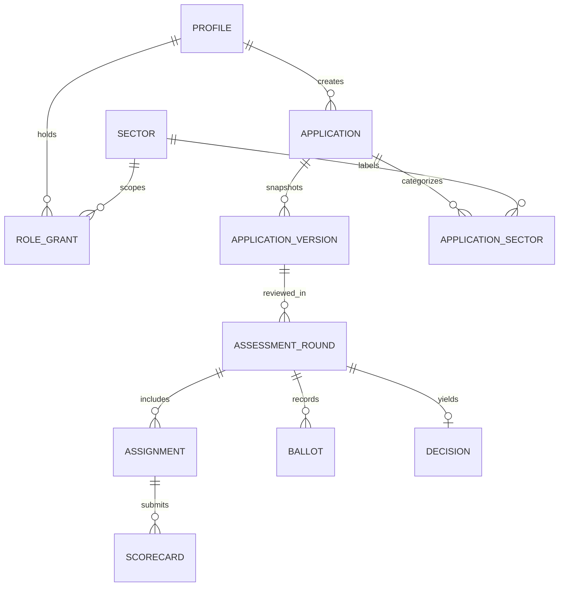

# Database design

For the implemented administration tables, private RPC boundary, invitation grants and audit records, see [Administration Implementation](<Administration Implementation.md>). The versioned migrations are the source of truth for the deployed schema.

Proposed logical schema for Supabase PostgreSQL. UUID primary keys unless specified. Use timestamptz, explicit foreign keys, named checks and restrictive deletion for business records. Publishing and security-sensitive changes write audit events. Record actor and timestamps on stateful rows.

## Target and first migration

The hosted target is [Ceda Innovation](https://supabase.com/dashboard/project/inzupertrdvlenrozqep), project reference `inzupertrdvlenrozqep`. On 19 November 2026 it was healthy in `eu-west-1`. Migration `20261119112830_innovator_profiles.sql` creates `public.profiles` as its first application table. The table uses the Supabase Auth user ID, stores a profile name and account status, and grants each permanent authenticated user read access to their own profile. Trusted server code will provision and update profiles. Account state is stored here for future server access checks.

The profile policy checks are in `supabase/tests/profiles.sql`. Run them on a local or disposable database after applying migrations. The initial hosted preflight ran inside a rolled-back transaction and checked owner access, denial of cross-account reads and writes, and denial of anonymous access. Verification after deployment showed zero profile rows.

### Innovator signup

Migration `20261119181502_innovator_signup.sql` provisions a profile after Supabase Auth records email confirmation. Pending accounts exist in Auth. Confirmed, non-anonymous email accounts receive a profile linked by Auth user ID with `account_role = 'innovator'` and `account_status = 'active'`. Signup submits `full_name` as display metadata. The database validates and bounds the stored name, assigns the role itself, and preserves the existing profile and status on a repeated confirmation. Staff permissions will use separate scoped grants.

The hosted Auth settings report email enabled, signup enabled and email auto-confirmation disabled. `supabase/tests/innovatorSignup.sql` verifies provisioning and the privilege restrictions with synthetic records in a rolled-back transaction. The migration also revokes client execute grants on `public.rls_auto_enable()` and preserves the database event trigger.

For the web integration, use the Supabase Auth signup API with the project publishable key, the applicant email and password, and `options.data.full_name`. Add an allowlisted verification return URL and test delivery with a controlled inbox. Configure or confirm custom SMTP for public recipients and verify the email delivery before enabling the signup form. Supabase Auth owns credentials and sessions.

## Identity, catalogue and application

| Table | Important columns and constraints |
| --- | --- |
| `profiles` | `id` FK to Auth user, name, account status, created/updated, safe last-sign-in metadata. Account status is active, suspended or closed. Staff role and account state are writable only through privileged commands. |
| `portal_sessions` | Provider session ID unique, user FK, first/last activity, auth level, revoked_at, expiry. Staff access requires matching active server-side record. Retain minimal device labels if approved. |
| `organizations`, `organization_memberships` | Organization ID, verified registration reference if needed, user and membership state. Unique organization/user. MVP grants application access to the submitting representative only; later delegated access requires policy review. |
| `roles`, `permissions`, `role_permissions` | Seed managed role keys and a reviewed mapping. MVP admin assigns predefined roles. Runtime creation of arbitrary permissions is deferred. |
| `role_grants` | User, role, optional sector, grantor, reason, approved_by, granted/revoked timestamps. Partial unique indexes for active global and sector-scoped grants. Enforce global vs scoped roles and prevent redundant grants. |
| `staff_invitations`, `access_change_requests` | Target email/user, intended role/scope, requester, approver, reason, state, expiry and provider reference. Unique active invite per normalized target and scope. Never store a usable recovery token. |
| `sectors` | Stable slug/code, label, description, display order and lifecycle (draft/published/archived). Unique normalized slug, immutable after first use. Archive instead of deleting referenced rows. |
| `form_versions` | Immutable published form key/version with schema and conditional rules. Drafts pin a form version. |
| `applications` | Owner, optional organization, applicant kind, active workflow state, nullable unique public reference, timestamps. Company path requires organization; individual path forbids it. |
| `application_drafts`, `application_versions` | Draft answers JSONB and integer revision, one active draft per application. Submitted version has immutable form version, applicable answers, consent revision and sector snapshots. Unique application/version number and one original version. |
| `application_sectors` | Application/sector pair unique, primary flag with partial unique primary. Require exactly one primary on submit. Only the primary determines staff scope for MVP. Secondary tags are discovery/report context. |
| `evidence_files`, `version_evidence` | Application, section, optional request, opaque object key unique, claimed and verified types, size, digest and scan state. Version join pins permissible evidence. Lock the application/section while enforcing the four-file cap. Explicit request creates separate scoped slots. |
| `receipts`, `application_status_events` | One original receipt per app, stable external reference and submitted version; append-only status events with audience and sequence. Applicant reads use a separate projection. |
| `information_requests`, `information_request_items`, `information_responses` | Manager-approved request, recipient app, permitted fields/slots, deadline, response version and state. Keep the initial submitted snapshot and request history immutable. |

Moving a case to a different primary sector after submission is outside the MVP. Archive blocks selection for new applications, leaves existing assignments and scopes intact, and requires a clear replacement path for drafts. Prevent new assignments to archived sectors unless an authorized manager is handling an existing case under an explicitly documented policy.

## Assessment, support and operations

| Table | Important columns and constraints |
| --- | --- |
| `rubric_versions`, `rubric_criteria`, `assessment_policy_versions` | Scope and immutable published versions. Preserve required six criteria, integer scores 1–5 and rationale. Demo uses unweighted results. Policy pins quorum, voting rules and decision rules. |
| `assessment_rounds`, `assessment_assignments` | Round pins version/rubric/policy and deadline, unique app/round number. Assignment includes user, role, conflict outcome and timestamps, unique round/user. Freeze a voting eligibility snapshot when opening a vote. |
| `scorecards`, `criterion_scores`, `panel_messages` | One scorecard per assignment, unique score per criterion and immutable submitted review. Panel discussion linked to its round. Separate drafts and peer visibility by policy. |
| `voting_windows`, `ballots`, `decisions` | Window has frozen eligibility, state and cutoff; unique window/member ballot. Decision binds the authoritative vote and authorized manager, result, reason, approved public feedback, release time and hold status. Unique released outcome per round. |
| `support_guest_identities`, `guest_recovery_challenges` | Verified identity or eligible temporary guest session. Store hashed opaque challenges, expiry and consumption state. Rate-limit request and verify. |
| `support_conversations`, `support_tickets`, `ticket_assignments` | User or guest owner enforced by FK and XOR check. One open ticket per conversation via partial unique index. Ticket persists enqueue time, status and priority policy. One active assignment per ticket. Keep assignment history. |
| `support_messages`, `support_internal_notes`, `ticket_events` | Ordered message sequence unique per conversation, client-message ID scoped by sender; audience-specific data in separate tables. Audit assignments, closure and disclosure. |
| `knowledge_articles`, `knowledge_article_versions`, `public_content_versions` | Publish only reviewed versions. Separate publish permission and append publication audit. Keep public projections free of private data. |
| `audit_events`, `command_receipts` | Append-only redacted actor/action/target/outcome/time/reason/correlation. Command idempotency unique by actor + operation + key, stores input digest and safe outcome pointer. |
| `notification_devices` | User-bound push registration with platform, FCM token, lifecycle state and last-seen timestamp. A job can use a token only while active. Keep registration, token rotation and removal scoped to the owner or authorized server. |
| `notifications`, `notification_outbox`, `delivery_attempts` | Persistent in-app notification, outbox unique by event + recipient + channel, retry schedule/lease and attempt records. Never use the outbox as an alternate source of business state. |

Use restricted telemetry samples and the planned operational metrics rollup for admin dashboards. The [monitoring design](<Admin Analytics and Monitoring.md>) defines the fields, access boundaries and retention.

## Read and write access

| Role | Read boundary | Write boundary |
| --- | --- | --- |
| Anonymous | Published projections and own bound guest support | Challenge-bound guest messages/handoff through server commands |
| Innovator | Own applications, eligible evidence, own tickets and released feedback | Own draft, evidence slots, submit and clarification response through server commands |
| Assessor | Safe sector library metadata; detailed evidence after active assignment and conflict clearance | Own in-scope reviews/ballots and authorized panel discussion |
| Manager | Scoped workflow records needed for screening, panel oversight and release | Scoped assignments, rounds, requests and release; unchanged peer scores |
| Support officer | Scoped queue metadata, assigned transcript and minimum verified status fields | Claim/reply/route/close per queue policy |
| System admin | Accounts, role metadata, sectors, health and authorized audit | Privileged directory, catalogue and session actions; case access requires a separate explicit role |
| Job identity | Specific operational rows for its task | Narrowly scoped delivery or scan transitions with audit |

Enable RLS on exposed tables, revoke broad grants, and use invoker-safe views or carefully authorized read functions. Expose response fields deliberately. Restrict command execution grants. Where a definer function is needed, pin its search path, qualify objects, and recheck identity, scope and resource inside the transaction. Normal user traffic uses the caller context. DB and Storage policies must cover any reachable direct Supabase paths. Keep admin-only tables and unexposed workflow internals in restricted schemas where practical.

## Transaction and migration order

1. Establish identity, sector catalogue, permission grants, append-only audit events and tests for denial. Bootstrap the first two custodians outside public signup. Add session revocation checks and privileged audit before staff actions.
2. Add versioned forms, applications, evidence slots, receipts and timelines. Lock the application for state transitions. Check expected revision and idempotency before mutating. Reserve and finalize evidence separately from file transfer, with cleanup for abandoned slots.
3. Add assessment policy, assignments, rounds/reviews/votes and released decisions. Close/open rounds and release using the same lock for the application and affected round. Lock consistently. Preserve prior versions.
4. Add support sessions, queue, chat, knowledge and operational data. Serialize claim and capacity checks per officer as well as ticket. Derive queue rank from a stable priority/time/id sort. Enforce closure and send using one ticket lock.
5. Add notification devices, outbox, projections and audit views alongside the first command that uses each. For the first submission milestone, verify an in-app receipt, EmailJS delivery and FCM delivery with synthetic records. Add indexes on FK columns and hot paths such as owner/date/id, primary sector/status/date, round/assessor, queue/status/priority/enqueue/id, conversation/sequence and pending outbox next attempt. Verify query plans under representative synthetic loads.

Provider Auth and file actions cannot share a PostgreSQL transaction. Record pending operations first, call the provider with recorded correlation, retry/verify safely, then finalize state. Give users and operators a clear pending, failed or recovered state. Treat activation as complete only after provider and portal state agree.
