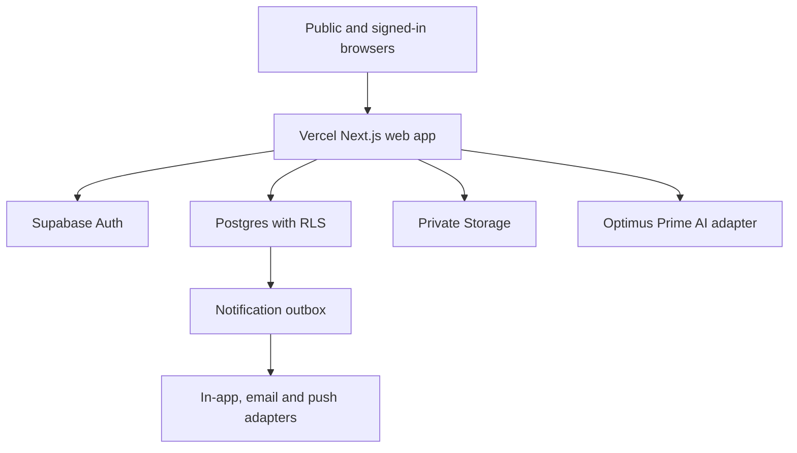

# System design

## Deployment and trust boundaries

The public site and protected workspaces share one deployable application. Auth proves identity. The server validates the session, MFA level for staff, active account, active scoped grants and requested resource. Postgres RLS and explicit command checks constrain records even if UI or route checks are bypassed. Supabase Auth administration is a separate server-only adapter called only from authorized privileged commands. Keep protected responses out of shared caches. Keep preview deployments and demo data isolated from future production.

During scaffolding, adopt `src/app/(public)`, `(auth)`, `(portal)`, `(staff)/staff`, `src/app/api/v1`, `src/features/{applications,assessment,support,admin,reporting}`, `src/components`, `src/lib/server`, `supabase/migrations`, and `tests` within the existing app root. Use that root's conventions if the team already has a scaffold. Routes parse inputs and translate results, feature services apply authorization and coordinate work, and transactional DB commands enforce domain invariants. Generate DB types and expose explicit response types. The Expo client starts in the foundation milestone at root `mobile` and consumes versioned contracts. See [Platform Setup](<Platform Setup.md>). Extract a shared package when the second client exists.

## Frontend and platform decisions

| Area | Use for the hackathon | Defer or revisit |
| --- | --- | --- |
| Rendering | Static public informational pages, accessible HTML and metadata. Public sector listing reads only published projections; rebuild on publish or serve a simple dynamic public read if immediate publication is required. Dynamic server rendering/server components for protected routes, with client components for forms, dialogs and live indicators. Use Suspense where it improves a measured slow path. | Custom streaming, ISR, partial hydration, islands and Edge runtime. React handles hydration, reconciliation and DOM updates. |
| Performance | Optimize hero images and font loading, set image sizes, lazy-load noncritical media, analyze production build on request, validate mobile load and interaction in Lighthouse. Use default route splitting and measure LCP, INP, CLS and TTFB separately. Check drag/resize, motion, layout shifts, excessive script and forced reflows during QA. | Custom chunk design, browser workers, virtualization, heavy memoization and RUM until usage justifies them. |
| State | Local state for UI, reducer for complex form UI when needed, URL query parameters for safe filters and Postgres for persistent data. Use a server draft with debounce and revision checks. Refetch after commands. Model workflow states and allowed transitions explicitly on the server. | Redux, Zustand, TanStack Query, signals and elaborate offline or cross-tab sync. Add a client cache only after repeated data-fetching needs justify it. |
| Networking | Versioned same-origin REST/BFF, shared validated contracts, bounded cursor pagination, timeouts, request cancellation on stale searches, and retry/backoff for transient idempotent operations. Start support chat with bounded polling while visible. Add scoped Realtime as an invalidation signal only when verified, with snapshot refresh on reconnect. | GraphQL, custom WebSockets/SSE, offline queue, infinite scroll and manual protocol tuning. |
| Caching | Framework/platform compression and fingerprinted assets, CDN/browser caching for public assets, explicit no-store on protected record, session and download responses. Clear in-memory protected data at sign-out. | Service workers, PWA/app shell, offline storage and background sync. Do not persist draft, evidence or chat content in browser storage. |
| Architecture | One web app, feature modules, reusable design tokens, semantic components and small server-owned integration flags. Document API boundaries and feature ownership. | Micro frontends, module federation, plugin architecture and elaborate monorepo tooling. |
| Security | See the enforced boundaries and release gates in [security and operations](<Security Accessibility and Operations.md>). | Production-only infrastructure and controls require an approved live-data release checklist. |
| Accessibility | WCAG 2.2 AA design target. Implement native controls, keyboard and assistive-technology support on day one. Use locale-aware formatting and externalize visible copy where useful. | Full locale routing and RTL only once languages and translation ownership are confirmed. |
| Observability | Redacted structured logs, request IDs, health checks, CI and targeted Playwright coverage. Check deployments and keep release history. | Session replay, A/B testing, canaries and telemetry vendors pending a real need and privacy review. |

For diagnostics, use mobile LCP ≤ 2.5 s, INP ≤ 200 ms and CLS ≤ 0.1 as field targets at the 75th percentile. Demo checks use repeatable lab runs, screenshots and a keyboard pass. Lighthouse lab results cannot establish field INP or WCAG conformance. Record build, device profile, run conditions and observations.

See [Admin Analytics and Monitoring](<Admin Analytics and Monitoring.md>) for the first-party event contract, provider tooling and admin access.

## Integration failure and portability

A successful domain transaction records notification work durably. A bounded worker or authorized retry action leases rows with expiry and records attempts. Provider failures preserve the original receipt, release or support message. External delivery may duplicate after a provider timeout, so use stable delivery identifiers where supported and describe guarantees accurately. Send generic notices with a sign-in link. Set up EmailJS and Firebase Cloud Messaging in the foundation milestone. Prove each with the provider smoke tests and enforce event quotas before enabling delivery. Auth email uses a separately verified delivery path. Approve explicit monitored substitutes for the demo where provider setup is unavailable.

Optimus Prime uses the Google Gemini Developer API for approved public guidance. The free-tier adapter receives approved content and allowlisted topic keys only, so raw chat, application content and personal data stay within the portal. Server retrieval reduces the task to approved content and minimal question context, returns source links and routes low-confidence or sensitive issues to a person. Never send evidence, internal notes, tokens or confidential decision data to the model. The model has no database or administrative action privileges. Keep a deterministic knowledge lookup and human handoff available when the provider fails.

Keep a provider adapter and data export contract for auth, notification, AI and files. Version approved CSV columns, API payloads and event schemas. Store timestamps in UTC and display Botswana time with `Africa/Gaborone` where appropriate. A future move from Supabase requires replacing or reproducing RLS, Auth, object policies and live updates, plus a rehearsed migration and restore.
